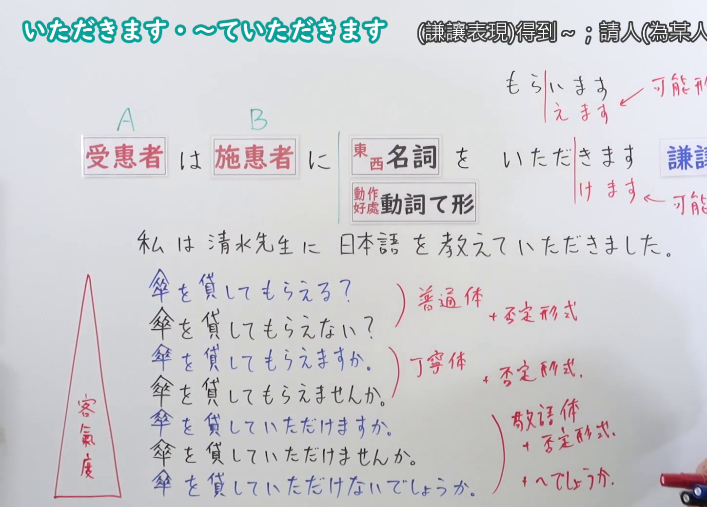
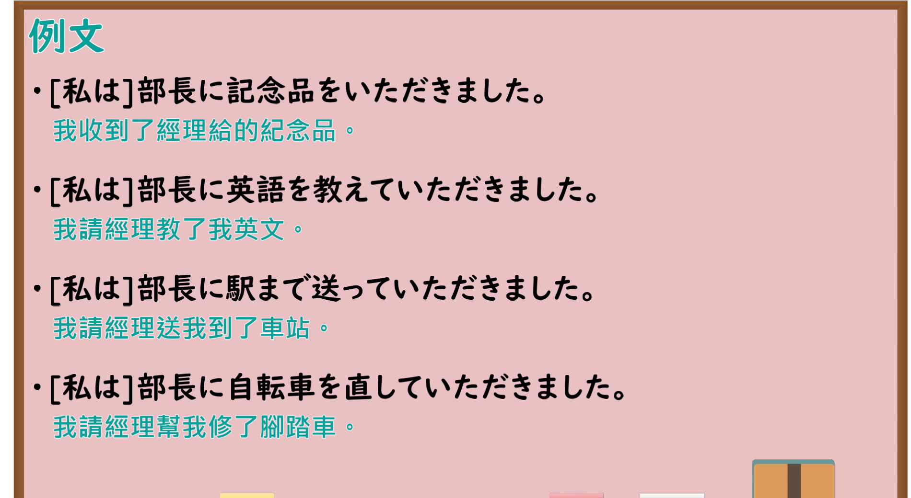

---
{
  "id": "N4-G-0039",
  "kind": "grammar",
  "level": "N4",
  "title": "～ていただきます(頂きます)（请长辈做……、蒙受长辈的恩惠）",
  "card_revision": 1,
  "schema_version": 1,
  "source": {
    "lesson": "N4 第39个语法",
    "material": "出口日語原视频板书、YouTube 原 WebVTT（中文为主、日语为辅）与Hagoromo文型检索正文",
    "video": "https://www.youtube.com/watch?v=J4pPyp65rbM",
    "screenshot": "assets/grammar/n4/N4-G-0039-connection.png",
    "screenshot_seconds": 424.0,
    "screenshot_crop": {
      "x": 0,
      "y": 0,
      "width": 1450,
      "height": 1040
    }
  },
  "tags": [
    "ていただく",
    "いただきます",
    "授受",
    "謙譲語",
    "敬語",
    "N4"
  ],
  "confusions": [
    "～てもらいます",
    "～てくださいます"
  ]
}
---

# N4 第39个语法：～ていただきます(頂きます)

# 视频学习资料整理

- 课程：[出口日語「～ていただきます(頂きます)」](https://www.youtube.com/watch?v=J4pPyp65rbM)
- 视频 ID：`J4pPyp65rbM`
- 视频时长：8分50秒

## 接续图

- 实际时间：7分04.00秒（424.00秒）
- 原图尺寸：1920×1080
- 裁切区域：左上角 `(0, 0)` 至右下角 `(1450, 1040)`；00:01 画面尚未补充谦让受惠与请求表达板书；选用 07:04 画面，黑板最上方完整保留「～ていただきます」大标题；板书已完整书写「動詞て形＋いただきます」「請[長輩・尊長]做~；得到長輩的恩惠（謙譲表現）」「先生に推薦状を書いていただきました／部長にごちそうしていただきました」「〜てもらいますの謙譲語」、主语为接受恩惠者，老师让出板书区域。固定左上角 (0, 0)，裁切区域宽 1450、高 1040，去除右侧人物与边缘多余画面，充分保留底部全部例句板书。

## 例句图

- 实际时间：7分35.80秒（455.80秒）
- 原图尺寸：1920×1080
- 裁切区域：左上角 `(0, 0)` 至右下角 `(1900, 1040)`；提取自视频 07:35 处的例句黑板页面。固定左上角 (0, 0)，裁切区域宽 1900、高 1040，去除右侧与底部多余画面，完整保留全部四条例句及中文翻译。

# 核心

## 功能一：请长辈做 A、蒙受长辈做 A 的恩惠（授受谦让语）

**最上位意味カテゴリー：**

- **Vていただく：** 人との関係（与人的关系）

**中位意味カテゴリー：**

- **Vていただく：** 授受（授受）

**意味：**

- **Vていただく：** 受給：行為（敬語）（行为授受（敬语））

**くわしい意味記述：**

- **Vていただく：** 「目上の人にある行為をしてもらう」という意味。ある行為をしてもらう対象（人）を敬う気持ちを表す。（表示“请长辈、尊长进行某种行为”之意。表达对为自己进行某种行为的对象（人）的尊敬之情。）

**派生語：** 未列出

### 例句

1. 先生に大学の推薦状を書いていただきました。

   （我请老师为我写了大学的推荐信。）

2. 部長に素晴らしいレストランでごちそうしていただきました。

   （部长在一家很棒的餐厅请了我们吃饭。）

3. 社長に新しい企画についてアドバイスしていただきました。

   （承蒙社长就新企划给予了我建议。）

4. 医者に詳しく診察していただきました。

   （请医生进行了详细的看诊。）

# 来源

- [出口日語原视频](https://www.youtube.com/watch?v=J4pPyp65rbM)
- [Hagoromo 文型検索「Vていただく」](https://hagoromo-text.work/lookup?vid=160)（查询日期：2026-09-25）
