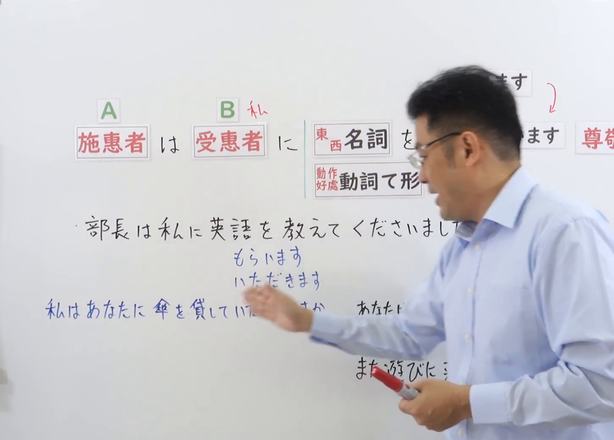

---
{
  "id": "N4-G-0040",
  "kind": "grammar",
  "level": "N4",
  "title": "～てくださいます（长辈为您/为我做……）",
  "card_revision": 1,
  "schema_version": 1,
  "source": {
    "lesson": "N4 第40个语法",
    "material": "出口日語原视频板书、YouTube 原 WebVTT（中文为主、日语为辅）与Hagoromo文型检索正文",
    "video": "https://www.youtube.com/watch?v=WVumpxF0QEY",
    "screenshot": "assets/grammar/n4/N4-G-0040-connection.png",
    "screenshot_seconds": 100.0,
    "screenshot_crop": {
      "x": 0,
      "y": 0,
      "width": 1450,
      "height": 1040
    }
  },
  "tags": [
    "てくださる",
    "くださいます",
    "授受",
    "尊敬語",
    "敬語",
    "N4"
  ],
  "confusions": [
    "～てくれる",
    "～ていただきます"
  ]
}
---

# N4 第40个语法：～てくださいます

# 视频学习资料整理

- 课程：[出口日語「～てくださいます」](https://www.youtube.com/watch?v=WVumpxF0QEY)
- 视频 ID：`WVumpxF0QEY`
- 视频时长：9分26秒

## 接续图

- 实际时间：1分40.00秒（100.00秒）
- 原图尺寸：1920×1080
- 裁切区域：左上角 `(0, 0)` 至右下角 `(1450, 1040)`；选用 01:40 广角画面，黑板最上方完整保留「【Ｎ４文法】くださいます・～てくださいます」醒目标题；板书已完整书写「動詞て形＋くださいます」「長輩為我/我們做~（尊敬表現）」「先生が本を貸してくださいました／部長が送ってくださいました」「〜てくれますの尊敬語」、长辈作为动作主体施惠，老师让出板书区域。固定左上角 (0, 0)，裁切区域宽 1450、高 1040，去除右侧人物与边缘多余画面，充分保留顶部标题与底部板书，绝无内容缺失。

## 例句图

- 实际时间：8分06.76秒（486.76秒）
- 原图尺寸：1920×1080
- 裁切区域：左上角 `(0, 0)` 至右下角 `(1900, 1040)`；提取自视频 08:06 处的例句黑板页面。固定左上角 (0, 0)，裁切区域宽 1900、高 1040，去除右侧与底部多余画面，完整保留全部四条例句及中文翻译。

# 核心

## 功能一：长辈为我/我方做 A（授受尊敬语）

**最上位意味カテゴリー：**

- **Vてくださる：** 人との関係（与人的关系）

**中位意味カテゴリー：**

- **Vてくださる：** 授受（授受）

**意味：**

- **Vてくださる：** 尊敬：行為の受給（尊敬：行为授受）

**くわしい意味記述：**

- **Vてくださる：** 「てくれる」の尊敬語。目上の人が自分やウチの人のために行為を行ってくれたときに敬意を表す。（“てくれる”的尊敬语。用于长辈、尊长为自己或己方人员进行某种行为时表达敬意。）

**派生語：** 未列出

### 例句

1. 先生が分かりやすく丁寧に教えてくださいました。

   （老师深入浅出、细致耐心地教导了我。）

2. 雨が降っていたので、部長が車で駅まで送ってくださいました。

   （因为下着雨，部长亲自开车送我到了车站。）

3. 社長が私の意見を熱心に聞いてくださいました。

   （社长非常热心地倾听了我的意见。）

4. 日本人の先生が私の発音を直してくださいました。

   （日本老师帮我纠正了发音。）

# 来源

- [出口日語原视频](https://www.youtube.com/watch?v=WVumpxF0QEY)
- [Hagoromo 文型検索「Vてくださる」](https://hagoromo-text.work/lookup?vid=813)（查询日期：2026-09-25）
