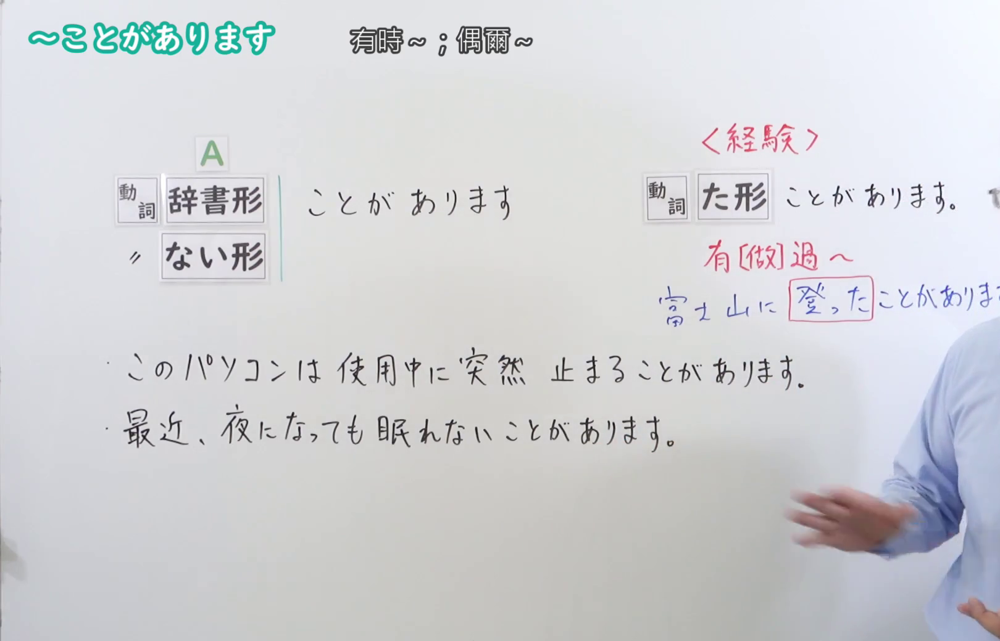
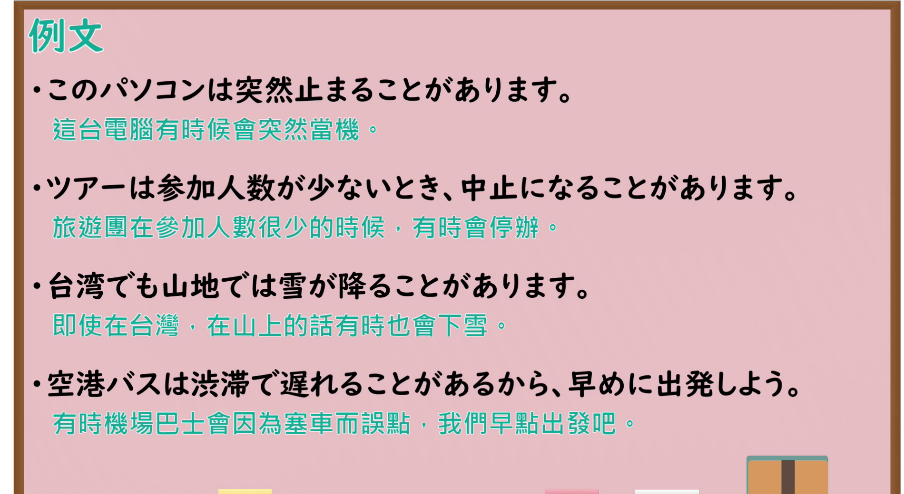

---
{
  "id": "N4-G-0041",
  "kind": "grammar",
  "level": "N4",
  "title": "～ことがあります(ことがある)（有时……、曾经……）",
  "card_revision": 1,
  "schema_version": 1,
  "source": {
    "lesson": "N4 第41个语法",
    "material": "出口日語原视频板书、YouTube 原 WebVTT（中文为主、日语为辅）与Hagoromo文型检索正文",
    "video": "https://www.youtube.com/watch?v=ND8yaEnkddM",
    "screenshot": "assets/grammar/n4/N4-G-0041-connection.png",
    "screenshot_seconds": 140.0,
    "screenshot_crop": {
      "x": 0,
      "y": 0,
      "width": 1620,
      "height": 1040
    }
  },
  "tags": [
    "ことがある",
    "ことがあります",
    "頻度",
    "経験",
    "N4"
  ],
  "confusions": [
    "～たことがある",
    "～たまに"
  ]
}
---

# N4 第41个语法：～ことがあります(ことがある)

# 视频学习资料整理

- 课程：[出口日語「～ことがあります(ことがある)」](https://www.youtube.com/watch?v=ND8yaEnkddM)
- 视频 ID：`ND8yaEnkddM`
- 视频时长：4分15秒

## 接续图

- 实际时间：2分20.00秒（140.00秒）
- 原图尺寸：1920×1080
- 裁切区域：左上角 `(0, 0)` 至右下角 `(1620, 1040)`；选用 02:20 画面，黑板最上方完整保留「～ことがあります 有時～；偶爾～」醒目标题；板书已完整书写「動詞辞書形／ない形＋ことがあります」「このパソコンは使用中に突然止まることがあります／最近、夜になっても眠れないことがあります」、右侧清晰对照「〈経験〉動詞た形＋ことがあります 有[做]過～ 富士山に登ったことがあります」，老师让出板书核心区域。固定左上角 (0, 0)，裁切区域宽 1620、高 1040，去除右侧人物与边缘多余画面，充分保留顶部标题与左右对比全部板书，高度充足不缺失内容。

## 例句图

- 实际时间：3分00.00秒（180.00秒）
- 原图尺寸：1920×1080
- 裁切区域：左上角 `(0, 0)` 至右下角 `(1900, 1040)`；提取自视频 03:00 处的例句黑板页面。底色为粉灰色课程幻灯片，固定左上角 (0, 0)，裁切区域宽 1900、高 1040，去除右侧与底部多余画面，完整保留全部四条例句及中文翻译，确保底部第四条例句完整呈现。

# 核心

## 功能一：有时会做 A、偶有某种情况发生（偶发频度）

**最上位意味カテゴリー：**

- **Vる/Vない+ことがある：** 頻度・生起（频度与发生）

**中位意味カテゴリー：**

- **Vる/Vない+ことがある：** 非日常・反復（非日常与偶发）

**意味：**

- **Vる/Vない+ことがある：** 時々（有时/偶尔）

**くわしい意味記述：**

- **Vる/Vない+ことがある：** いつもではないが，時々Vする/Vしないという事態が起こることを表す。（表示并非平时常态，但偶尔会有该动作发生或不发生的情况。）

**派生語：** 未列出

### 例句

1. たまに朝ごはんを食べないで学校へ行くことがあります。

   （偶尔会有不吃早饭就去学校的情况。）

2. 仕事が忙しいときは、終電に間に合わないことがあります。

   （工作繁忙的时候，有时会赶不上末班电车。）

3. 普段は元気ですが、季節の変わり目には体調を崩すことがあります。

   （平时虽然挺健康，但到了换季时偶尔会身体不适。）

4. 慎重に確認しても、思わぬミスをしてしまうことがあります。

   （即使非常慎重地确认，有时也难免会发生意想不到的失误。）

# 来源

- [出口日語原视频](https://www.youtube.com/watch?v=ND8yaEnkddM)
- [Hagoromo 文型検索「Vることがある」](https://hagoromo-text.work/lookup?vid=200)（查询日期：2026-09-25）
