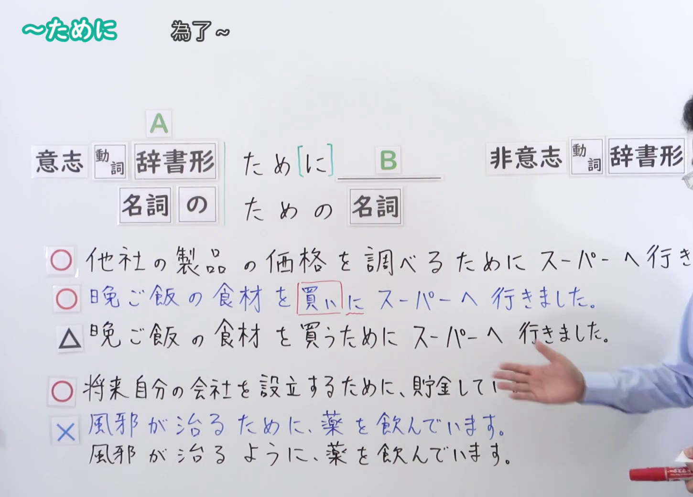
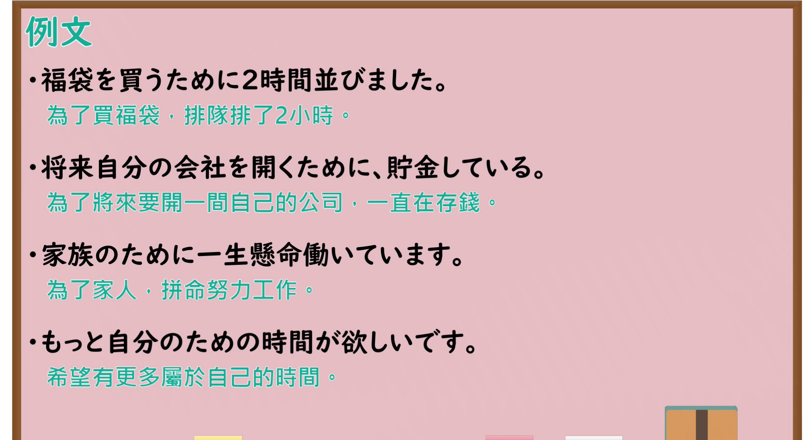

---
{
  "id": "N4-G-0042",
  "kind": "grammar",
  "level": "N4",
  "title": "～ために(目的)（为了……）",
  "card_revision": 1,
  "schema_version": 1,
  "source": {
    "lesson": "N4 第42个语法",
    "material": "出口日語原视频板书、YouTube 原 WebVTT（中文为主、日语为辅）与Hagoromo文型检索正文",
    "video": "https://www.youtube.com/watch?v=eKeXgQqxVFk",
    "screenshot": "assets/grammar/n4/N4-G-0042-connection.png",
    "screenshot_seconds": 286.89,
    "screenshot_crop": {
      "x": 0,
      "y": 0,
      "width": 1450,
      "height": 1040
    }
  },
  "tags": [
    "ために",
    "目的",
    "意志動詞",
    "名詞のため",
    "N4"
  ],
  "confusions": [
    "～ように",
    "～に(目的)"
  ]
}
---

# N4 第42个语法：～ために(目的)

# 视频学习资料整理

- 课程：[出口日語「～ために(目的)」](https://www.youtube.com/watch?v=eKeXgQqxVFk)
- 视频 ID：`eKeXgQqxVFk`
- 视频时长：6分33秒

## 接续图

- 实际时间：4分46.89秒（286.89秒）
- 原图尺寸：1920×1080
- 裁切区域：左上角 `(0, 0)` 至右下角 `(1450, 1040)`；选用 04:46 画面，黑板最上方完整保留「～ために 為了～」醒目标题；板书已完整书写「意志動詞辞書形＋ため[に] B」「名詞の＋ための名詞」以及「他社の製品の価格を調べるためにスーパーへ行きました／晩ご飯の食材を買いに／将来自分の会社を設立するために、貯金しています／×風邪が治るために→風邪が治るように」，老师侧身让出完整板书区域。固定左上角 (0, 0)，裁切区域宽 1450、高 1040，充分保留顶部标题与底部完整板书，高度充足不缺失内容。

## 例句图

- 实际时间：5分14.40秒（314.40秒）
- 原图尺寸：1920×1080
- 裁切区域：左上角 `(0, 0)` 至右下角 `(1900, 1040)`；提取自视频 05:14 处的例句黑板页面。底色为粉灰色课程幻灯片，固定左上角 (0, 0)，裁切区域宽 1900、高 1040，去除右侧与底部多余画面，完整保留全部四条例句及中文翻译，确保底部第四条例句完整呈现。

# 核心

## 功能一：为了达成目标 A 而采取行动 B（意志目的）

**最上位意味カテゴリー：**

- **Vる/Nの+ために：** 目的・意図（目的与意图）

**中位意味カテゴリー：**

- **Vる/Nの+ために：** 行為・目標（行为与目标）

**意味：**

- **Vる/Nの+ために：** 目的（为了）

**くわしい意味記述：**

- **Vる/Nの+ために：** 「〜（するの）が目的で」という意味を表す。「Xため（に）Y」の形をとり，Xは目的を，Yは何をするかを述べる。前後の主語は同一で，Xには意志動詞がくる。（表示“以……为目的”。采取“Xため（に）Y”的形式，X表示目的，Y表示采取的动作行为。前后主语必须一致，且X通常为意志动词。）

**派生語：** 未列出

### 例句

1. 日本語能力試験に合格するために、毎日四時間復習しています。

   （为了通过日语能力考试，每天复习四个小时。）

2. 健康のために、毎朝野菜ジュースを飲むようにしています。

   （为了身体健康，每天早晨坚持喝蔬菜汁。）

3. 留学の費用を貯めるために、アルバイトを二つ掛け持ちしています。

   （为了攒够留学的费用，同时兼职打两份工。）

4. 新居を買うために、無駄な出費をできるだけ抑えています。

   （为了买新房子，尽可能地削减不必要的开支。）

# 来源

- [出口日語原视频](https://www.youtube.com/watch?v=eKeXgQqxVFk)
- [Hagoromo 文型検索「ため（に）(目的)」](https://hagoromo-text.work/lookup?vid=726)（查询日期：2026-09-25）
