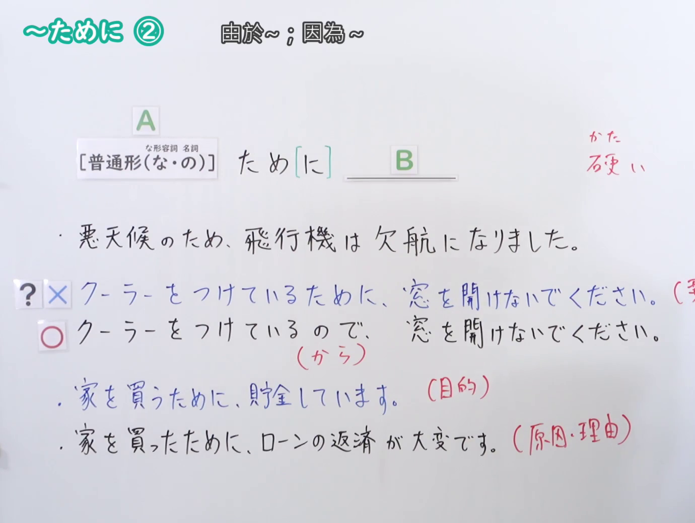
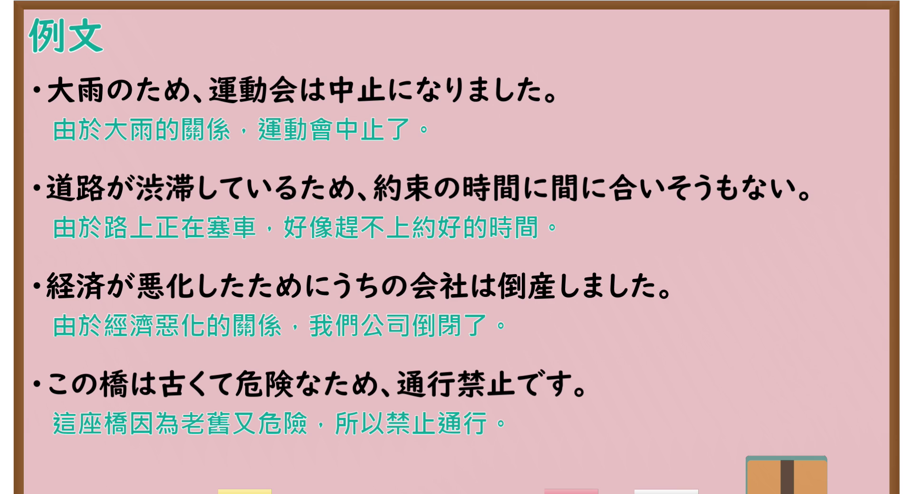

---
{
  "id": "N4-G-0043",
  "kind": "grammar",
  "level": "N4",
  "title": "～ために(原因・理由)（由于……、因为……）",
  "card_revision": 1,
  "schema_version": 1,
  "source": {
    "lesson": "N4 第43个语法",
    "material": "出口日語原视频板书、YouTube 原 WebVTT（中文为主、日语为辅）与Hagoromo文型检索正文",
    "video": "https://www.youtube.com/watch?v=YgY_hKNtvBM",
    "screenshot": "assets/grammar/n4/N4-G-0043-connection.png",
    "screenshot_seconds": 254.77,
    "screenshot_crop": {
      "x": 0,
      "y": 0,
      "width": 1380,
      "height": 1040
    }
  },
  "tags": [
    "ために",
    "原因",
    "理由",
    "客观因果",
    "N4"
  ],
  "confusions": [
    "～から",
    "～ので"
  ]
}
---

# N4 第43个语法：～ために(原因・理由)

# 视频学习资料整理

- 课程：[出口日語「～ために(原因・理由)」](https://www.youtube.com/watch?v=YgY_hKNtvBM)
- 视频 ID：`YgY_hKNtvBM`
- 视频时长：5分49秒

## 接续图

- 实际时间：4分14.77秒（254.77秒）
- 原图尺寸：1920×1080
- 裁切区域：左上角 `(0, 0)` 至右下角 `(1380, 1040)`；选用 04:14 画面，黑板最上方完整保留「～ために ② 由於～；因為～」醒目标题；板书已完整书写「[普通形(な・の)]＋ため[に] B」「悪天候のため、飛行機は欠航になりました」「?×クーラーをつけているために、窓を開けないでください(要求)→○ので」「家を買うために(目的)／家を買ったために(原因・理由)」，老师站在右侧不遮挡核心内容。固定左上角 (0, 0)，裁切区域宽 1380、高 1040，去除右侧人物与边缘多余画面，充分保留顶部标题与底部板书，高度充足不缺失内容。

## 例句图

- 实际时间：4分39.20秒（279.20秒）
- 原图尺寸：1920×1080
- 裁切区域：左上角 `(0, 0)` 至右下角 `(1900, 1040)`；提取自视频 04:39 处的例句黑板页面。底色为粉灰色课程幻灯片，固定左上角 (0, 0)，裁切区域宽 1900、高 1040，去除右侧与底部多余画面，完整保留全部四条例句及中文翻译，确保底部第四条例句完整呈现。

# 核心

## 功能一：因为……导致某种客观结果（客观因果/正式书面理由）

**最上位意味カテゴリー：**

- **普/な/Nの+ため（に）：** 原因・理由（原因与理由）

**中位意味カテゴリー：**

- **普/な/Nの+ため（に）：** 因果関係（因果关系）

**意味：**

- **普/な/Nの+ため（に）：** 客観的理由（由于/因为）

**くわしい意味記述：**

- **普/な/Nの+ため（に）：** 「Xなので，Y」「Xが原因で」という意味を表す。「Xため（に）Y」の形をとり，Xは原因を表し，Yでその結果何が起こるかを述べる。改まった場面や書き言葉で多く用いられ，後文に働きかけの文（命令・依頼など）は来ない。（表示客观的因果关系“由于X导致了Y的结果”。多用于书面语或正式播报场合，后项一般不能接命令、劝诱、请求等意志表达。）

**派生語：** 未列出

### 例句

1. 台風が接近しているため、午後の授業はすべて休講となります。

   （由于台风正在接近，下午的课程全部停课。）

2. 人身事故が発生したため、電車が大幅に遅延しております。

   （因发生人员伤亡事故，电车出现大幅晚点。）

3. 睡眠不足が続いたため、仕事中に激しい頭痛がしてきました。

   （由于连日睡眠不足，在工作中突然感到剧烈头痛。）

4. 設備点検のため、エレベーターは終日ご利用いただけません。

   （因设备检修，电梯全天暂停使用。）

# 来源

- [出口日語原视频](https://www.youtube.com/watch?v=YgY_hKNtvBM)
- [Hagoromo 文型検索「ため（に）(理由)」](https://hagoromo-text.work/lookup?vid=727)（查询日期：2026-09-25）
