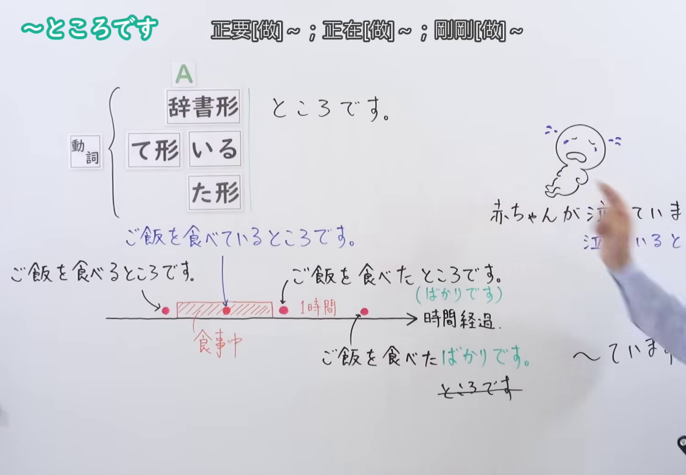
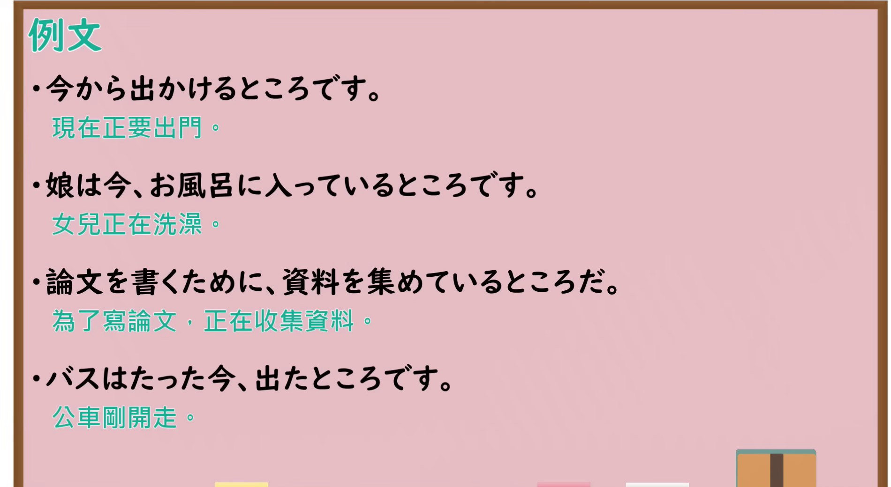

---
{
  "id": "N4-G-0044",
  "kind": "grammar",
  "level": "N4",
  "title": "～ところです（正要……、正在……、刚刚……）",
  "card_revision": 1,
  "schema_version": 1,
  "source": {
    "lesson": "N4 第44个语法",
    "material": "出口日語原视频板书、YouTube 原 WebVTT（中文为主、日语为辅）与Hagoromo文型检索正文",
    "video": "https://www.youtube.com/watch?v=DQHaW-DpXKw",
    "screenshot": "assets/grammar/n4/N4-G-0044-connection.png",
    "screenshot_seconds": 355.68,
    "screenshot_crop": {
      "x": 0,
      "y": 0,
      "width": 1500,
      "height": 1040
    }
  },
  "tags": [
    "ところです",
    "直前",
    "最中",
    "直後",
    "局面",
    "N4"
  ],
  "confusions": [
    "～ばかりです",
    "～ている"
  ]
}
---

# N4 第44个语法：～ところです

# 视频学习资料整理

- 课程：[出口日語「～ところです」](https://www.youtube.com/watch?v=DQHaW-DpXKw)
- 视频 ID：`DQHaW-DpXKw`
- 视频时长：7分48秒

## 接续图

- 实际时间：5分55.68秒（355.68秒）
- 原图尺寸：1920×1080
- 裁切区域：左上角 `(0, 0)` 至右下角 `(1500, 1040)`；选用 05:55 画面，黑板最上方完整保留「～ところです 正要[做]～；正在[做]～；剛剛[做]～」醒目标题；板书已完整书写「動詞辞書形＋ところです／動詞て形いる＋ところです／動詞た形＋ところです」「ご飯を食べるところです／ご飯を食べているところです／ご飯を食べたところです」「時間経過：ご飯を食べたばかりです」，时间轴与阶段对应极其详尽清晰。固定左上角 (0, 0)，裁切区域宽 1500、高 1040，去除右侧多余画面，充分保留顶部标题与底部完整板书，高度充足不缺失内容。

## 例句图

- 实际时间：6分28.44秒（388.44秒）
- 原图尺寸：1920×1080
- 裁切区域：左上角 `(0, 0)` 至右下角 `(1900, 1040)`；提取自视频 06:28 处的例句黑板页面。底色为粉灰色课程幻灯片，固定左上角 (0, 0)，裁切区域宽 1900、高 1040，去除右侧与底部多余画面，完整保留全部四条例句及中文翻译，确保底部第四条例句完整呈现。

# 核心

## 功能一：动作或事态所处的时点局面（即将发生、正在进行或刚刚完成）

**最上位意味カテゴリー：**

- **Vる/Vている/Vた+ところだ：** 事態の局面（事态的阶段局面）

**中位意味カテゴリー：**

- **Vる/Vている/Vた+ところだ：** 直前・最中・直後（紧接发生・进行中・刚完成）

**意味：**

- **Vる/Vている/Vた+ところだ：** 局面（处于……时点）

**くわしい意味記述：**

- **Vる/Vている/Vた+ところだ：** 動作の流れにおける直前（これから〜する），最中（今〜している），直後（〜したばかり）の各局面を表す。（表示动作流程中即将发生、正在进行、或刚刚结束的精确时间节点。）

**派生語：** 未列出

### 例句

1. これから会議が始まるところですので、後でお電話します。

   （会议马上就要开始了，我稍后再给您打电话。）

2. 今、ちょうど報告書をまとめているところですから、少々お待ちください。

   （我现在正好正在汇总报告，请稍候片刻。）

3. 駅に着いたところですが、急な雨で動けなくなってしまいました。

   （刚到达车站，就因为突降大雨而被困住了。）

4. お風呂から上がったところなので、髪を乾かしてから寝ます。

   （刚从浴室洗完澡出来，吹干头发后就准备睡觉了。）

# 来源

- [出口日語原视频](https://www.youtube.com/watch?v=DQHaW-DpXKw)
- [Hagoromo 文型検索「Vているところだ」](https://hagoromo-text.work/lookup?vid=804)（查询日期：2026-09-25）
- [Hagoromo 文型検索「Vたところだ」](https://hagoromo-text.work/lookup?vid=711)（查询日期：2026-09-25）
