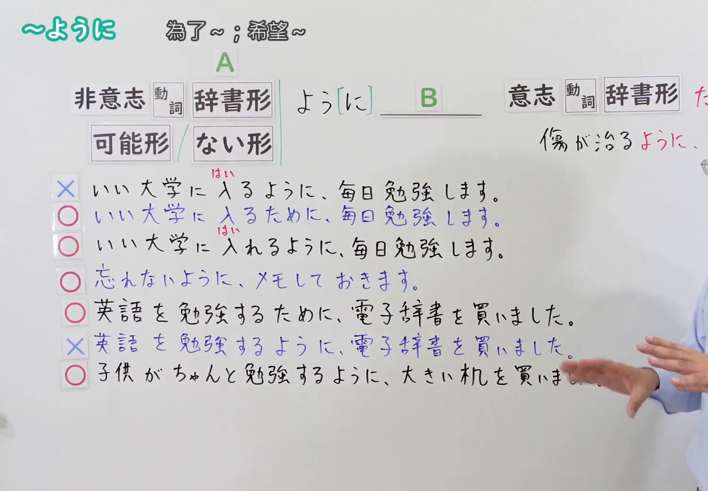

---
{
  "id": "N4-G-0045",
  "kind": "grammar",
  "level": "N4",
  "title": "～ように(目的)（为了……、希望……）",
  "card_revision": 1,
  "schema_version": 1,
  "source": {
    "lesson": "N4 第45个语法",
    "material": "出口日語原视频板书、YouTube 原 WebVTT（中文为主、日语为辅）与Hagoromo文型检索正文",
    "video": "https://www.youtube.com/watch?v=lV7QxAUbxYU",
    "screenshot": "assets/grammar/n4/N4-G-0045-connection.png",
    "screenshot_seconds": 388.8,
    "screenshot_crop": {
      "x": 0,
      "y": 0,
      "width": 1500,
      "height": 1040
    }
  },
  "tags": [
    "ように",
    "目的",
    "非意志動詞",
    "可能形",
    "ない形",
    "N4"
  ],
  "confusions": [
    "～ために(目的)"
  ]
}
---

# N4 第45个语法：～ように(目的)

# 视频学习资料整理

- 课程：[出口日語「～ように(目的)」](https://www.youtube.com/watch?v=lV7QxAUbxYU)
- 视频 ID：`lV7QxAUbxYU`
- 视频时长：8分06秒

## 接续图

- 实际时间：6分28.80秒（388.80秒）
- 原图尺寸：1920×1080
- 裁切区域：左上角 `(0, 0)` 至右下角 `(1500, 1040)`；选用 06:28 画面，黑板最上方完整保留「～ように 為了～；希望～」醒目标题；板书已完整书写「非意志動詞辞書形／可能形／ない形＋よう[に] B」「×いい大学に入るように／○いい大学に入るために／○いい大学に入れるように」「○忘れないように、メモしておきます」「○英語を勉強するために、電子辞書を買いました／×勉強するように」「○子供がちゃんと勉強するように、大きい机を買いました」，老师退到右侧边缘。固定左上角 (0, 0)，裁切区域宽 1500、高 1040，去除右侧人物与边缘多余画面，充分保留顶部标题与底部完整板书，高度充足不缺失内容。

## 例句图

- 实际时间：6分52.38秒（412.38秒）
- 原图尺寸：1920×1080
- 裁切区域：左上角 `(0, 0)` 至右下角 `(1900, 1040)`；提取自视频 06:52 处的例句黑板页面。底色为粉灰色课程幻灯片，固定左上角 (0, 0)，裁切区域宽 1900、高 1040，去除右侧与底部多余画面，完整保留全部四条例句及中文翻译，确保底部第四条例句完整呈现。

# 核心

## 功能一：为了使某种状态得以实现或避免不良结果（状态实现/非意志目的）

**最上位意味カテゴリー：**

- **Vる(無意志・可能)/Vない+ように：** 目的・目標（目的与目标）

**中位意味カテゴリー：**

- **Vる(無意志・可能)/Vない+ように：** 状態実現・予防（状态实现与预防）

**意味：**

- **Vる(無意志・可能)/Vない+ように：** 目標達成（为了使……/以便……）

**くわしい意味記述：**

- **Vる(無意志・可能)/Vない+ように：** ある状態が実現することや，好ましくない状態が起こらないことを目指して行為を行うことを表す。前節には非意志動詞・可能形・否定形が来る。（表示为了实现某种目标状态，或为了避免不良情况发生而付诸行动。前项通常为非意志动词、可能形或否定形式。）

**派生語：** 未列出

### 例句

1. 後ろの席の学生にもよく聞こえるように、マイクの音量を上げました。

   （为了让后排座位的学生也能听得清楚，调大了麦克风的音量。）

2. 風邪をひかないように、毎晩温かいお風呂に入って早く寝ています。

   （为了不感冒，每天晚上泡温水澡并早早入睡。）

3. 誰でも迷わず来られるように、分かりやすい案内図を描いておきました。

   （为了让所有人都能顺利到达而不迷路，提前画好了浅显易懂的路线指引图。）

4. 事故が二度と起きないように、安全対策を徹底的に見直しました。

   （为了防止事故再次发生，彻底对安全防范措施进行了检视。）

# 来源

- [出口日語原视频](https://www.youtube.com/watch?v=lV7QxAUbxYU)
- [Hagoromo 文型検索「ように(目的)」](https://hagoromo-text.work/lookup?vid=1677)（查询日期：2026-09-25）
