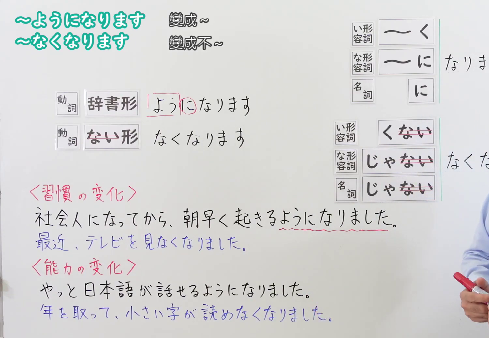
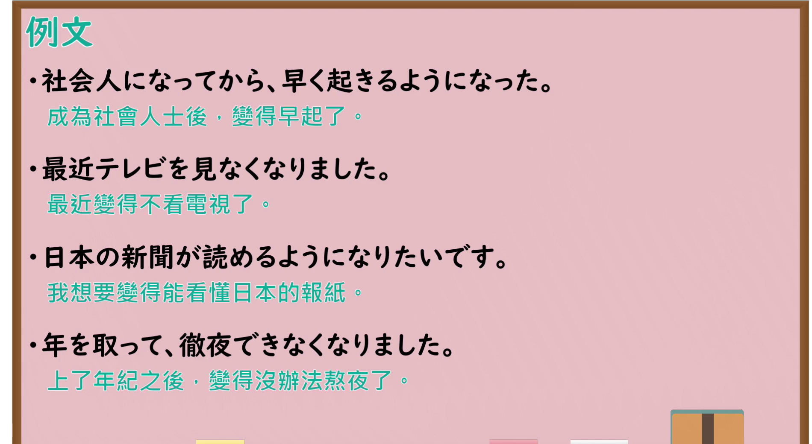

---
{
  "id": "N4-G-0046",
  "kind": "grammar",
  "level": "N4",
  "title": "～ようになります・～なくなります（变得……、变得不……）",
  "card_revision": 1,
  "schema_version": 1,
  "source": {
    "lesson": "N4 第46个语法",
    "material": "出口日語原视频板书、Bilibili P46 音频的本地中文／日语混合转写 WebVTT与Hagoromo文型检索正文",
    "video": "https://www.youtube.com/watch?v=ZIOKM1tJVh8",
    "screenshot": "assets/grammar/n4/N4-G-0046-connection.png",
    "screenshot_seconds": 238.0,
    "screenshot_crop": {
      "x": 0,
      "y": 0,
      "width": 1500,
      "height": 1040
    }
  },
  "tags": [
    "ようになる",
    "なくなる",
    "変化",
    "習慣",
    "能力",
    "N4"
  ],
  "confusions": [
    "～ようにする",
    "～ことになる"
  ]
}
---

# N4 第46个语法：～ようになります・～なくなります

# 视频学习资料整理

- 课程：[出口日語「～ようになります・～なくなります」](https://www.youtube.com/watch?v=ZIOKM1tJVh8)
- 视频 ID：`ZIOKM1tJVh8`
- 视频时长：5分40秒

## 接续图

- 实际时间：3分58.00秒（238.00秒）
- 原图尺寸：1920×1080
- 裁切区域：左上角 `(0, 0)` 至右下角 `(1500, 1040)`；选用 03:58 画面，黑板最上方完整保留「～ようになります 變成～／～なくなります 變成不～」醒目标题；板书已完整书写「動詞辞書形＋ようになります／動詞ない形＋なくなります」「〈習慣の変化〉社会人になってから、朝早く起きるようになりました／最近、テレビを見なくなりました」「〈能力の変化〉やっと日本語が話せるようになりました／年を取って、小さい字が読めなくなりました」，习惯变化与能力变化区分工整明了。固定左上角 (0, 0)，裁切区域宽 1500、高 1040，去除右侧人物与边缘多余画面，充分保留顶部标题与底部全部板书，高度充足不缺失内容。

## 例句图

- 实际时间：4分32.00秒（272.00秒）
- 原图尺寸：1920×1080
- 裁切区域：左上角 `(0, 0)` 至右下角 `(1900, 1040)`；提取自视频 04:32 处的例句黑板页面。底色为粉灰色课程幻灯片，固定左上角 (0, 0)，裁切区域宽 1900、高 1040，去除右侧与底部多余画面，完整保留全部四条例句及中文翻译，确保底部第四条例句完整呈现。

# 核心

## 功能一：能力或习惯发生自发转变（从不能到能、从有到无）

**最上位意味カテゴリー：**

- **Vるようになる/Vなくなる：** 変化・習得（变化与习得）

**中位意味カテゴリー：**

- **Vるようになる/Vなくなる：** 無意志・自然推移（自然演变与习惯养成）

**意味：**

- **Vるようになる/Vなくなる：** 能力・習慣変化（变得会……/不再……）

**くわしい意味記述：**

- **Vるようになる/Vなくなる：** ある事態ができない状態からできる状態に変化すること，あるいは以前の習慣が変化したことを表す。（表示原本做不到的事情变得能够做到（能力习得），或者生活习惯发生了自然转变。否定为“～なくなる”。）

**派生語：** 未列出

### 例句

1. 日本に来て半年が経ち、一人で病院へ行けるようになりました。

   （来日本半年后，变得能独自去医院看病了。）

2. 健康のために食生活を改善して、甘いお菓子は食べなくなりました。

   （为了健康改善了饮食习惯，变得不再吃甜点心了。）

3. 練習を重ねたおかげで、難しい漢字も正しく書けるようになりました。

   （多亏了反复练习，难写难记的汉字也变得能工整正确地写出来了。）

4. スマートフォンを使うようになってから、腕時計をしなくなりました。

   （自从开始使用智能手机后，变得不再佩戴手表了。）

# 来源

- [出口日語原视频](https://www.youtube.com/watch?v=ZIOKM1tJVh8)
- [Hagoromo 文型検索「Vるようになる」](https://hagoromo-text.work/lookup?vid=1734)（查询日期：2026-09-25）
