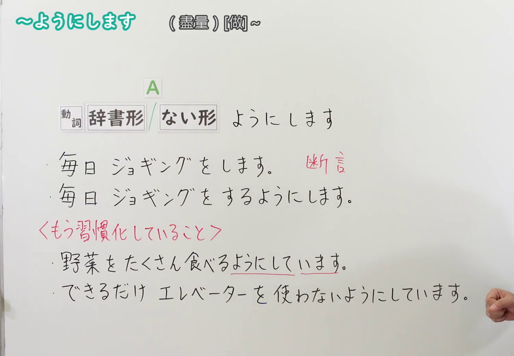
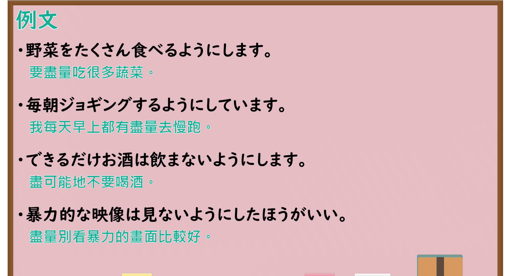

---
{
  "id": "N4-G-0047",
  "kind": "grammar",
  "level": "N4",
  "title": "～ようにします・～ようにしています（尽量……、坚持做到……）",
  "card_revision": 1,
  "schema_version": 1,
  "source": {
    "lesson": "N4 第47个语法",
    "material": "出口日語原视频板书、YouTube 原 WebVTT（中文为主、日语为辅）与Hagoromo文型检索正文",
    "video": "https://www.youtube.com/watch?v=79TO1ZhU-10",
    "screenshot": "assets/grammar/n4/N4-G-0047-connection.png",
    "screenshot_seconds": 157.2,
    "screenshot_crop": {
      "x": 0,
      "y": 0,
      "width": 1500,
      "height": 1040
    }
  },
  "tags": [
    "ようにする",
    "ようにしている",
    "努力",
    "心がけ",
    "習慣",
    "N4"
  ],
  "confusions": [
    "～ようになる",
    "～ことにする"
  ]
}
---

# N4 第47个语法：～ようにします・～ようにしています

# 视频学习资料整理

- 课程：[出口日語「～ようにします・～ようにしています」](https://www.youtube.com/watch?v=79TO1ZhU-10)
- 视频 ID：`79TO1ZhU-10`
- 视频时长：4分22秒

## 接续图

- 实际时间：2分37.20秒（157.20秒）
- 原图尺寸：1920×1080
- 裁切区域：左上角 `(0, 0)` 至右下角 `(1500, 1040)`；选用 02:37 画面，黑板最上方完整保留「～ようにします (盡量)[做]～」醒目标题；板书已完整书写「動詞辞書形／ない形＋ようにします」「毎日ジョギングをします(断言)／毎日ジョギングをするようにします」「〈もう習慣化していること〉野菜をたくさん食べるようにしています／できるだけエレベーターを使わないようにしています」，刻意努力与已习惯化的对比一目了然。固定左上角 (0, 0)，裁切区域宽 1500、高 1040，去除右侧人物与边缘多余画面，充分保留顶部标题与底部全部板书，高度充足不缺失内容。

## 例句图

- 实际时间：3分11.26秒（191.26秒）
- 原图尺寸：1920×1080
- 裁切区域：左上角 `(0, 0)` 至右下角 `(1900, 1040)`；提取自视频 03:11 处的例句黑板页面。底色为粉灰色课程幻灯片，固定左上角 (0, 0)，裁切区域宽 1900、高 1040，去除右侧与底部多余画面，完整保留全部四条例句及中文翻译，确保底部第四条例句完整呈现。

# 核心

## 功能一：努力践行某种行为或保持日常习惯（刻意努力与习惯保持）

**最上位意味カテゴリー：**

- **Vる/Vない+ようにする：** 意志・習慣（意志与习惯）

**中位意味カテゴリー：**

- **Vる/Vない+ようにする：** 心がけ・努力（用心与自觉努力）

**意味：**

- **Vる/Vない+ようにする：** 努力目標（尽量做到……/注意做到……）

**くわしい意味記述：**

- **Vる/Vない+ようにする：** ある行為をすることを心がけるという意味。継続して努力している場合は「〜ようにしている」を用いる。（表示自觉用心努力去做到某件事。如果表示平时一直坚持践行的习惯，则使用“～ようにしている”。）

**派生語：** 未列出

### 例句

1. 夜遅くには油っこいものを食べないようにしています。

   （平时一直坚持注意深夜不吃油腻食物。）

2. 分からない単語があったら、すぐに辞書で調べるようにしましょう。

   （一旦遇到不懂的单词，就尽量立刻查字典弄明白吧。）

3. 人と話すときは、相手の目を見て笑顔で挨拶するようにしています。

   （与人交流时，平时都努力注意看着对方的眼睛微笑着打招呼。）

4. 忘れ物を防ぐために、前夜に持ち物を準備するようにしてください。

   （为了防止遗漏物品，请尽量在前一天晚上就把随身物品准备好。）

# 来源

- [出口日語原视频](https://www.youtube.com/watch?v=79TO1ZhU-10)
- [Hagoromo 文型検索「Vるようにする」](https://hagoromo-text.work/lookup?vid=1698)（查询日期：2026-09-25）
