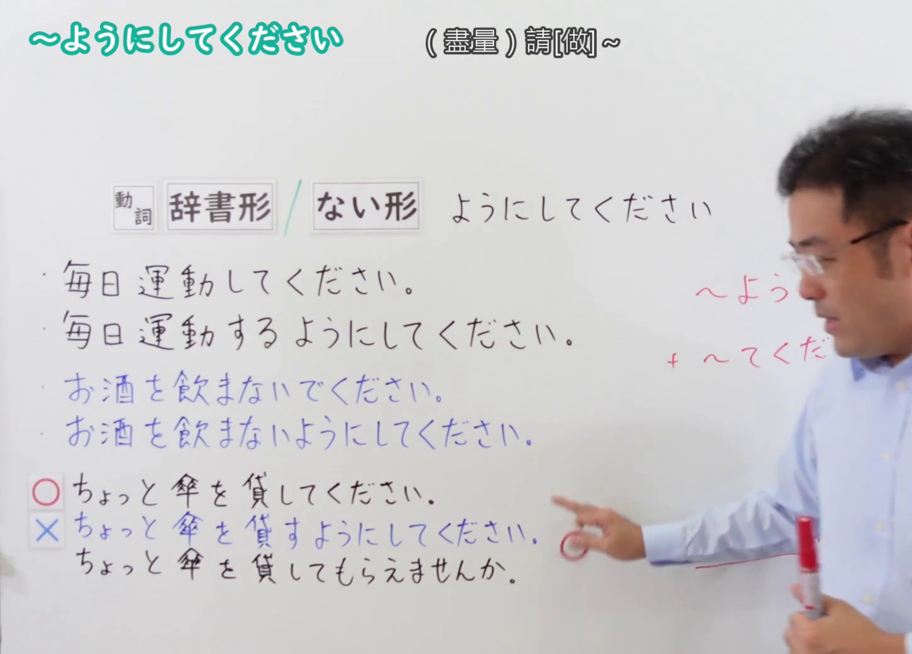
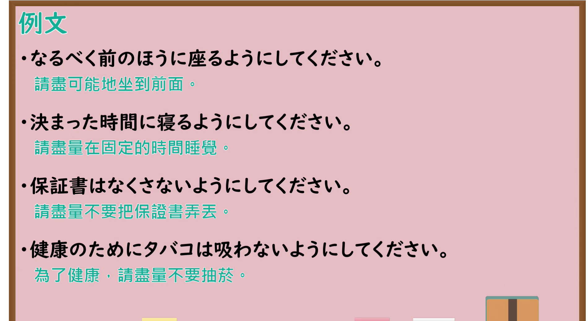

---
{
  "id": "N4-G-0048",
  "kind": "grammar",
  "level": "N4",
  "title": "～ようにしてください（请尽量……、请注意……）",
  "card_revision": 1,
  "schema_version": 1,
  "source": {
    "lesson": "N4 第48个语法",
    "material": "出口日語原视频板书、YouTube 原 WebVTT（中文为主、日语为辅）与Hagoromo文型检索正文",
    "video": "https://www.youtube.com/watch?v=N1H2XqUWg20",
    "screenshot": "assets/grammar/n4/N4-G-0048-connection.png",
    "screenshot_seconds": 246.4,
    "screenshot_crop": {
      "x": 0,
      "y": 0,
      "width": 1450,
      "height": 1040
    }
  },
  "tags": [
    "ようにしてください",
    "指示",
    "依頼",
    "間接的",
    "習慣要求",
    "N4"
  ],
  "confusions": [
    "～てください",
    "～ないでください"
  ]
}
---

# N4 第48个语法：～ようにしてください

# 视频学习资料整理

- 课程：[出口日語「～ようにしてください」](https://www.youtube.com/watch?v=N1H2XqUWg20)
- 视频 ID：`N1H2XqUWg20`
- 视频时长：5分52秒

## 接续图

- 实际时间：4分06.40秒（246.40秒）
- 原图尺寸：1920×1080
- 裁切区域：左上角 `(0, 0)` 至右下角 `(1450, 1040)`；选用 04:06 画面，黑板最上方完整保留「～ようにしてください (盡量)請[做]～」醒目标题；板书已完整书写「動詞辞書形／ない形＋ようにしてください」「毎日運動してください／毎日運動するようにしてください」「お酒を飲まないでください／お酒を飲まないようにしてください」「○ちょっと傘を貸してください／×ちょっと傘を貸すようにしてください→貸してもらえませんか」，对比日常习惯要求与一次性动作指示的差异。固定左上角 (0, 0)，裁切区域宽 1450、高 1040，去除右侧多余画面，充分保留顶部标题与底部板书，高度充足不缺失内容。

## 例句图

- 实际时间：4分41.60秒（281.60秒）
- 原图尺寸：1920×1080
- 裁切区域：左上角 `(0, 0)` 至右下角 `(1900, 1040)`；提取自视频 04:41 处的例句黑板页面。底色为粉灰色课程幻灯片，固定左上角 (0, 0)，裁切区域宽 1900、高 1040，去除右侧与底部多余画面，完整保留全部四条例句及中文翻译，确保底部第四条例句完整呈现。

# 核心

## 功能一：委婉叮嘱对方保持习惯或注意做到某事（间接叮嘱/习惯性要求）

**最上位意味カテゴリー：**

- **Vる/Vない+ようにしてください：** 指示・依頼（指示与请求）

**中位意味カテゴリー：**

- **Vる/Vない+ようにしてください：** 間接的・習慣化（间接性与习惯化）

**意味：**

- **Vる/Vない+ようにしてください：** 配慮指示（请尽量……/请注意做到……）

**くわしい意味記述：**

- **Vる/Vない+ようにしてください：** 相手に継続的な行動や注意を促す表現。「〜てください」より直接的でなく，柔らかい響きを持つ。その場限りの依頼には使えない。（用于委婉叮嘱对方长期保持良好习惯或注意做到某事。语气比直接的“～てください”更委婉柔和，不可用于当场一次性的即时请求。）

**派生語：** 未列出

### 例句

1. 薬は毎食後三十分以内に必ず飲むようにしてください。

   （药品请务必在每次饭后三十分钟以内按时服用。）

2. 夜十時を過ぎたら、近所の迷惑にならないよう静かにしてください。

   （过了晚上十点之后，为了不给邻居造成困扰，请注意保持安静。）

3. 体調に異変を感じたら、無理をせず休むようにしてください。

   （一旦感觉身体有异样，请尽量不要硬撑，注意休息。）

4. 大切な書類は失くさないよう、専用のファイルに保管してください。

   （重要的文件为了防止丢失，请务必注意保存在专用的文件夹中。）

# 来源

- [出口日語原视频](https://www.youtube.com/watch?v=N1H2XqUWg20)
- [Hagoromo 文型検索「Vるようにする」延伸](https://hagoromo-text.work/lookup?vid=1698)（查询日期：2026-09-25）
