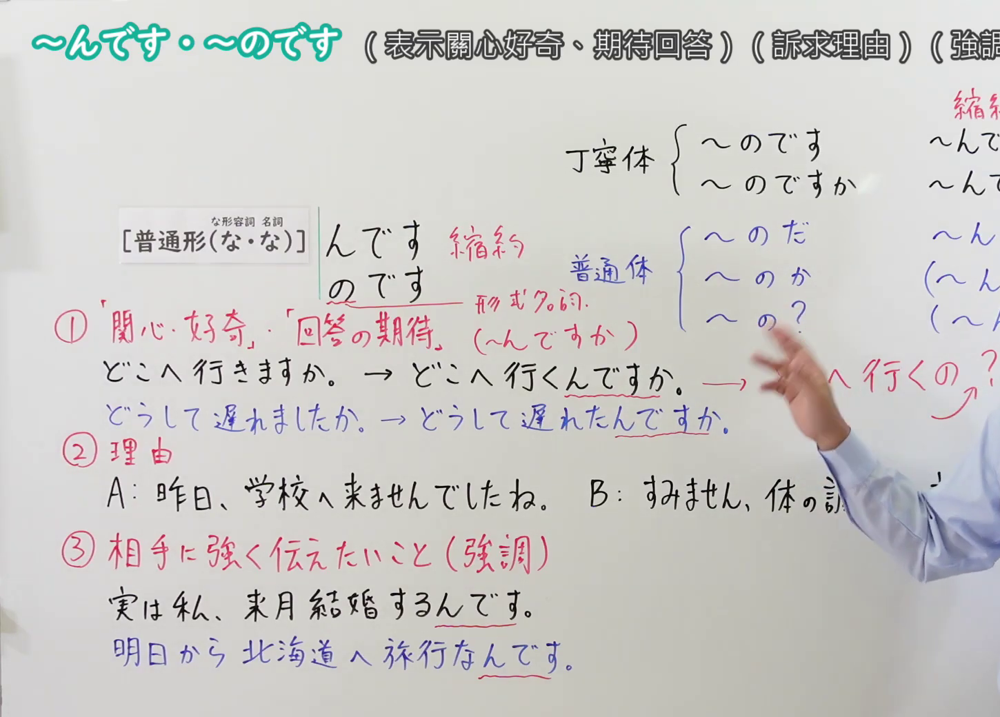
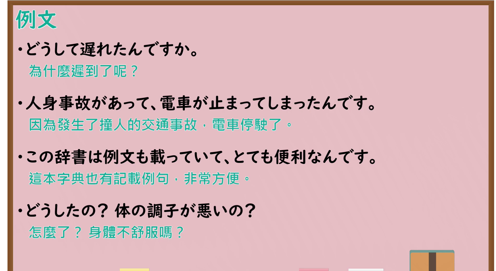

---
{
  "id": "N4-G-0049",
  "kind": "grammar",
  "level": "N4",
  "title": "～んです・～のです（说明、解释、强调）",
  "card_revision": 1,
  "schema_version": 1,
  "source": {
    "lesson": "N4 第49个语法",
    "material": "出口日語原视频板书、Bilibili P49 音频的本地中文／日语混合转写 WebVTT与Hagoromo文型检索正文",
    "video": "https://www.youtube.com/watch?v=GPqGAOa1_kQ",
    "screenshot": "assets/grammar/n4/N4-G-0049-connection.png",
    "screenshot_seconds": 517.92,
    "screenshot_crop": {
      "x": 0,
      "y": 0,
      "width": 1450,
      "height": 1040
    }
  },
  "tags": [
    "んです",
    "のです",
    "説明",
    "理由",
    "強調",
    "問いかけ",
    "N4"
  ],
  "confusions": [
    "～のだ",
    "～わけだ"
  ]
}
---

# N4 第49个语法：～んです・～のです

# 视频学习资料整理

- 课程：[出口日語「～んです・～のです」](https://www.youtube.com/watch?v=GPqGAOa1_kQ)
- 视频 ID：`GPqGAOa1_kQ`
- 视频时长：10分24秒

## 接续图

- 实际时间：8分37.92秒（517.92秒）
- 原图尺寸：1920×1080
- 裁切区域：左上角 `(0, 0)` 至右下角 `(1450, 1040)`；选用 08:37 画面，黑板最上方完整保留「～んです・～のです (表示関心好奇、期待回答) (訴求理由) (強調)」醒目标题；板书已完整书写「[普通形(な形容詞名詞 な・な)] んです(縮約)／のです(形式名詞)」「①『関心・好奇』『回答の期待』(～んですか) どこへ行くんですか」「②理由 A:昨日、学校へ来ませんでしたね。B:すみません、体の調子が…」「③相手に強く伝えたいこと(強調) 実は私、来月結婚するんです／明日から北海道へ旅行なんです」，三大核心功能分类系统严整。固定左上角 (0, 0)，裁切区域宽 1450、高 1040，去除右侧多余画面，充分保留顶部标题与底部板书，高度充足不缺失内容。

## 例句图

- 实际时间：9分15.36秒（555.36秒）
- 原图尺寸：1920×1080
- 裁切区域：左上角 `(0, 0)` 至右下角 `(1900, 1040)`；提取自视频 09:15 处的例句黑板页面。底色为粉灰色课程幻灯片，固定左上角 (0, 0)，裁切区域宽 1900、高 1040，去除右侧与底部多余画面，完整保留全部四条例句及中文翻译，确保底部第四条例句完整呈现。

# 核心

## 功能一：表示関心好奇・回答の期待（关切好奇与期待回答）

**最上位意味カテゴリー：**

- **普通形(な/名+な)+んです/のです：** 態度・関係（态度与人际交流）

**中位意味カテゴリー：**

- **普通形(な/名+な)+んです/のです：** 質問・働きかけ（提问与促动）

**意味：**

- **普通形(な/名+な)+んです/のです：** 関心・好奇・回答の期待（关切、好奇与探问背景）

**くわしい意味記述：**

- **普通形(な/名+な)+んです/のです：** 相手の様子や現場の状況を見て、関心や好奇心を持ってその背景や理由を尋ね、相手からの詳しい回答を期待する表現。「〜んですか」「〜の？」の形で多用される。（看到对方的情状或现场状况，带着关切或好奇探问其背后的原委或原因，期待对方给出进一步解释说明。）

**派生語：** 未列出

### 例句

1. どうして遅れたんですか。

   （為什麼遲到了呢？）

2. どうしたの？体の調子が悪いの？

   （怎麼了？身體不舒服嗎？）

3. どこへ行くんですか。ずいぶん大荷物ですね。

   （你要去哪儿呀？带了这么大一件行李呢。）

## 功能二：理由・原因の説明（说明理由与深层原委）

**最上位意味カテゴリー：**

- **普通形(な/名+な)+んです/のです：** 論理・関係（逻辑与因果关系）

**中位意味カテゴリー：**

- **普通形(な/名+な)+んです/のです：** 原因・理由（原因与理由）

**意味：**

- **普通形(な/名+な)+んです/のです：** 事情説明（陈述事情原委与客观理由）

**くわしい意味記述：**

- **普通形(な/名+な)+んです/のです：** 先行する事態や自らの行動の原因・理由を、相手に納得してもらうために背景を含めて丁寧に説明する表現。（向对方说明某件事或自己某种行动背后的具体原因理由，以便对方能够理解和释怀。）

**派生語：** 未列出

### 例句

1. 人身事故があって、電車が止まってしまったんです。

   （因為發生了撞人的交通事故，電車停駛了。）

2. 昨日、学校に来ませんでしたね。——すみません、急に熱が出てしまったんです。

   （昨天你没来学校呢。——不好意思，昨天突然发烧了。）

3. 道に迷ってしまって、約束の時間に遅れてしまいました。

   （在路上迷路了，所以没有按时赶到约定的时间。）

## 功能三：相手に強く伝えたいこと（強調）（强调事实与倾诉心声）

**最上位意味カテゴリー：**

- **普通形(な/名+な)+んです/のです：** 伝達・感情（传达与情感表露）

**中位意味カテゴリー：**

- **普通形(な/名+な)+んです/のです：** 強調・主張（强调与主动主张）

**意味：**

- **普通形(な/名+な)+んです/のです：** 強い伝達・話題提供（向对方强烈传达要事或提供核心话题）

**くわしい意味記述：**

- **普通形(な/名+な)+んです/のです：** 相手にぜひ知ってもらいたい情報や自らの強い感情・意図・事実を、感情を込めて印象づけるように伝える表現。（向对方传达希望对方了解的重要事实、强烈愿望或心声，起到加深印象、提供核心交际话题的作用。）

**派生語：** 未列出

### 例句

1. この辞書は例文も載っていて、とても便利なんです。

   （這本字典也有記載例句，非常方便。）

2. 実は私、来月結婚するんです。

   （其实，我下个月就要结婚了。）

3. 明日から北海道へ旅行なんです。

   （明天开始我要去北海道旅行了。）

# 来源

- [出口日語原视频](https://www.youtube.com/watch?v=GPqGAOa1_kQ)
- [Hagoromo 文型検索「だから〜のだ(理由説明)」](https://hagoromo-text.work/lookup?vid=680)（查询日期：2026-09-25）
