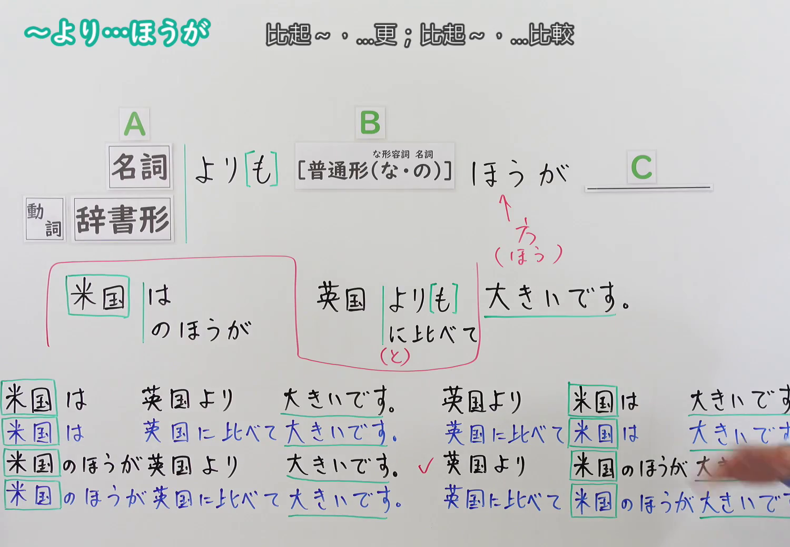
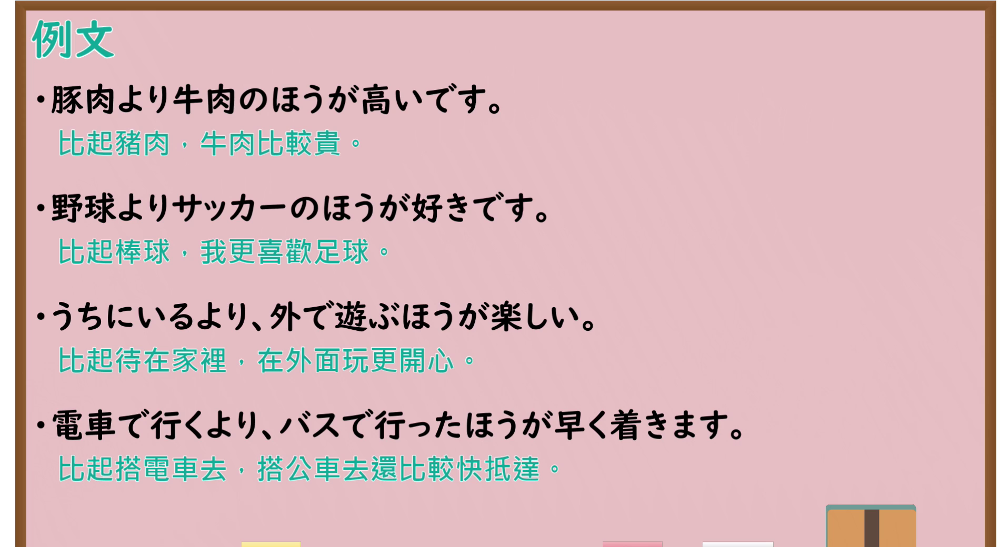

---
{
  "id": "N4-G-0050",
  "kind": "grammar",
  "level": "N4",
  "title": "～より…ほうが（比起……，更……）",
  "card_revision": 1,
  "schema_version": 1,
  "source": {
    "lesson": "N4 第50个语法",
    "material": "出口日語原视频板书、YouTube 原 WebVTT（中文为主、日语为辅）与Hagoromo文型检索正文",
    "video": "https://www.youtube.com/watch?v=0Zc5_41mtls",
    "screenshot": "assets/grammar/n4/N4-G-0050-connection.png",
    "screenshot_seconds": 383.8,
    "screenshot_crop": {
      "x": 0,
      "y": 0,
      "width": 1500,
      "height": 1040
    }
  },
  "tags": [
    "より",
    "ほうが",
    "比較",
    "対比",
    "N4"
  ],
  "confusions": [
    "～ほど…ない",
    "～に比べて"
  ]
}
---

# N4 第50个语法：～より…ほうが

# 视频学习资料整理

- 课程：[出口日語「～より…ほうが」](https://www.youtube.com/watch?v=0Zc5_41mtls)
- 视频 ID：`0Zc5_41mtls`
- 视频时长：8分25秒

## 接续图

- 实际时间：6分23.80秒（383.80秒）
- 原图尺寸：1920×1080
- 裁切区域：左上角 `(0, 0)` 至右下角 `(1500, 1040)`；选用 06:23 画面，黑板最上方完整保留「～より…ほうが 比起～，…更；比起～，…比較」醒目标题；板书已完整书写「名詞／動詞辞書形＋より[も] [普通形(な・の)]＋ほうが C」「米国は英国より[も]大きいです」「米国は英国より大きいです／米国のほうが英国より大きいです／英国より米国のほうが大きいです」等各种语序置换，并与「に比べて」「と」对照。固定左上角 (0, 0)，裁切区域宽 1500、高 1040，充分保留顶部标题与底部板书，高度充足不缺失内容。

## 例句图

- 实际时间：7分08.80秒（428.80秒）
- 原图尺寸：1920×1080
- 裁切区域：左上角 `(0, 0)` 至右下角 `(1900, 1040)`；提取自视频 07:08 处的例句黑板页面。底色为粉灰色课程幻灯片，固定左上角 (0, 0)，裁切区域宽 1900、高 1040，去除右侧与底部多余画面，完整保留全部四条例句及中文翻译，确保底部第四条例句完整呈现。

# 核心

## 功能一：两者进行对比并强调其中一方程度更深（二者比较）

**最上位意味カテゴリー：**

- **AよりBのほうが+述語：** 比較・対比（比较与对比）

**中位意味カテゴリー：**

- **AよりBのほうが+述語：** 二者比較（二者比较）

**意味：**

- **AよりBのほうが+述語：** 相対的優位（比起A，B更加……）

**くわしい意味記述：**

- **AよりBのほうが+述語：** 「AよりもBのほうが」でAとBを比べて，Bのほうが特定の性質や程度において高いことを述べる時に使う。語順を入れ替えて「BのほうがAより」とすることも可能。（用于将A和B两个事物进行对比，强调B在某种性质、状态或程度上超过A。语序可自由调换为“BのほうがAより”。）

**派生語：** 未列出

### 例句

1. 飛行機は新幹線より運賃が高いですが、時間の節約になります。

   （飞机比起新干线票价虽然更贵，但能节省不少时间。）

2. 夏より冬のほうが空気が澄んでいて夜空が綺麗に見えます。

   （比起夏天，冬天的空气更加清澄，夜空看起来更美丽。）

3. 自分で料理を作るより、外食するほうが手軽で時間もかかりません。

   （比起自己做饭，在外面吃更加轻便省事。）

4. 都会に住むより、自然豊かな田舎で暮らすほうがストレスが少ないです。

   （比起住在大都市，生活在自然环境优美的乡村压力更小。）

# 来源

- [出口日語原视频](https://www.youtube.com/watch?v=0Zc5_41mtls)
- [Hagoromo 文型検索「ほうが〜より（も）」](https://hagoromo-text.work/lookup?vid=1499)（查询日期：2026-09-25）
