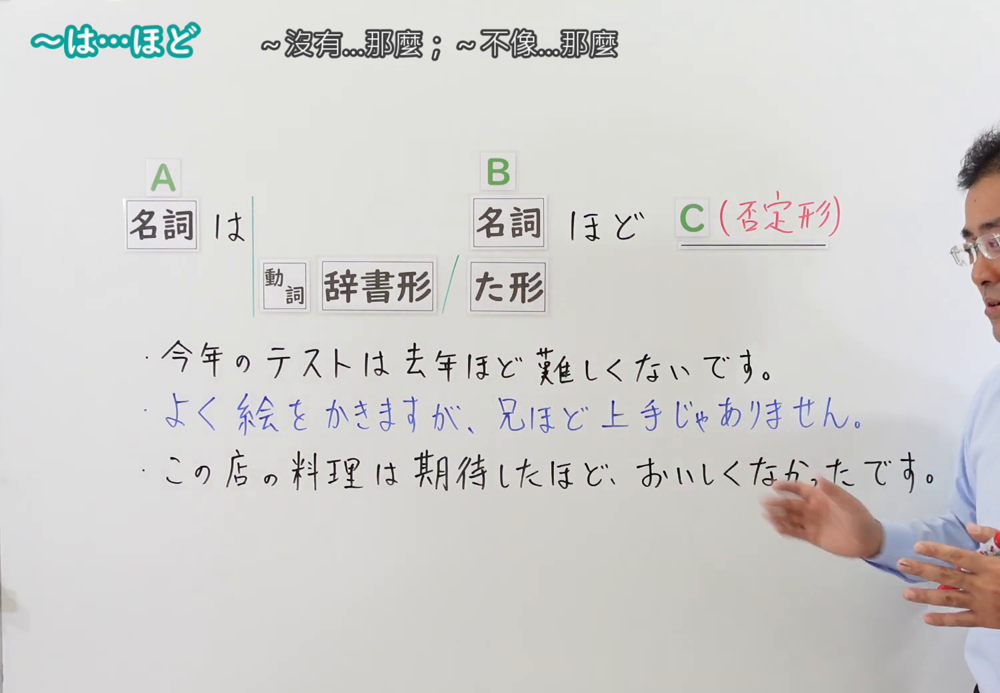
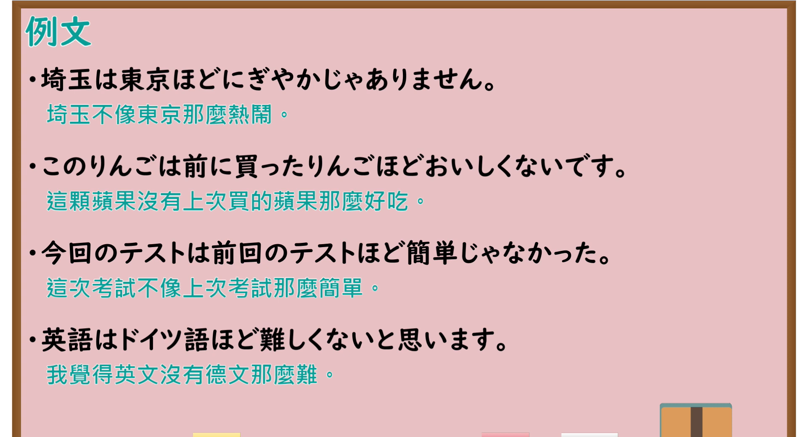

---
{
  "id": "N4-G-0051",
  "kind": "grammar",
  "level": "N4",
  "title": "～は…ほど…ない（A不如B那样……）",
  "card_revision": 1,
  "schema_version": 1,
  "source": {
    "lesson": "N4 第51个语法",
    "material": "出口日語原视频板书、YouTube 原 WebVTT（中文为主、日语为辅）与Hagoromo文型检索正文",
    "video": "https://www.youtube.com/watch?v=N6kNfaEnXy8",
    "screenshot": "assets/grammar/n4/N4-G-0051-connection.png",
    "screenshot_seconds": 100.0,
    "screenshot_crop": {
      "x": 0,
      "y": 0,
      "width": 1500,
      "height": 1040
    }
  },
  "tags": [
    "ほど〜ない",
    "比較",
    "否定",
    "程度",
    "N4"
  ],
  "confusions": [
    "～より",
    "～くらい"
  ]
}
---

# N4 第51个语法：～は…ほど…ない

# 视频学习资料整理

- 课程：[出口日語「～は…ほど…ない」](https://www.youtube.com/watch?v=N6kNfaEnXy8)
- 视频 ID：`N6kNfaEnXy8`
- 视频时长：3分20秒

## 接续图

- 实际时间：1分40.00秒（100.00秒）
- 原图尺寸：1920×1080
- 裁切区域：左上角 `(0, 0)` 至右下角 `(1500, 1040)`；选用 01:40 画面，黑板最上方完整保留「～は…ほど…ない ～沒有…那麼…」醒目标题；板书已完整书写「名詞 は 名詞 ほど [形容詞／動詞] ない」「台北は 北海道 ほど 寒くないです／今年の夏は 去年 ほど 暑くないです／私は 兄 ほど 上手に 泳げません」，老师侧身让出板书区域。固定左上角 (0, 0)，裁切区域宽 1500、高 1040，去除右侧人物与边缘多余画面，充分保留顶部标题与左右对比全部板书，高度充足不缺失内容。

## 例句图

- 实际时间：2分20.00秒（140.00秒）
- 原图尺寸：1920×1080
- 裁切区域：左上角 `(0, 0)` 至右下角 `(1900, 1040)`；提取自视频 02:20 处的例句黑板页面。底色为粉灰色课程幻灯片，固定左上角 (0, 0)，裁切区域宽 1900、高 1040，去除右侧与底部多余画面，完整保留全部四条例句及中文翻译，确保底部第四条例句完整呈现。

# 核心

## 功能一：A 不如 B 达到某种程度（否定程度比较）

**最上位意味カテゴリー：**

- **NはNほど〜ない：** ものごとの関係（事物之间的关系）

**中位意味カテゴリー：**

- **NはNほど〜ない：** 比較（比较）

**意味：**

- **NはNほど〜ない：** 程度（程度（否定））

**くわしい意味記述：**

- **NはNほど〜ない：** ある事柄Xの程度が，基準となる要素Yほどには達していないことを表す。否定表現と呼応して「XはYほど〜ではない」の形で用いる。（表示某事某物X在某种属性或程度上，没有达到作为基准的Y的水平。常与否定式呼应，构成“X不如Y那样……”的比较句式。）

**派生語：** 未列出

### 例句

1. 台北は北海道ほど寒くないです。

   （台北没有北海道那么冷。）

2. 今年の夏は去年ほど暑くないです。

   （今年夏天没有去年那么热。）

3. 私は兄ほど上手に泳げません。

   （我游泳游得没有哥哥那么好。）

4. 昨日の試験は思っていたほど難しくなかった。

   （昨天的考试并没有我想象的那么难。）

# 来源

- [出口日語原视频](https://www.youtube.com/watch?v=N6kNfaEnXy8)
- [Hagoromo 文型検索「ほど」](https://hagoromo-text.work/lookup?vid=1507)（查询日期：2026-09-25）
