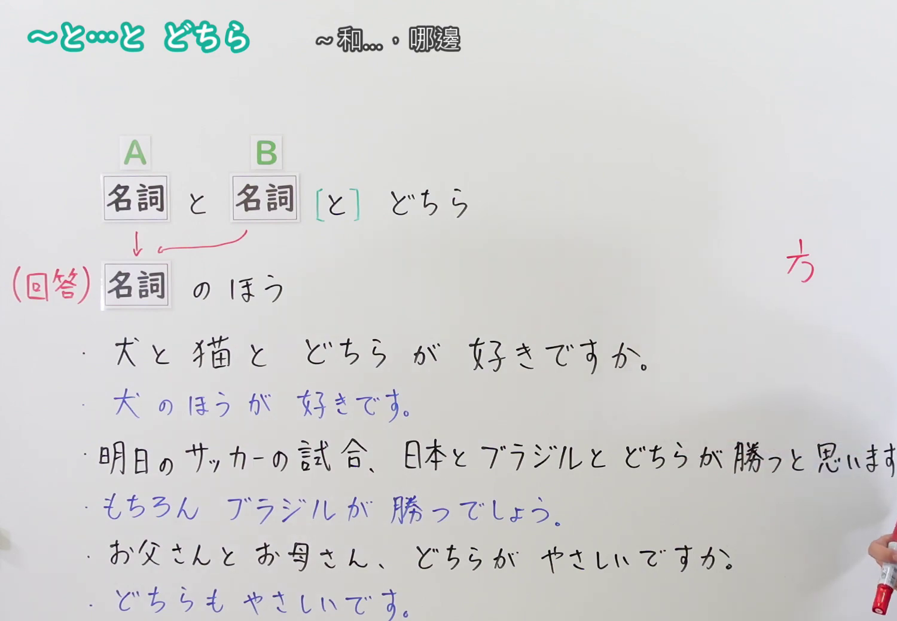
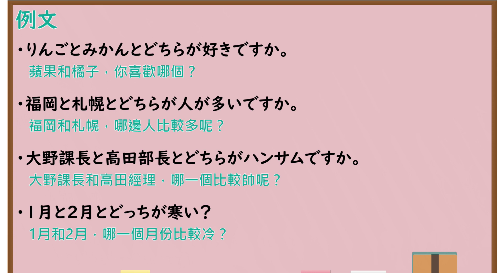

---
{
  "id": "N4-G-0052",
  "kind": "grammar",
  "level": "N4",
  "title": "～と…とどちら・～のほうが…（A和B哪个……、A更……）",
  "card_revision": 1,
  "schema_version": 1,
  "source": {
    "lesson": "N4 第52个语法",
    "material": "出口日語原视频板书、YouTube 原 WebVTT（中文为主、日语为辅）与Hagoromo文型检索正文",
    "video": "https://www.youtube.com/watch?v=IMOLiUOteSs",
    "screenshot": "assets/grammar/n4/N4-G-0052-connection.png",
    "screenshot_seconds": 236.6,
    "screenshot_crop": {
      "x": 0,
      "y": 0,
      "width": 1500,
      "height": 1040
    }
  },
  "tags": [
    "どちら",
    "ほうが",
    "二者比較",
    "選択",
    "N4"
  ],
  "confusions": [
    "～より",
    "どれ"
  ]
}
---

# N4 第52个语法：～と…とどちら・～のほうが…

# 视频学习资料整理

- 课程：[出口日語「～と…とどちら・～のほうが…」](https://www.youtube.com/watch?v=IMOLiUOteSs)
- 视频 ID：`IMOLiUOteSs`
- 视频时长：5分36秒

## 接续图

- 实际时间：3分56.60秒（236.60秒）
- 原图尺寸：1920×1080
- 裁切区域：左上角 `(0, 0)` 至右下角 `(1500, 1040)`；选用 03:56 画面，黑板最上方完整保留「～と…と どちら ～和…，哪邊」醒目标题；板书已完整书写「名詞 と 名詞 [と] どちら」「(回答) 名詞 の ほう」「犬 と 猫 と どちら が 好きですか。／犬 の ほう が 好きです。／明日のサッカーの試合、日本 と ブラジル と どちら が 勝つと思いますか。／もちろん ブラジル が 勝つでしょう。／お父さん と お母さん、どちらが やさしいですか。／どちらも やさしいです。」，老师站在右侧边缘。固定左上角 (0, 0)，裁切区域宽 1500、高 1040，去除右侧人物与边缘多余画面，充分保留顶部标题与左右对比全部板书，高度充足不缺失内容。

## 例句图

- 实际时间：4分30.40秒（270.40秒）
- 原图尺寸：1920×1080
- 裁切区域：左上角 `(0, 0)` 至右下角 `(1900, 1040)`；提取自视频 04:30 处的例句黑板页面。底色为粉灰色课程幻灯片，固定左上角 (0, 0)，裁切区域宽 1900、高 1040，去除右侧与底部多余画面，完整保留全部四条例句及中文翻译，确保底部第四条例句完整呈现。

# 核心

## 功能一：在二者之间比较并询问或表达哪一方程度更高（二者比较与选择）

**最上位意味カテゴリー：**

- **NとNとどちら：** ものごとの関係（事物之间的关系）
- **Nのほうが：** ものごとの関係（事物之间的关系）

**中位意味カテゴリー：**

- **NとNとどちら：** 比較（比较）
- **Nのほうが：** 比較（比较）

**意味：**

- **NとNとどちら：** 比較（比较询问）
- **Nのほうが：** 比較（比较回答）

**くわしい意味記述：**

- **NとNとどちら：** XとYという二つのものを取り上げて比べ，一方を選ぶときに使う疑問文。（提出X和Y两个事物加以比较，在二者中询问选择哪一方的疑问句表达。）
- **Nのほうが：** ２つのものを比べ，「ほう」に前接する要素のが程度が高いことを表す。（在两者进行比较时，表示接在“ほう”前面的那一方程度更高、更具优势。）

**派生語：** 〜と〜とどちら，どっち

### 例句

1. りんごとみかんとどちらが好きですか。

   （苹果和橘子，你喜欢哪一个？）

2. 福岡と札幌とどちらが人が多いですか。

   （福冈和札幌，哪边人比较多呢？）

3. 大野課長と高田部長とどちらがハンサムですか。

   （大野课长和高田经理，哪一个比较帅呢？）

4. 1月と2月とどっちが寒い？

   （1月和2月，哪一个月比较冷？）

# 来源

- [出口日語原视频](https://www.youtube.com/watch?v=IMOLiUOteSs)
- [Hagoromo 文型検索「〜と〜（と）どちら」](https://hagoromo-text.work/lookup?vid=1033)（查询日期：2026-09-25）
- [Hagoromo 文型検索「ほう」](https://hagoromo-text.work/lookup?vid=1496)（查询日期：2026-09-25）
