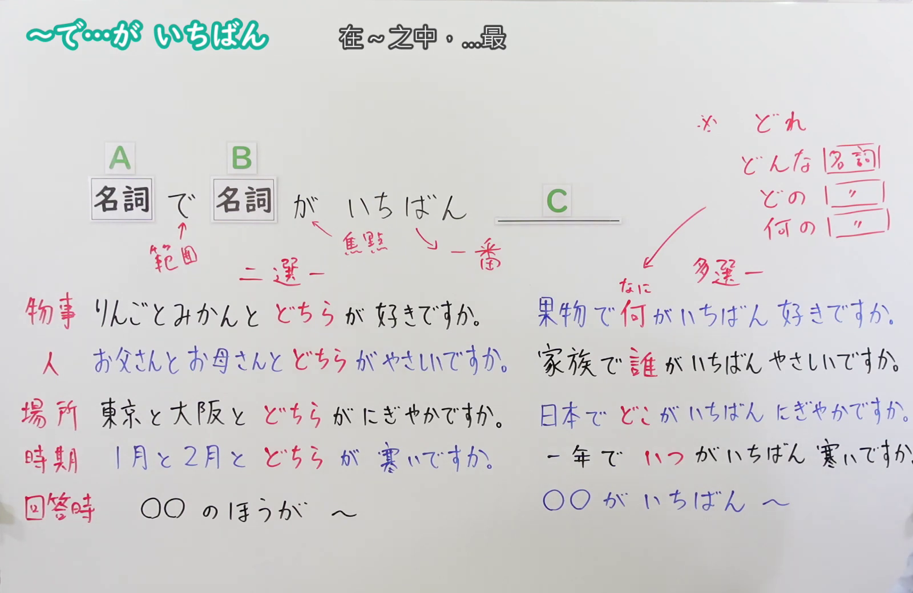
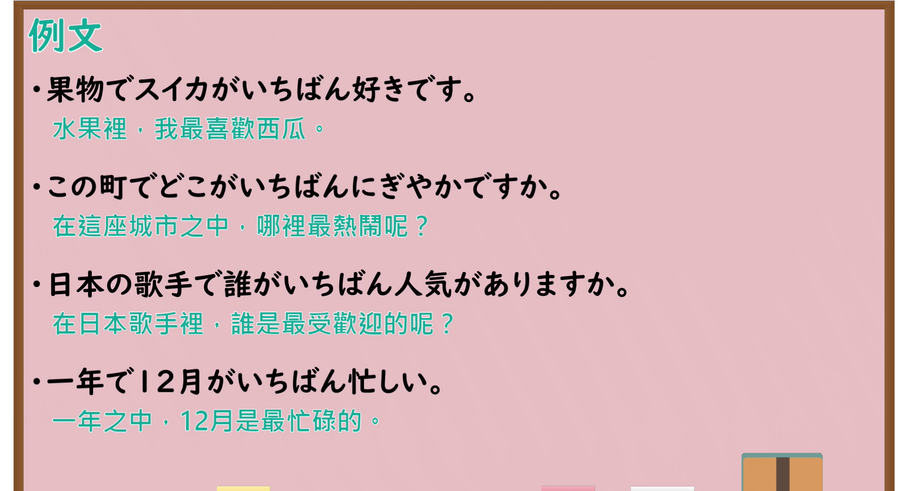

---
{
  "id": "N4-G-0053",
  "kind": "grammar",
  "level": "N4",
  "title": "～で…がいちばん(一番)（在……之中最……）",
  "card_revision": 1,
  "schema_version": 1,
  "source": {
    "lesson": "N4 第53个语法",
    "material": "出口日語原视频板书、YouTube 原 WebVTT（中文为主、日语为辅）与Hagoromo文型检索正文",
    "video": "https://www.youtube.com/watch?v=jRMorA2j5Qs",
    "screenshot": "assets/grammar/n4/N4-G-0053-connection.png",
    "screenshot_seconds": 361.0,
    "screenshot_crop": {
      "x": 0,
      "y": 0,
      "width": 1600,
      "height": 1040
    }
  },
  "tags": [
    "で",
    "いちばん",
    "一番",
    "最上級",
    "比較",
    "N4"
  ],
  "confusions": [
    "～のほうが",
    "～より"
  ]
}
---

# N4 第53个语法：～で…がいちばん(一番)

# 视频学习资料整理

- 课程：[出口日語「～で…がいちばん(一番)」](https://www.youtube.com/watch?v=jRMorA2j5Qs)
- 视频 ID：`jRMorA2j5Qs`
- 视频时长：7分55秒

## 接续图

- 实际时间：6分01.00秒（361.00秒）
- 原图尺寸：1920×1080
- 裁切区域：左上角 `(0, 0)` 至右下角 `(1600, 1040)`；选用 06:01 画面，黑板最上方完整保留「～で…が いちばん 在～之中，…最」醒目标题；板书已完整书写「名詞で 名詞が いちばん [形容詞／動詞]」、清晰对比左侧「二選一（どちら）」与右侧「多選一（果物で何がいちばん好きですか／家族で誰がいちばんやさしいですか／日本でどこがいちばんにぎやかですか／一年でいつがいちばん寒いですか／○○がいちばん〜）」以及上方疑问词归纳，老师站在右侧边缘。固定左上角 (0, 0)，裁切区域宽 1600、高 1040，去除右侧人物与边缘多余画面，充分保留顶部标题与左右对比全部板书，高度充足不缺失内容。

## 例句图

- 实际时间：6分34.25秒（394.25秒）
- 原图尺寸：1920×1080
- 裁切区域：左上角 `(0, 0)` 至右下角 `(1900, 1040)`；提取自视频 06:34 处的例句黑板页面。底色为粉灰色课程幻灯片，固定左上角 (0, 0)，裁切区域宽 1900、高 1040，去除右侧与底部多余画面，完整保留全部四条例句及中文翻译，确保底部第四条例句完整呈现。

# 核心

## 功能一：在限定范围中某人或某物程度最高（多者范围最上级）

**最上位意味カテゴリー：**

- **NでNがいちばん：** ものごとの関係（事物之间的关系）

**中位意味カテゴリー：**

- **NでNがいちばん：** 比較（比较）

**意味：**

- **NでNがいちばん：** 最上級（最上级）

**くわしい意味記述：**

- **NでNがいちばん：** ある限定された範囲（時間・場所・集団・カテゴリなど）の中で，ある事物が最もその性質や状態の程度が高いことを表す。（在某一限定的范围（时间、空间场所、群体或类别等）之内，表示某一特定事物具有最高程度的性质或状态。）

**派生語：** 未列出

### 例句

1. 果物でスイカがいちばん好きです。

   （水果里，我最喜欢西瓜。）

2. この町でどこがいちばんにぎやかですか。

   （在这座城市之中，哪里最热闹呢？）

3. 日本の歌手で誰がいちばん人気がありますか。

   （在日本歌手里，谁是最受欢迎的呢？）

4. 一年で12月がいちばん忙しい。

   （一年之中，12月是最忙碌的。）

# 来源

- [出口日語原视频](https://www.youtube.com/watch?v=jRMorA2j5Qs)
- [出口日語原视频板书与教学例句](https://www.youtube.com/watch?v=jRMorA2j5Qs)（查询日期：2026-09-25）
