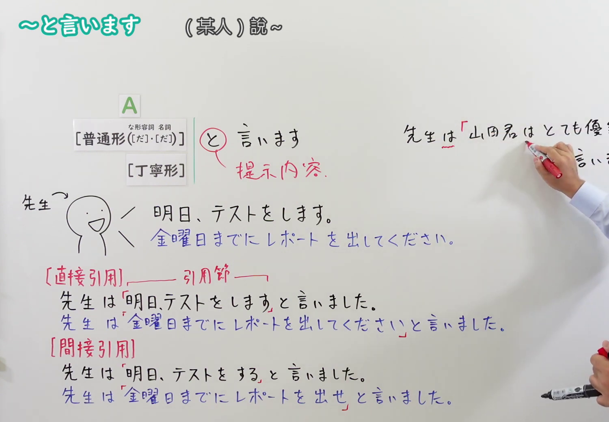
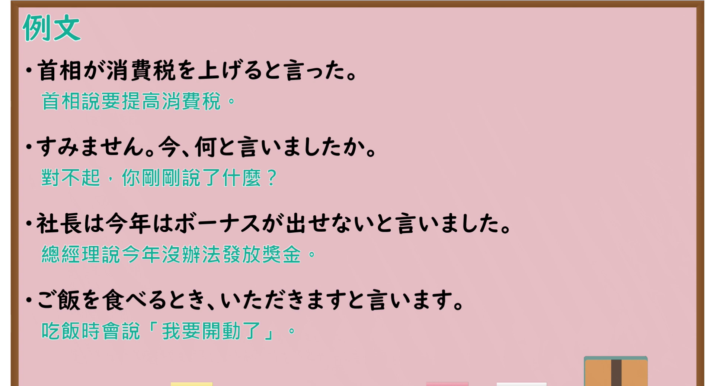

---
{
  "id": "N4-G-0054",
  "kind": "grammar",
  "level": "N4",
  "title": "～と言います（某人说……、被称为……）",
  "card_revision": 1,
  "schema_version": 1,
  "source": {
    "lesson": "N4 第54个语法",
    "material": "出口日語原视频板书、Bilibili P54 音频的本地中文／日语混合转写 WebVTT与Hagoromo文型检索正文",
    "video": "https://www.youtube.com/watch?v=uAn9x1L1Ycc",
    "screenshot": "assets/grammar/n4/N4-G-0054-connection.png",
    "screenshot_seconds": 348.21,
    "screenshot_crop": {
      "x": 0,
      "y": 0,
      "width": 1500,
      "height": 1040
    }
  },
  "tags": [
    "と言います",
    "直接引用",
    "間接引用",
    "伝達",
    "発話",
    "N4"
  ],
  "confusions": [
    "～と思います",
    "～そうです(伝聞)"
  ]
}
---

# N4 第54个语法：～と言います

# 视频学习资料整理

- 课程：[出口日語「～と言います」](https://www.youtube.com/watch?v=uAn9x1L1Ycc)
- 视频 ID：`uAn9x1L1Ycc`
- 视频时长：7分57秒

## 接续图

- 实际时间：5分48.21秒（348.21秒）
- 原图尺寸：1920×1080
- 裁切区域：左上角 `(0, 0)` 至右下角 `(1500, 1040)`；选用 05:48 画面，黑板最上方完整保留「～と言います (某人)說～」醒目标题；板书已完整书写「[普通形([だ]・[だ])／丁寧形] と 言います（提示内容）」、左侧板书生动区分「[直接引用] 先生は『明日、テストをします』と言いました／先生は『金曜日までにレポートを出してください』と言いました」与「[間接引用] 先生は明日、テストをすると言いました／先生は金曜日までにレポートを出せと言いました」，老师在右侧板书。固定左上角 (0, 0)，裁切区域宽 1500、高 1040，去除右侧人物与边缘多余画面，充分保留顶部标题与直接间接引用完整对比板书，高度充足不缺失内容。

## 例句图

- 实际时间：6分35.91秒（395.91秒）
- 原图尺寸：1920×1080
- 裁切区域：左上角 `(0, 0)` 至右下角 `(1900, 1040)`；提取自视频 06:35 处的例句黑板页面。底色为粉灰色课程幻灯片，固定左上角 (0, 0)，裁切区域宽 1900、高 1040，去除右侧与底部多余画面，完整保留全部四条例句及中文翻译，确保底部第四条例句完整呈现。

# 核心

## 功能一：直接或间接传达某人所说的话或表述内容（发话内容传达）

**最上位意味カテゴリー：**

- **普/丁寧形+と言います：** 人との関係（人与人的关系）

**中位意味カテゴリー：**

- **普/丁寧形+と言います：** 伝達・発話（传达与发话）

**意味：**

- **普/丁寧形+と言います：** 引用（引用内容）

**くわしい意味記述：**

- **普/丁寧形+と言います：** 発話者の発言内容をそのまま，あるいは普通形に変えて引用・伝達する表現。直接引用では鉤括弧を用い，間接引用では普通形（命令・依頼は命令形や接続変化）を用いる。（将发话者的发言内容原封不动引用，或者转换为普通体进行间接转述的表达。直接引用时使用引号，间接引用时将句子变为简体（命令或请求相应转换）。）

**派生語：** と言う，と言いました，という

### 例句

1. 首相が消費税を上げると言った。

   （首相说要提高消费税。）

2. すみません。今、何と言いましたか。

   （对不起，你刚刚说了什么？）

3. 社長は今年はボーナスが出せないと言いました。

   （总经理说今年没办法发放奖金。）

4. ご飯を食べるとき、いただきますと言います。

   （吃饭时会说「我要开动了」。）

# 来源

- [出口日語原视频](https://www.youtube.com/watch?v=uAn9x1L1Ycc)
- [Hagoromo 文型検索「（のこと）を〜という」](https://hagoromo-text.work/lookup?vid=3)（查询日期：2026-09-25）
