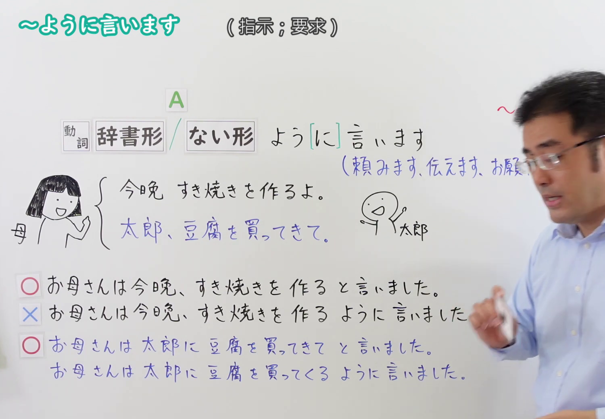
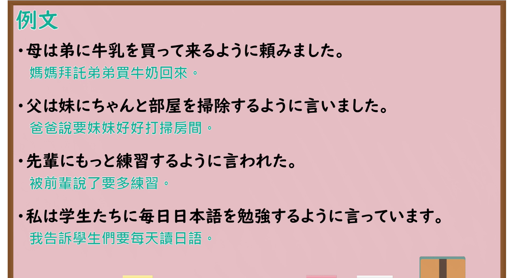

---
{
  "id": "N4-G-0055",
  "kind": "grammar",
  "level": "N4",
  "title": "～ように言います(指示の伝達)（转告……转达指示）",
  "card_revision": 1,
  "schema_version": 1,
  "source": {
    "lesson": "N4 第55个语法",
    "material": "出口日語原视频板书、YouTube 原 WebVTT（中文为主、日语为辅）与Hagoromo文型检索正文",
    "video": "https://www.youtube.com/watch?v=OAZToz527BE",
    "screenshot": "assets/grammar/n4/N4-G-0055-connection.png",
    "screenshot_seconds": 261.1,
    "screenshot_crop": {
      "x": 0,
      "y": 0,
      "width": 1500,
      "height": 1040
    }
  },
  "tags": [
    "ように言います",
    "指示",
    "伝達",
    "間接命令",
    "要求",
    "N4"
  ],
  "confusions": [
    "～と言います",
    "～ようにする"
  ]
}
---

# N4 第55个语法：～ように言います(指示の伝達)

# 视频学习资料整理

- 课程：[出口日語「～ように言います(指示の伝達)」](https://www.youtube.com/watch?v=OAZToz527BE)
- 视频 ID：`OAZToz527BE`
- 视频时长：5分48秒

## 接续图

- 实际时间：4分21.10秒（261.10秒）
- 原图尺寸：1920×1080
- 裁切区域：左上角 `(0, 0)` 至右下角 `(1500, 1040)`；选用 04:21 画面，黑板最上方完整保留「～ように言います (指示・要求)」醒目标题；板书已完整书写「動詞辞書形／ない形 よう[に] 言います（頼みます、伝えます、お願い...）」、中间配有母亲吩咐太郎买豆腐的插图，下方辨析「○お母さんは今晩、すき焼きを作ると言いました／×お母さんは今晩、すき焼きを作るように言いました／○お母さんは太郎に豆腐を買ってきてと言いました／お母さんは太郎に豆腐を買ってくるように言いました」，老师在右侧。固定左上角 (0, 0)，裁切区域宽 1500、高 1040，去除右侧人物与边缘多余画面，充分保留顶部标题与例解对比板书，高度充足不缺失内容。

## 例句图

- 实际时间：4分58.40秒（298.40秒）
- 原图尺寸：1920×1080
- 裁切区域：左上角 `(0, 0)` 至右下角 `(1900, 1040)`；提取自视频 04:58 处的例句黑板页面。底色为粉灰色课程幻灯片，固定左上角 (0, 0)，裁切区域宽 1900、高 1040，去除右侧与底部多余画面，完整保留全部四条例句及中文翻译，确保底部第四条例句完整呈现。

# 核心

## 功能一：向第三者转述指示、命令、建议或请求（间接指示传达）

**最上位意味カテゴリー：**

- **Vる/Vない+ように言います：** 人との関係（人与人的关系）

**中位意味カテゴリー：**

- **Vる/Vない+ように言います：** 依頼・命令（请求与命令）

**意味：**

- **Vる/Vない+ように言います：** 間接指示（间接指示与转达）

**くわしい意味記述：**

- **Vる/Vない+ように言います：** 他者に対して何らかの行動をするよう、またはしないよう指示・要求・依頼した内容を間接的に伝える表現。後続動詞には「言います」「伝えます」「頼みます」などが用いられる。（向他人间接转述指示、要求或请求对方采取某动作（或不采取某动作）的表达。后续动词常使用“言います”“伝えます”“頼みます”等。）

**派生語：** ように頼む，ように伝える，ように注意する

### 例句

1. 母は弟に牛乳を買って来るように頼みました。

   （妈妈拜托弟弟买牛奶回来。）

2. 父は妹にちゃんと部屋を掃除するように言いました。

   （爸爸说要妹妹好好打扫房间。）

3. 先輩にもっと練習するように言われた。

   （被前辈说了要多练习。）

4. 私は学生たちに毎日日本語を勉強するように言っています。

   （我告诉学生们要每天读日语。）

# 来源

- [出口日語原视频](https://www.youtube.com/watch?v=OAZToz527BE)
- [出口日語原视频板书与教学例句](https://www.youtube.com/watch?v=OAZToz527BE)（查询日期：2026-09-25）
