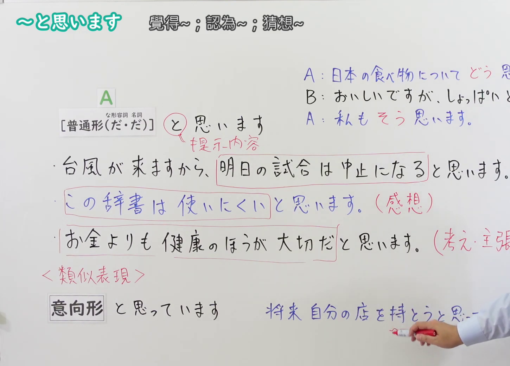
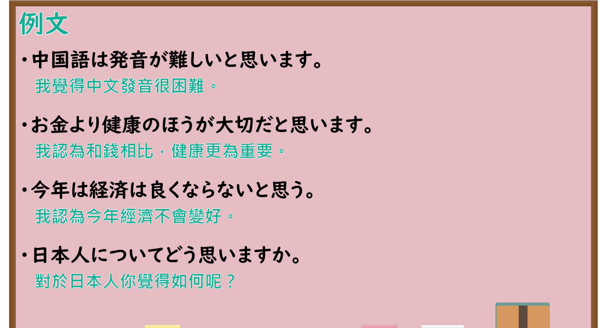

---
{
  "id": "N4-G-0056",
  "kind": "grammar",
  "level": "N4",
  "title": "～と思います(意見・推量)（觉得……、认为……、猜想……）",
  "card_revision": 1,
  "schema_version": 1,
  "source": {
    "lesson": "N4 第56个语法",
    "material": "出口日語原视频板书、YouTube 原 WebVTT（中文为主、日语为辅）与Hagoromo文型检索正文",
    "video": "https://www.youtube.com/watch?v=ibZywFkUqxI",
    "screenshot": "assets/grammar/n4/N4-G-0056-connection.png",
    "screenshot_seconds": 290.54,
    "screenshot_crop": {
      "x": 0,
      "y": 0,
      "width": 1450,
      "height": 1040
    }
  },
  "tags": [
    "と思います",
    "推量",
    "意見",
    "感想",
    "思考",
    "N4"
  ],
  "confusions": [
    "～うと思う",
    "～はずだ",
    "～だろう"
  ]
}
---

# N4 第56个语法：～と思います(意見・推量)

# 视频学习资料整理

- 课程：[出口日語「～と思います(意見・推量)」](https://www.youtube.com/watch?v=ibZywFkUqxI)
- 视频 ID：`ibZywFkUqxI`
- 视频时长：6分38秒

## 接续图

- 实际时间：4分50.54秒（290.54秒）
- 原图尺寸：1920×1080
- 裁切区域：左上角 `(0, 0)` 至右下角 `(1450, 1040)`；选用 04:50 画面，黑板最上方完整保留「～と思います 覺得～；認為～；猜想～」醒目标题；板书已完整书写「A[普通形(だ・だ)] と 思います（提示内容）」、「台風が来ますから、明日の試合は中止になると思います。(推量)／この辞書は使いにくいと思います。(感想)／お金よりも健康のほうが大切だと思います。(考え・主張)」、下方对照「＜類似表現＞ 意向形 と思っています 将来 自分の店を持とうと思っています」，老师在右侧。固定左上角 (0, 0)，裁切区域宽 1450、高 1040，去除右侧人物与边缘多余画面，充分保留顶部标题与三种语义用例板书，高度充足不缺失内容。

## 例句图

- 实际时间：5分18.40秒（318.40秒）
- 原图尺寸：1920×1080
- 裁切区域：左上角 `(0, 0)` 至右下角 `(1900, 1040)`；提取自视频 05:18 处的例句黑板页面。底色为粉灰色课程幻灯片，固定左上角 (0, 0)，裁切区域宽 1900、高 1040，去除右侧与底部多余画面，完整保留全部四条例句及中文翻译，确保底部第四条例句完整呈现。

# 核心

## 功能一：表达说话人的个人推测、感想或意见主张（推量与主观意见）

**最上位意味カテゴリー：**

- **普+と思います：** 考え・感情（思考与情感）

**中位意味カテゴリー：**

- **普+と思います：** 思考・推量（思考与推量）

**意味：**

- **普+と思います：** 意見・推量（意见与推量）

**くわしい意味記述：**

- **普+と思います：** 話し手の主観的な推量や判断、感想、個人的な考え・意見を述べる表現。断定を避け、柔らかく自分の認識を相手に伝える機能を持つ。（表达说话人的主观推测、判断、感想或个人想法意见的句型。避免直接断定，柔和地向对方传达自身认知。）

**派生語：** と思っている，と思う，と考えます

### 例句

1. 中国語は発音が難しいと思います。

   （我觉得中文发音很困难。）

2. お金より健康のほうが大切だと思います。

   （我认为和钱相比，健康更为重要。）

3. 今年は経済は良くならないと思う。

   （我认为今年经济不会变好。）

4. 日本人についてどう思いますか。

   （对于日本人你觉得如何呢？）

# 来源

- [出口日語原视频](https://www.youtube.com/watch?v=ibZywFkUqxI)
- [Hagoromo 文型検索「Vたいとおもう」](https://hagoromo-text.work/lookup?vid=670)（查询日期：2026-09-25）
