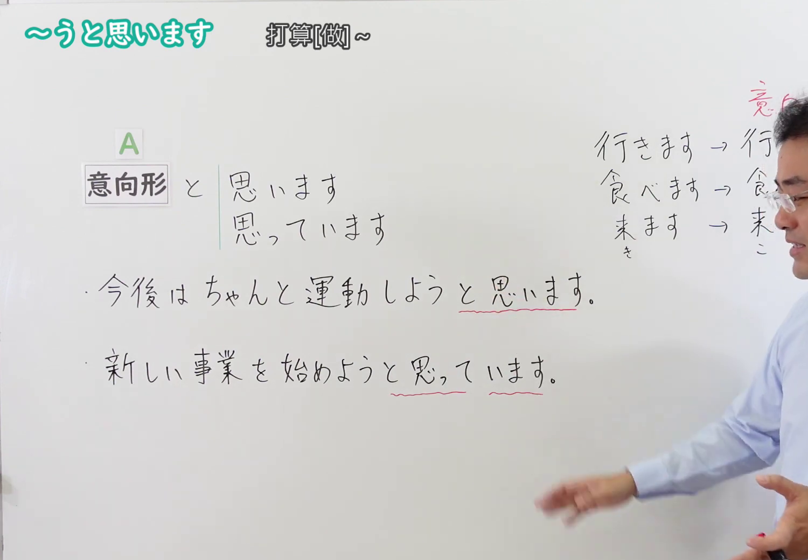
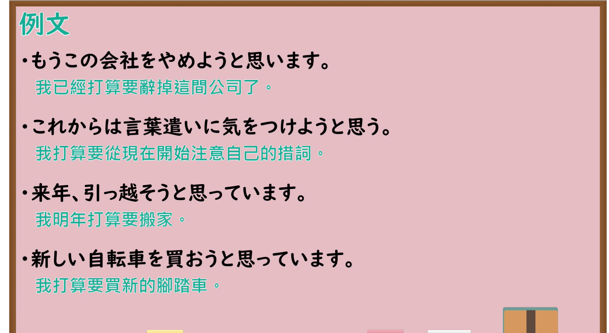

---
{
  "id": "N4-G-0057",
  "kind": "grammar",
  "level": "N4",
  "title": "～ようと思います・～ようと思っています(意志)（打算……、想要……）",
  "card_revision": 1,
  "schema_version": 1,
  "source": {
    "lesson": "N4 第57个语法",
    "material": "出口日語原视频板书、YouTube 原 WebVTT（中文为主、日语为辅）与Hagoromo文型检索正文",
    "video": "https://www.youtube.com/watch?v=NwxKcOrz-ww",
    "screenshot": "assets/grammar/n4/N4-G-0057-connection.png",
    "screenshot_seconds": 183.6,
    "screenshot_crop": {
      "x": 0,
      "y": 0,
      "width": 1500,
      "height": 1040
    }
  },
  "tags": [
    "ようと思う",
    "ようと思っています",
    "意向形",
    "意志",
    "計画",
    "N4"
  ],
  "confusions": [
    "～つもりだ",
    "～うとする"
  ]
}
---

# N4 第57个语法：～ようと思います・～ようと思っています(意志)

# 视频学习资料整理

- 课程：[出口日語「～ようと思います・～ようと思っています(意志)」](https://www.youtube.com/watch?v=NwxKcOrz-ww)
- 视频 ID：`NwxKcOrz-ww`
- 视频时长：4分05秒

## 接续图

- 实际时间：3分03.60秒（183.60秒）
- 原图尺寸：1920×1080
- 裁切区域：左上角 `(0, 0)` 至右下角 `(1500, 1040)`；选用 03:03 画面，黑板最上方完整保留「～うと思います 打算[做]～」醒目标题；板书已完整书写「動詞意向形 と 思います／思っています」、「今後は ちゃんと運動しようと思います。／新しい事業を始めようと思っています。」、右侧清晰列出意向形规则「行きます→行こう／食べます→食べよう／来ます→来よう」，老师侧身让出板书。固定左上角 (0, 0)，裁切区域宽 1500、高 1040，去除右侧人物与边缘多余画面，充分保留顶部标题与左右板书，高度充足不缺失内容。

## 例句图

- 实际时间：3分43.38秒（223.38秒）
- 原图尺寸：1920×1080
- 裁切区域：左上角 `(0, 0)` 至右下角 `(1900, 1040)`；提取自视频 03:43 处的例句黑板页面。底色为粉灰色课程幻灯片，固定左上角 (0, 0)，裁切区域宽 1900、高 1040，去除右侧与底部多余画面，完整保留全部四条例句及中文翻译，确保底部第四条例句完整呈现。

# 核心

## 功能一：表达自己未来的计划与打算（意志表达）

**最上位意味カテゴリー：**

- **Vようとおもう：** 考え・感情（思考与情感）

**中位意味カテゴリー：**

- **Vようとおもう：** 意志（意志）

**意味：**

- **Vようとおもう：** 意志（未来意志与打算）

**くわしい意味記述：**

- **Vようとおもう：** 将来，Vをする，という話し手の気持ちを表す。その場で思い立った意志には「〜ようと思う」、以前から継続して考えている意志や第三者の意志には「〜ようと思っている」を用いる。（表达说话人将来要做某事的意志与打算。当场临时起意时多用“〜ようと思う”，若表示已经酝酿一段时日的持续打算或第三人称的打算时，则用“〜ようと思っている”。）

**派生語：** Vようと思っている，Vようと思う

### 例句

1. もうこの会社をやめようと思います。

   （我已经打算要辞掉这间公司了。）

2. これからは言葉遣いに気をつけようと思う。

   （我打算要从现在开始注意自己的措词。）

3. 来年、引っ越そうと思っています。

   （我明年打算要搬家。）

4. 新しい自転車を買おうと思っています。

   （我打算要买新的脚踏车。）

# 来源

- [出口日語原视频](https://www.youtube.com/watch?v=NwxKcOrz-ww)
- [Hagoromo 文型検索「Vようとおもう」](https://hagoromo-text.work/lookup?vid=1687)（查询日期：2026-09-25）
