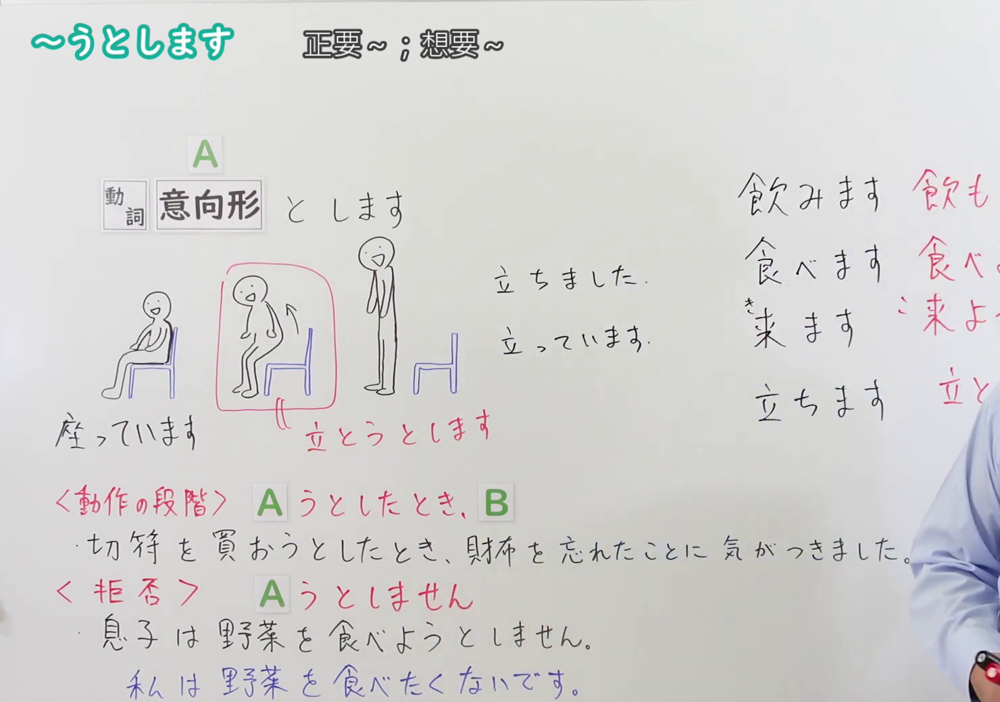
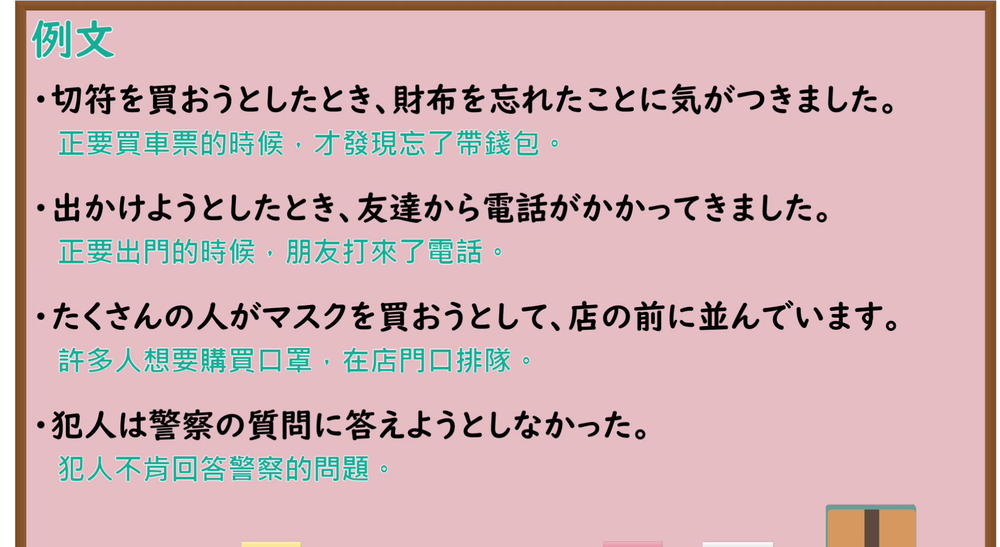

---
{
  "id": "N4-G-0058",
  "kind": "grammar",
  "level": "N4",
  "title": "～ようとします・～ようとしています(直前・試み)（正要做……、想要……）",
  "card_revision": 1,
  "schema_version": 1,
  "source": {
    "lesson": "N4 第58个语法",
    "material": "出口日語原视频板书、YouTube 原 WebVTT（中文为主、日语为辅）与Hagoromo文型检索正文",
    "video": "https://www.youtube.com/watch?v=f9Q5VdhwASc",
    "screenshot": "assets/grammar/n4/N4-G-0058-connection.png",
    "screenshot_seconds": 315.27,
    "screenshot_crop": {
      "x": 0,
      "y": 0,
      "width": 1480,
      "height": 1040
    }
  },
  "tags": [
    "ようとする",
    "直前",
    "試み",
    "意向形",
    "拒否",
    "N4"
  ],
  "confusions": [
    "～ようと思う",
    "～ところだ"
  ]
}
---

# N4 第58个语法：～ようとします・～ようとしています(直前・試み)

# 视频学习资料整理

- 课程：[出口日語「～ようとします・～ようとしています(直前・試み)」](https://www.youtube.com/watch?v=f9Q5VdhwASc)
- 视频 ID：`f9Q5VdhwASc`
- 视频时长：7分01秒

## 接续图

- 实际时间：5分15.27秒（315.27秒）
- 原图尺寸：1920×1080
- 裁切区域：左上角 `(0, 0)` 至右下角 `(1480, 1040)`；选用 05:15 画面，黑板最上方完整保留「～うとします 正要～；想要～」醒目标题；板书已完整书写「動詞意向形 と します」、中间配合坐立图解清晰呈现动作发生前夕的阶段，下方完整呈现「＜動作の段階＞ Aうとしたとき、B 切符を買おうとしたとき、財布を忘れたことに気がつきました。／＜拒否＞ Aうとしません 息子は野菜を食べようとしません。私は野菜を食べたくないです。」，老师在右侧。固定左上角 (0, 0)，裁切区域宽 1480、高 1040，去除右侧人物与边缘多余画面，充分保留顶部标题与动作阶段及拒否对比板书，高度充足不缺失内容。

## 例句图

- 实际时间：5分49.43秒（349.43秒）
- 原图尺寸：1920×1080
- 裁切区域：左上角 `(0, 0)` 至右下角 `(1900, 1040)`；提取自视频 05:49 处的例句黑板页面。底色为粉灰色课程幻灯片，固定左上角 (0, 0)，裁切区域宽 1900、高 1040，去除右侧与底部多余画面，完整保留全部四条例句及中文翻译，确保底部第四条例句完整呈现。

# 核心

## 功能一：动作刚要发生的直前阶段、努力尝试或顽固拒否（动作直前与试行）

**最上位意味カテゴリー：**

- **Vようとする(直前)：** 場所・時間（场所与时间）
- **Vようとする(試み)：** 考え・感情（思考与情感）
- **Vようとしない(拒否)：** 考え・感情（思考与情感）

**中位意味カテゴリー：**

- **Vようとする(直前)：** 時間的前後（时间的前后）
- **Vようとする(試み)：** 意志（意志）
- **Vようとしない(拒否)：** 意志（意志）

**意味：**

- **Vようとする(直前)：** 起点（动作发生直前）
- **Vようとする(試み)：** 意志（试行与努力）
- **Vようとしない(拒否)：** 主張（拒否与顽固不愿）

**くわしい意味記述：**

- **Vようとする(直前)：** Vをする直前という意味。ある動作や事態が今にも始まろうとしている瞬間の局面を表す。（表示正要做某动作的直前阶段。表达某种动作或事态眼看就要发生的瞬间局面。）
- **Vようとする(試み)：** 何かをしたり，実現させたりするために，試行・努力するという意味を持つ。（表示为了实现某事而付诸努力、尝试去做的意志与行为过程。）
- **Vようとしない(拒否)：** 「ある行為をしようという気持ちがまったくない」という意味。主語の強い拒否や不作為の態度を表す。（表示完全没有要做某行为的想法与意愿。表现出主语强烈的抗拒、不愿配合的态度。）

**派生語：** Vようとしたとき，Vようとしない，Vようとしている

### 例句

1. 切符を買おうとしたとき、財布を忘れたことに気がつきました。

   （正要买车票的时候，才发现忘了带钱包。）

2. 出かけようとしたとき、友達から電話がかかってきました。

   （正要出门的时候，朋友打来了电话。）

3. たくさんの人がマスクを買おうとして、店の前に並んでいます。

   （许多人想要购买口罩，在店门口排队。）

4. 犯人は警察の質問に答えようとしなかった。

   （犯人不肯回答警察的问题。）

# 来源

- [出口日語原视频](https://www.youtube.com/watch?v=f9Q5VdhwASc)
- [Hagoromo 文型検索「Vようとする(直前)」](https://hagoromo-text.work/lookup?vid=1689)（查询日期：2026-09-25）
- [Hagoromo 文型検索「Vようとする(試み)」](https://hagoromo-text.work/lookup?vid=1688)（查询日期：2026-09-25）
- [Hagoromo 文型検索「Vようとしない」](https://hagoromo-text.work/lookup?vid=1683)（查询日期：2026-09-25）
