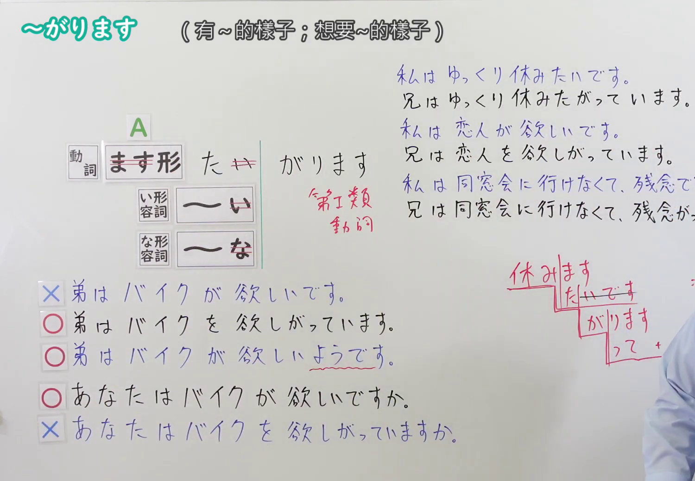
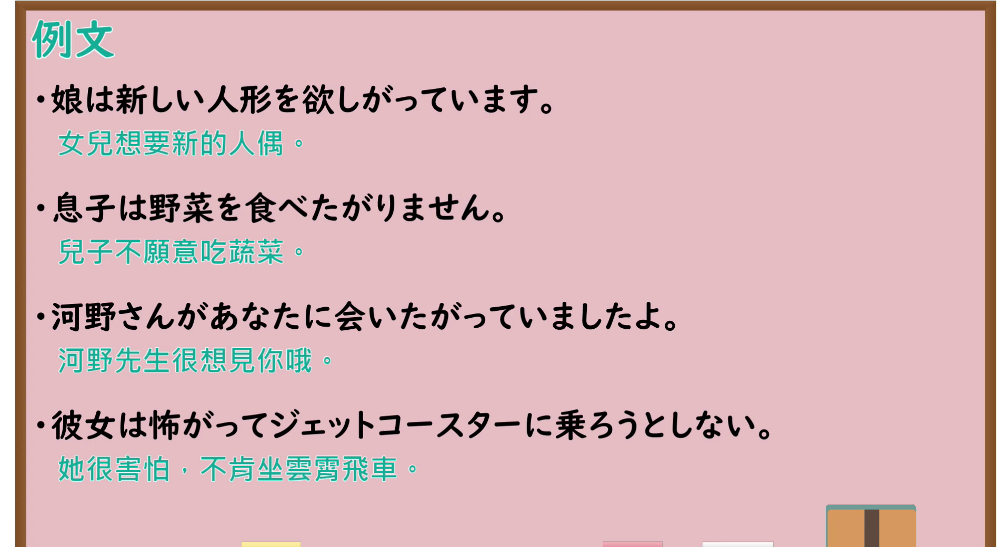

---
{
  "id": "N4-G-0059",
  "kind": "grammar",
  "level": "N4",
  "title": "～がります・～がっています(第三者の感情・欲求)（表现出……的样子）",
  "card_revision": 1,
  "schema_version": 1,
  "source": {
    "lesson": "N4 第59个语法",
    "material": "出口日語原视频板书、YouTube 原 WebVTT（中文为主、日语为辅）与Hagoromo文型检索正文",
    "video": "https://www.youtube.com/watch?v=5X2MG1StEs0",
    "screenshot": "assets/grammar/n4/N4-G-0059-connection.png",
    "screenshot_seconds": 494.4,
    "screenshot_crop": {
      "x": 0,
      "y": 0,
      "width": 1500,
      "height": 1040
    }
  },
  "tags": [
    "がります",
    "がっている",
    "第三者",
    "感情",
    "欲求",
    "たがる",
    "N4"
  ],
  "confusions": [
    "～たい",
    "～ほしい",
    "～そうだ(様態)"
  ]
}
---

# N4 第59个语法：～がります・～がっています(第三者の感情・欲求)

# 视频学习资料整理

- 课程：[出口日語「～がります・～がっています(第三者の感情・欲求)」](https://www.youtube.com/watch?v=5X2MG1StEs0)
- 视频 ID：`5X2MG1StEs0`
- 视频时长：9分50秒

## 接续图

- 实际时间：8分14.40秒（494.40秒）
- 原图尺寸：1920×1080
- 裁切区域：左上角 `(0, 0)` 至右下角 `(1500, 1040)`；选用 08:14 画面，黑板最上方完整保留「～がります (有～的樣子；想要～的樣子)」醒目标题；板书已完整书写「動詞ます形たい→たがります」「い形容詞い→がります」「な形容詞な→がります」「第一類動詞」、右侧对照「私はゆっくり休みたいです／兄はゆっくり休みたがっています／私は恋人が欲しいです／兄は恋人を欲しがっています」、下方正误对照「✕弟はバイクが欲しいです／○弟はバイクを欲しがっています／○弟はバイクが欲しいようです／○あなたはバイクが欲しいですか／✕あなたはバイクを欲しがっていますか」，老师在右侧。固定左上角 (0, 0)，裁切区域宽 1500、高 1040，去除右侧人物与边缘多余画面，充分保留顶部标题与左右规则对比板书，高度充足不缺失内容。

## 例句图

- 实际时间：8分51.48秒（531.48秒）
- 原图尺寸：1920×1080
- 裁切区域：左上角 `(0, 0)` 至右下角 `(1900, 1040)`；提取自视频 08:51 处的例句黑板页面。底色为粉灰色课程幻灯片，固定左上角 (0, 0)，裁切区域宽 1900、高 1040，去除右侧与底部多余画面，完整保留全部四条例句及中文翻译，确保底部第四条例句完整呈现。

# 核心

## 功能一：客观描述第三人称表现出的情绪、感觉或欲望（第三者情感与欲望客观化）

**最上位意味カテゴリー：**

- **Vたがる：** 考え・感情（思考与情感）
- **イAがる：** 考え・感情（思考与情感）

**中位意味カテゴリー：**

- **Vたがる：** 願望（愿望）
- **イAがる：** 願望（愿望）

**意味：**

- **Vたがる：** 第三者の希望（第三者的希望）
- **イAがる：** 第三者の感情（第三者的感情）

**くわしい意味記述：**

- **Vたがる：** 第三者の欲求を表す。話し手が直接感じ取ることのできない第三者の願望を，その人の態度や言動などの客観的な様子から推知して表現する。（表示第三人称的欲望要求。由于说话人无法直接感知第三人的内心体验，通过其举止态度等外部表现客观转述。）
- **イAがる：** 形容詞語幹につき，第三者がその感覚・感情を外に表している状態を示す動詞を作る。助詞は「が」から「を」に転換することが多い（例：欲しがる）。（接在形容词词干后，构成表示第三人称向外显露该感觉或情绪的动词。情感对象助词往往从“が”转变为“を”（如：欲しがる）。）

**派生語：** 〜がっている，〜がり，〜がらない

### 例句

1. 娘は新しい人形を欲しがっています。

   （女儿想要新的人偶。）

2. 息子は野菜を食べたがりません。

   （儿子不愿意吃蔬菜。）

3. 河野さんがあなたに会いたがっていましたよ。

   （河野先生很想见你哦。）

4. 彼女は怖がってジェットコースターに乗ろうとしない。

   （她很害怕，不肯坐云霄飞车。）

# 来源

- [出口日語原视频](https://www.youtube.com/watch?v=5X2MG1StEs0)
- [Hagoromo 文型検索「Vたがる」](https://hagoromo-text.work/lookup?vid=146)（查询日期：2026-09-25）
- [Hagoromo 文型検索「イAがる」](https://hagoromo-text.work/lookup?vid=72)（查询日期：2026-09-25）
