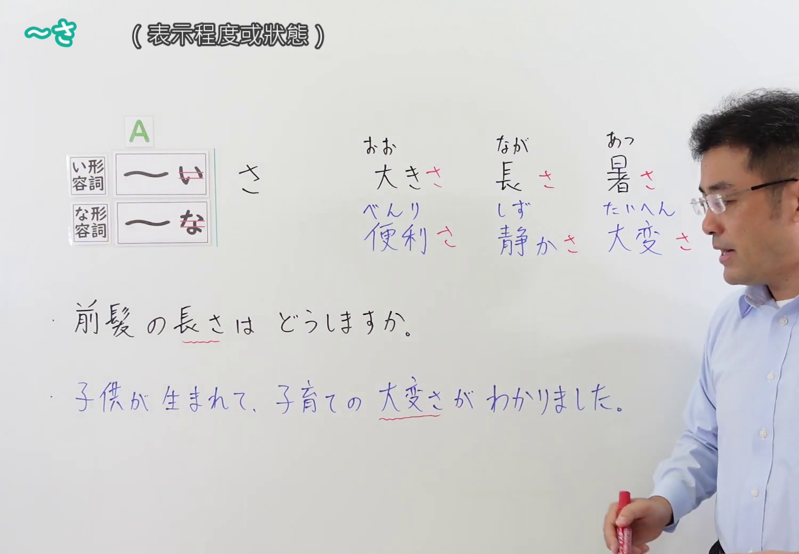
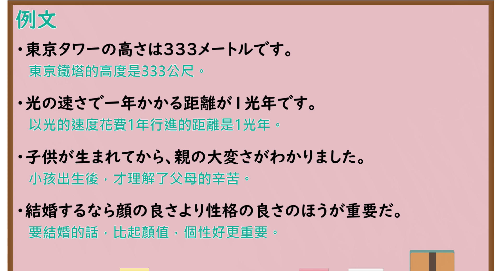

---
{
  "id": "N4-G-0060",
  "kind": "grammar",
  "level": "N4",
  "title": "～さ(名詞化)（……的程度、状态）",
  "card_revision": 1,
  "schema_version": 1,
  "source": {
    "lesson": "N4 第60个语法",
    "material": "出口日語原视频板书、YouTube 原 WebVTT（中文为主、日语为辅）与Hagoromo文型检索正文",
    "video": "https://www.youtube.com/watch?v=KQCKI5V-a4k",
    "screenshot": "assets/grammar/n4/N4-G-0060-connection.png",
    "screenshot_seconds": 184.2,
    "screenshot_crop": {
      "x": 0,
      "y": 0,
      "width": 1500,
      "height": 1040
    }
  },
  "tags": [
    "さ",
    "名詞化",
    "接尾語",
    "程度",
    "状態",
    "N4"
  ],
  "confusions": [
    "～み",
    "～こと"
  ]
}
---

# N4 第60个语法：～さ(名詞化)

# 视频学习资料整理

- 课程：[出口日語「～さ(名詞化)」](https://www.youtube.com/watch?v=KQCKI5V-a4k)
- 视频 ID：`KQCKI5V-a4k`
- 视频时长：4分40秒

## 接续图

- 实际时间：3分04.20秒（184.20秒）
- 原图尺寸：1920×1080
- 裁切区域：左上角 `(0, 0)` 至右下角 `(1500, 1040)`；选用 03:04 画面，黑板最上方完整保留「～さ (表示程度或狀態)」醒目标题；板书已完整书写「い形容詞い→さ」「な形容詞な→さ」「大きさ、長さ、暑さ／便利さ、静かさ、大変さ」、下方完整例句「前髪の長さはどうしますか。／子供が生まれて、子育ての大変さがわかりました。」，老师在右侧。固定左上角 (0, 0)，裁切区域宽 1500、高 1040，去除右侧人物与边缘多余画面，充分保留顶部标题与形容词名词化全部板书，高度充足不缺失内容。

## 例句图

- 实际时间：3分44.11秒（224.11秒）
- 原图尺寸：1920×1080
- 裁切区域：左上角 `(0, 0)` 至右下角 `(1900, 1040)`；提取自视频 03:44 处的例句黑板页面。底色为粉灰色课程幻灯片，固定左上角 (0, 0)，裁切区域宽 1900、高 1040，去除右侧与底部多余画面，完整保留全部四条例句及中文翻译，确保底部第四条例句完整呈现。

# 核心

## 功能一：将形容词转化为表示程度、深浅或状态的名词（性质状态名词化）

**最上位意味カテゴリー：**

- **イAさ：** もの・こと（事物与概念）
- **ナAさ：** もの・こと（事物与概念）

**中位意味カテゴリー：**

- **イAさ：** 文法のことば（语法范畴词）
- **ナAさ：** 文法のことば（语法范畴词）

**意味：**

- **イAさ：** 接尾語（接尾词（程度名词化））
- **ナAさ：** 接尾語（接尾词（状态名词化））

**くわしい意味記述：**

- **イAさ：** イAをNとして用いる時に使う。程度を表す名詞を作る。客観的に測定・比較可能な性質や状態の度合いを表す。（接在い形容词词干后作为名词使用。构成表示程度的名词，指客观可测定、可比较的性质或状态度量。）
- **ナAさ：** ナAをNとして用いる時に使う。その感情や状態の度合い・程度を表す名詞を派生させる。（接在那形容词词干后作为名词使用。派生出表示某种情感、状态的深浅程度或具体状态的名词。）

**派生語：** 深さ，重さ，高さ，強さ，よさ

### 例句

1. 東京タワーの高さは333メートルです。

   （东京铁塔的高度是333公尺。）

2. 光の速さで一年かかる距離が1光年です。

   （以光的速度花费1年行进的距离是1光年。）

3. 子供が生まれてから、親の大変さがわかりました。

   （小孩出生后，才理解了父母的辛苦。）

4. 結婚するなら顔の良さより性格の良さのほうが重要だ。

   （要结婚的话，比起颜值，个性好更重要。）

# 来源

- [出口日語原视频](https://www.youtube.com/watch?v=KQCKI5V-a4k)
- [Hagoromo 文型検索「Aさ」](https://hagoromo-text.work/lookup?vid=84)（查询日期：2026-09-25）
- [Hagoromo 文型検索「ナAさ」](https://hagoromo-text.work/lookup?vid=51)（查询日期：2026-09-25）
