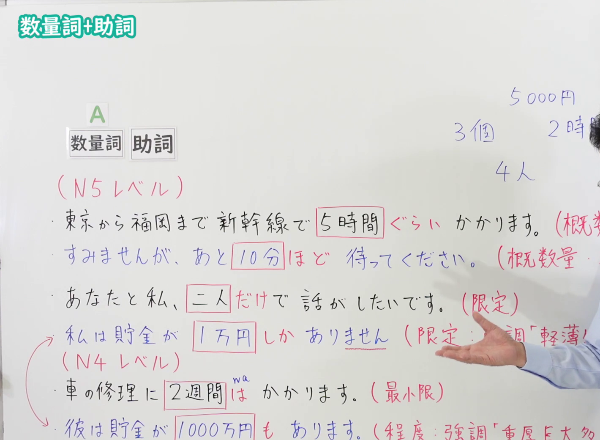
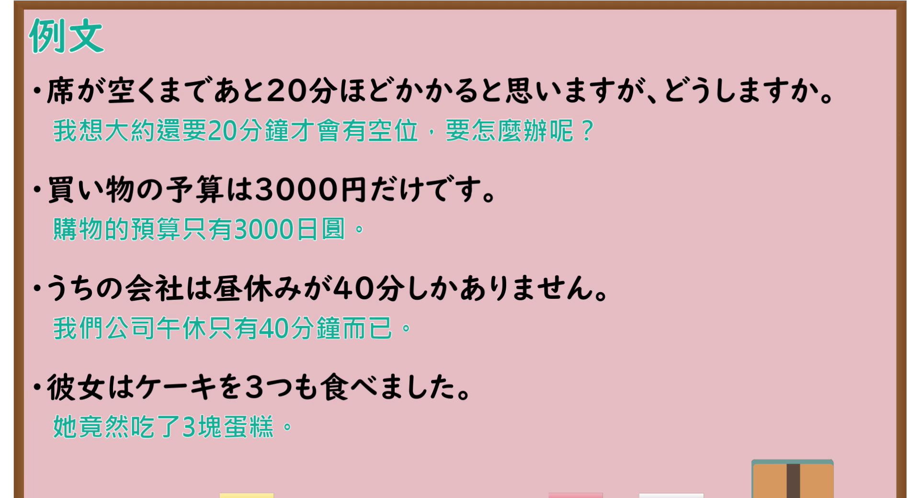

---
{
  "id": "N4-G-0061",
  "kind": "grammar",
  "level": "N4",
  "title": "数量詞＋助詞（くらい・ほど／だけ／しか～ない／は／も）（数量词与助词的组合）",
  "card_revision": 1,
  "schema_version": 1,
  "source": {
    "lesson": "N4 第61个语法",
    "material": "出口日語原视频板书、Hagoromo文型检索与日本語NET正文",
    "video": "https://www.youtube.com/watch?v=Z8DAqYMiNVU",
    "screenshot": "assets/grammar/n4/N4-G-0061-connection.png",
    "screenshot_seconds": 365.0,
    "screenshot_crop": {
      "x": 0,
      "y": 0,
      "width": 1420,
      "height": 1040
    }
  },
  "tags": [
    "数量詞＋助詞",
    "くらい",
    "ほど",
    "だけ",
    "しか～ない",
    "は",
    "も",
    "N4"
  ],
  "confusions": [
    "だけ／しか～ない",
    "くらい／ほど",
    "数量詞＋は／数量詞＋も"
  ]
}
---

# N4 第61个语法：数量詞＋助詞（くらい・ほど／だけ／しか～ない／は／も）

# 视频学习资料整理

- 课程：[出口日語「【Ｎ４文法】数量詞+助詞」](https://www.youtube.com/watch?v=Z8DAqYMiNVU)
- 视频 ID：`Z8DAqYMiNVU`
- 视频时长：8分9秒

## 接续图

- 实际时间：6分5.00秒（365.00秒）
- 原图尺寸：1920×1080
- 裁切区域：左上角 `(0, 0)` 至右下角 `(1420, 1040)`；选用 06:05 画面，板书已写出 N5 程度的「ぐらい」「ほど」「だけ」「しか…ない」与 N4 程度的「は」「も」六个例句及红字说明（概数量／限定／最小限／程度），老师侧身让出板书。固定左上角 (0, 0)，裁去右侧人物与边缘多余画面；各行行末的红字说明被画面右缘截去少许，老师右手遮挡「しか」一行的部分红字。

## 例句图

- 实际时间：6分55.76秒（415.76秒）
- 原图尺寸：1920×1080
- 裁切区域：左上角 `(0, 0)` 至右下角 `(1900, 1040)`；提取自视频 06:55 处的例句页。固定左上角 (0, 0)，去除右侧与底部多余画面，完整保留「ほど」「だけ」「しか」「も」四条例句及中文翻译。

# 核心

## 功能一：大致的数量（「ほど」语气较郑重）

**最上位意味カテゴリー：**

- **〔数量・時間〕くらい：** ものごとの様子（事物的样态）
- **〔数量詞〕＋ほど：** ものごとの様子（事物的样态）

**中位意味カテゴリー：**

- **〔数量・時間〕くらい：** 程度（程度）
- **〔数量詞〕＋ほど：** 程度（程度）

**意味：**

- **〔数量・時間〕くらい：** おおよその数量・時間（大致的数量与时间）
- **〔数量詞〕＋ほど：** 概数（概数）

**くわしい意味記述：**

- **〔数量・時間〕くらい：** 「大体」「約」という意味を表す。数量を表す表現とともに使って，大体の数を示す。「ぐらい」「ほど」「ばかり」という言い方もある。（表示“大体”“约”的意思。与表示数量的表达一起使用，表示大致的数目。也可以说“ぐらい”“ほど”“ばかり”。）
- **〔数量詞〕＋ほど：** 「大体」「約」という意味を表す。数量を表す表現とともに使って，大体の数を示す。「くらい」「ぐらい」「ばかり」という言い方もある。（表示“大体”“约”的意思。与表示数量的表达一起使用，表示大致的数目。也可以说“くらい”“ぐらい”“ばかり”。）

**派生語：** 未列出

### 例句

1. あのへやに人が三十人くらいいます。

   （那个房间里大约有三十个人。）

2. 取り調べているときからさかのぼって三回くらいの食事の状態をくわしくきくと、ほぼ見当がつくということである。

   （据说从审问时往前追溯，详细询问大约三顿饭的情况，就基本能有个判断。）

3. １時間ほど待ってください。

   （请等一个小时左右。）

4. だって、あと２０分ほどしたら、もうＰ先生、お着きになっちゃいますよ。

   （可是再过二十分钟左右，P老师就要到了啊。）

5. わたしは四十三年の夏、アメリカをぐるりと二回ほど廻るスケジュールを、一週間もかかって立ててもらった。

   （四十三年的夏天，我请人花了整整一周，为我制定了在美国绕行两圈左右的行程。）

## 功能二：限定

**最上位意味カテゴリー：**

- **だけ：** ものごとの関係（事物之间的关系）

**中位意味カテゴリー：**

- **だけ：** 限定（限定）

**意味：**

- **だけ：** 限定（限定）

**くわしい意味記述：**

- **だけ：** 「それ以外はない」という意味。範囲を限定するときに使う。（表示“除此之外没有”的意思。用于限定范围。）

**派生語：** 未列出

### 例句

1. 男の子が一人だけいます。

   （只有一个男孩。）

2. くだものだけ食べました。

   （只吃了水果。）

3. もう準備はできた。あとは結果を待つだけだ。

   （准备已经做好了，剩下的只是等待结果。）

## 功能三：限定：强调“轻、薄、短、小”（数量少）

**最上位意味カテゴリー：**

- **しか～〔否定表現〕：** 考え・感情（想法与情感）

**中位意味カテゴリー：**

- **しか～〔否定表現〕：** 主張・断定的評価（主张与断定性评价）

**意味：**

- **しか～〔否定表現〕：** 評価（评价）

**くわしい意味記述：**

- **しか～〔否定表現〕：** 「〜より他はない／しない」「〜だけ」という意味。（表示“除了……以外没有／不做”“只有……”的意思。）

**派生語：** 未列出

### 例句

1. お金が少ししかありません。

   （钱只有一点点。）

2. おいしいものしか食べません。

   （只吃好吃的东西。）

3. だけど、ポケットには三百円しかなかったんです。

   （可是口袋里只有三百日元。）

## 功能四：最低限度

**くわしい意味記述：**

- **数量 + は：** 少なくとも（至少）

### 例句

1. 昨日、あまり勉強できませんでしたが、３０分は勉強しました。

   （昨天没怎么能学习，不过至少学了三十分钟。）

2. 毎月、３冊は本を読みます。

   （我每个月至少读三本书。）

3. 歩いていくなら、３０分はかかるでしょう。バスで行くのがいいと思いますよ。

   （走路去的话，至少要三十分钟吧。我觉得坐公交车去比较好。）

4. この商品を開発するには、１,０００万円は必要です。

   （开发这个产品至少需要一千万日元。）

## 功能五：程度：强调“重、厚、长、大”（数量多）

**最上位意味カテゴリー：**

- **も：** 考え・感情（想法与情感）

**中位意味カテゴリー：**

- **も：** 軽重の強調（轻重的强调）

**意味：**

- **も：** 予想以上（超出预想）

**くわしい意味記述：**

- **も：** 数量に接続し，話し手／書き手がその数量を多いと捉えていることを表す。（接在数量后面，表示说话人或写作者认为该数量多。）

**派生語：** 未列出

### 例句

1. 彼はパンを五つも食べました。

   （他竟然吃了五个面包。）

2. 四年間も戦闘を経験しておりながら、日本軍隊の戦術は初めから終わりまですこしも変化がなかった。

   （尽管经历了长达四年的战斗，日本军队的战术从头到尾却丝毫没有变化。）

3. ほとんど各行に、二つも三つもの「・」が出てくるので、びっくりしたものです。

   （几乎每一行都出现两三个“・”，真让人吃惊。）

# 来源

- [出口日語原视频](https://www.youtube.com/watch?v=Z8DAqYMiNVU)
- [Hagoromo 文型検索「〔数量・時間〕くらい」](https://hagoromo-text.work/lookup?vid=1872)（查询日期：2026-10-15）
- [Hagoromo 文型検索「〔数量詞〕＋ほど」](https://hagoromo-text.work/lookup?vid=1875)（查询日期：2026-10-15）
- [Hagoromo 文型検索「だけ」](https://hagoromo-text.work/lookup?vid=683)（查询日期：2026-10-15）
- [Hagoromo 文型検索「しか～〔否定表現〕」](https://hagoromo-text.work/lookup?vid=575)（查询日期：2026-10-15）
- [Hagoromo 文型検索「も」](https://hagoromo-text.work/lookup?vid=1579)（查询日期：2026-10-15）
- [日本語NET「【JLPT N3】文法・例文：数量 + は」](https://nihongokyoshi-net.com/2019/08/14/jlptn3-grammar-wa/)（Hagoromo 未收录「数量＋は（最低限）」，毎日のんびり日本語教師未检索到直接对应条目；查询日期：2026-10-15）
