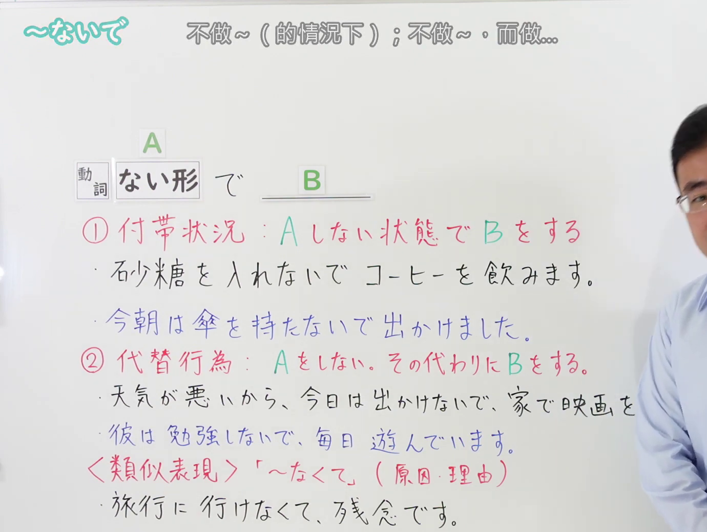
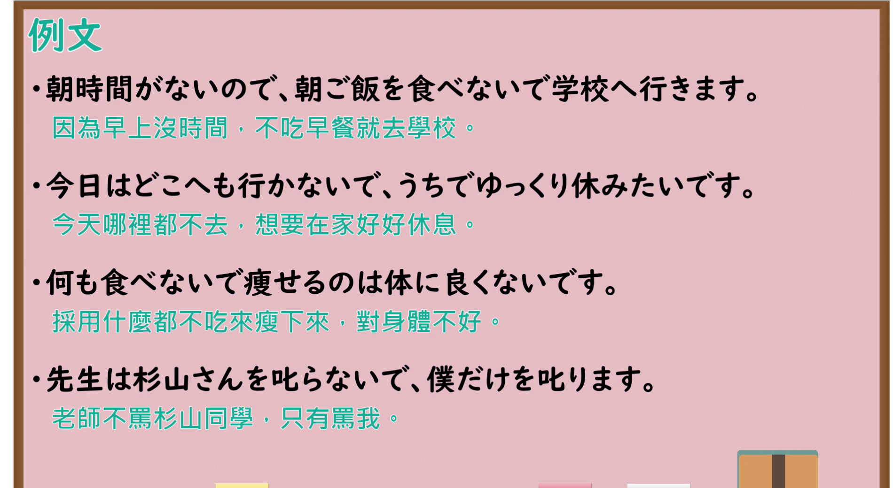

# N4-G-0062 ～ないで（附带状况・替代行为）

## 接续与说明

### 接续板书说明

- **截取时间点**：视频 3分48.90秒（228.90秒） 处。
- **画面说明**：选用 03:48 画面，黑板最上方完整保留「～ないで 不做～（的情況下）；不做～，而做...」醒目标题；板书已完整书写接续「[動詞 ない形] で B」以及清晰的 ①、② 两大核心功能分类与板书例句，老师侧身让出板书区域。固定左上角 (0, 0)，裁切区域宽 1380、高 1040，去除右侧人物与边缘多余画面，充分保留顶部标题与两大功能全部板书，高度充足不缺失内容。

### 核心接续与分组体系

- **核心接续**：`[動詞 ない形] で ＋ B`

#### 第 1 组：① 付帯状況（Aしない状態でBをする）

- **核心语意**：不做动作 A 的状态下进行后项动作 B（伴随状态）。
- **板书重点例句**：
  - 砂糖を入れないでコーヒーを飲みます。（不加糖喝咖啡。）
  - 今朝は傘を持たないで出かけました。（今早没带伞就出门了。）

#### 第 2 组：② 代替行為（Aをしない。その代わりにBをする）

- **核心语意**：放弃或不做前项动作 A，转而选择做后项动作 B（替代行为）。
- **板书重点例句**：
  - 天気が悪いから、今日は出かけないで、家で映画を見ます。（因为天气不好，今天不出门，而在家看电影。）
  - 彼は勉強しないで、毎日遊んでいます。（他不用功学习，每天光顾着玩。）

#### ＜类似表现辨析＞

- **「～なくて」（原因・理由）**：
  - 旅行に行けなくて、残念です。（没能去旅行，真遗憾。——因果关系，后项为心理感情反应，不能用「ないで」）

## 例文

### 视频核心例句（按 1、2 功能分组）

- **截取时间点**：视频 4分08.52秒（248.52秒） 处。
- **画面说明**：提取自视频 04:08 处的例句黑板页面。底色为粉灰色课程幻灯片，固定左上角 (0, 0)，裁切区域宽 1900、高 1040，去除右侧与底部多余画面，完整保留对应两大功能的全部四条例句及中文翻译，确保底部第四条例句完整呈现。

#### 第 1 组：① 付帯状況（伴随状态）

1. 朝時間がないので、朝ご飯を食べないで学校へ行きます。
   - 中文：因为早上没时间，不吃早餐就去学校。
   - 结构解析：处于“没吃早餐”的状态下去学校（Aしない状態でBする）。
2. 何も食べないで痩せるのは体に良くないです。
   - 中文：采用什么都不吃来瘦下来，对身体不好。
   - 结构解析：以“什么都不吃”的方式来减肥。

#### 第 2 组：② 代替行為（替代行为）

1. 今日はどこへも行かないで、うちでゆっくり休みたいです。
   - 中文：今天哪里都不去，想要在家好好休息。
   - 结构解析：放弃“出门”，选择“在家里好好休息”（Aをしない。その代わりにBをする）。
2. 先生は杉山さんを叱らないで、僕だけを叱ります。
   - 中文：老师不骂杉山同学，只有骂我。
   - 结构解析：老师没有做“批评杉山同学”的行为，而是选择做了“单单批评我”的行为。

## 语法解说与补充

### 核心语义与功能边界

- **第 1 组（付帯状況）**：动作主体在不具备或不进行状态/动作 A 的情况下执行动作 B，前后项动作主体相同。
- **第 2 组（代替行為）**：在两个可供选择的动作之间，否定并放弃 A，转而选择实行 B。
- **易混淆语法辨析**：
  - **对比「～なくて」**：表示原因理由或中顿消极感情（如「行けなくて、残念です」）时必须用「なくて」，不能用「ないで」；表示伴随方式与主观替代时必须用「ないで」。
  - **对比「～ずに」**：属于书面语体（硬い表現），「〜ずに」在功能上完全对应口语的「〜ないで」（付帯状況・代替行為）。

### Hagoromo 文型条目对照

- **文型名**：`Vないで，V`
  - **大分类**：ものごとの関係（事物之间的关系）
  - **中分类**：付帯状態・非付帯状態（伴随与非伴随状态）
  - **小分类**：付帯状態（付帯状況・代替行為）
  - **日文释义**：「V1をしない状態で，V2をする」という意味を表す。V1とV2の主語は同じである。また，「V1をしないで，その代わりにV2をする」という代替の選択も表す。
  - **中文释义**：表示在不进行动词1动作的状态下进行动词2的动作（伴随状态）。动词1和动词2的主语相同。亦可表示不做动词1而改为进行动词2（替代行为）。
- **派生词（派生語）**：未列出

### 考点与注意事项

1. **JLPT 考察侧重点**：
   - 牢固掌握「ないで」表示“伴随状态”和“替代行为”两大核心用法。
   - 重点考查「ないで」与「なくて」的语义边界：后项若为感情形容词（残念、嬉しい）、可能动词否定（買えない）或评价结果时，必须使用「なくて」，严禁误用「ないで」。
2. **易错陷阱与辨析**：
   - × 傘を持たなくて出かけました。 → 〇 傘を持たないで出かけました。（伴随状态应用「ないで」）
   - × 旅行に行けないで、残念です。 → 〇 旅行に行けなくて、残念です。（原因理由应用「なくて」）

### 参考资料

- 出口日語 第 62 課：[～ないで（附带状况・替代行为）](https://www.youtube.com/watch?v=RAzWgL0t7tQ)（时长：5分27秒）
- [Hagoromo 文型検索「Vないで，V」](https://hagoromo-text.work/lookup?vid=180)
