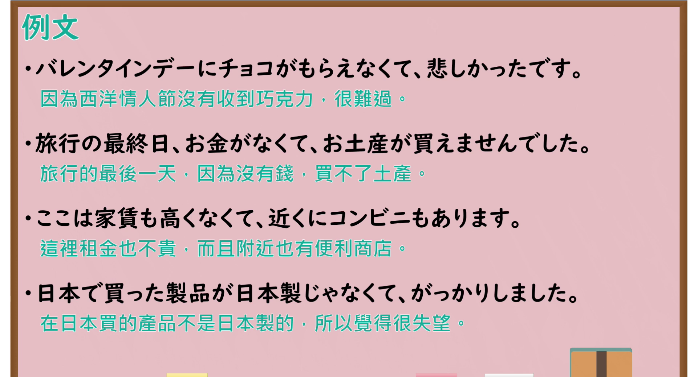

# N4-G-0063 ～なくて（否定原因・否定并述）

## 接续与说明

### 接续板书说明

- **截取时间点**：视频 5分50.36秒（350.36秒） 处。
- **画面说明**：选用 05:50 画面，黑板最上方完整保留「～なくて（原因・並述） 因為不～；不～而且」醒目标题；板书已完整书写接续「[動詞 ない形 <s>ない</s>] なくて B／[い形容詞 く<s>ない</s>] なくて B／[な形容詞 <s>じゃない</s>] ※でなくて／[名詞 <s>じゃない</s>] ※でなくて」与两大功能：「＜否定を含む原因＞ 旅行に行けなくて、残念です。 (肯定：手紙をもらってうれしいです)」「＜否定を含む並述＞ この部屋は水も出なくて、電気も使えません。 (肯定：この部屋は海も見えて、...)」「＜動詞以外＞ 昨日見た映画はおもしろくなくて、寝てしまいました。(原因)／このスーパーの魚は新鮮じゃなくて、値段も高いです。(並述)」，老师侧身让出板书区域。固定左上角 (0, 0)，裁切区域宽 1380、高 1040，去除右侧人物与边缘多余画面，充分保留顶部标题与全部板书，高度充足不缺失内容。
- **核心句型与接续要点**：
  - 语法形式优先用平假名，并在括号中标注对应汉字。

## 例文

### 视频核心例句

- **截取时间点**：视频 6分22.63秒（382.63秒） 处。
- **画面说明**：提取自视频 06:22 处的例句黑板页面。底色为粉灰色课程幻灯片，固定左上角 (0, 0)，裁切区域宽 1900、高 1040，去除右侧与底部多余画面，完整保留全部四条例句及中文翻译，确保底部第四条例句完整呈现。
- **例文列表**：
- バレンタインデーにチョコがもらえなくて、悲しかったです。
  - 中文：因为西洋情人节没有收到巧克力，很难过。
- 旅行の最終日、お金がなくて、お土産が買えませんでした。
  - 中文：旅行的最后一天，因为没有钱，买不了土产。
- ここは家賃も高くなくて、近くにコンビニもあります。
  - 中文：这里租金也不贵，而且附近也有便利商店。
- 日本で買った製品が日本製じゃなくて、がっかりしました。
  - 中文：在日本买的产品不是日本制的，所以觉得很失望。

## 语法解说与补充

### 核心语义与功能边界

- **核心功能**：因为不……而产生后续感情或结果（否定原因），或并列叙述多项否定属性（否定并述）
- **易混淆语法辨析**：重点区分 `～ないで（附带状况・替代行为）`、`～ず（硬い表現）`。

### Hagoromo 文型条目对照

- **文型名**：`Vなくて`
  - **大分类**：ものごとの関係（事物之间的关系）
  - **中分类**：原因・理由（原因・理由）
  - **小分类**：原因・理由（否定原因）
  - **日文释义**：否定の事態が原因・理由となって，後件の感情や結果が引き起こされることを表す。
  - **中文释义**：表示前项否定的事态作为原因或理由，引发后项的感情、心理状态或消极结果。
- **文型名**：`Aくて / Aじゃなくて`
  - **大分类**：ものごとの様子（事物的状态）
  - **中分类**：並述（并述）
  - **小分类**：並述（否定並述）
  - **日文释义**：動詞・形容詞・名詞の否定形を並列し，複数の否定的な属性や状態を併記する。
  - **中文释义**：并列动词、形容词或名词的否定形式，叙述多个并存的否定属性或状态。
- **派生词（派生語）**：未列出

### 考点与注意事项

1. **JLPT 考察侧重点**：牢固掌握该句型的标准接续规则与语义使用边界，注意辨析口语随意表达与正式书面表达之间的语体差异。
2. **易错陷阱与辨析**：注意助词搭配、固定呼应形式以及前后主语的一致性要求。

### 参考资料

- 出口日語 第 63 課：[～なくて（否定原因・否定并述）](https://www.youtube.com/watch?v=QTZf2KIKwLo)（时长：7分41秒）
- [Hagoromo 文型検索「Vなくて」](https://hagoromo-text.work/lookup?vid=1124)
