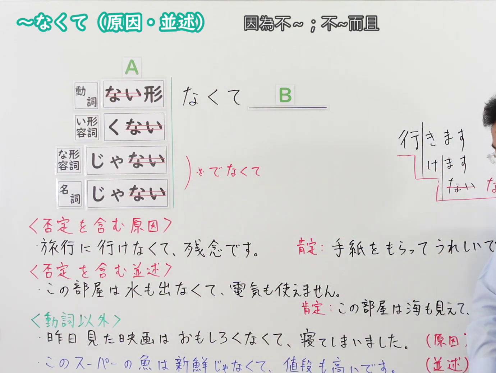

---
{
  "id": "N4-G-0063",
  "kind": "grammar",
  "level": "N4",
  "title": "～なくて（因为不……；不……而且……）",
  "card_revision": 1,
  "schema_version": 1,
  "source": {
    "lesson": "N4 第63个语法",
    "material": "出口日語原视频板书、Hagoromo文型检索与日本語教師の広場正文",
    "video": "https://www.youtube.com/watch?v=QTZf2KIKwLo",
    "screenshot": "assets/grammar/n4/N4-G-0063-connection.png",
    "screenshot_seconds": 350.36,
    "screenshot_crop": {
      "x": 0,
      "y": 0,
      "width": 1380,
      "height": 1040
    }
  },
  "tags": [
    "なくて",
    "原因・理由",
    "並述",
    "否定",
    "N4"
  ],
  "confusions": [
    "～ないで",
    "～ず（に）"
  ]
}
---

# N4 第63个语法：～なくて（原因・並述）

# 视频学习资料整理

- 课程：[出口日語「【Ｎ４文法】～なくて（原因・並述）」](https://www.youtube.com/watch?v=QTZf2KIKwLo)
- 视频 ID：`QTZf2KIKwLo`
- 视频时长：7分41秒

## 接续图

- 实际时间：5分50.36秒（350.36秒）
- 原图尺寸：1920×1080
- 裁切区域：左上角 `(0, 0)` 至右下角 `(1380, 1040)`；选用 05:50 画面，板书已写出标题「～なくて（原因・並述）　因為不～；不～而且」、接续（動詞ない形去掉「ない」、い形容詞「くない」去掉「ない」、な形容詞与名詞「じゃない」去掉「ない」，后接「なくて B」，な形容词与名词另注「でなくて」），以及〈否定を含む原因〉〈否定を含む並述〉两组红字说明和例句，〈動詞以外〉为绿字补充（原因・並述各一句）。固定左上角 (0, 0)，裁去右侧人物与边缘多余画面；右侧「肯定：…」对照句和部分括注被画面右缘截去少许。

## 例句图

- 实际时间：6分22.63秒（382.63秒）
- 原图尺寸：1920×1080
- 裁切区域：左上角 `(0, 0)` 至右下角 `(1900, 1040)`；提取自视频 06:22 处的例句页。固定左上角 (0, 0)，去除右侧与底部多余画面，完整保留四条例句及中文翻译。

# 核心

## 功能一：包含否定的原因

**最上位意味カテゴリー：**

- **なくて：** ものごとの関係（事物之间的关系）

**中位意味カテゴリー：**

- **なくて：** 原因・理由（原因与理由）

**意味：**

- **なくて：** 原因・理由（原因与理由）

**くわしい意味記述：**

- **なくて：** 〜ではない状態で。〜ではない状態だから。「なくて」の後は，安心した，助かったなど話し手の感情や評価を表す表現がよく使われる。（在不是……的状态下。因为是不……的状态。「なくて」之后，常用表示“放心了”“得救了”等说话人感情或评价的表达。）

**派生語：** 未列出

### 例句

1. 電車に乗れなくて、授業に遅れてしまった。

   （因为没能坐上电车，上课迟到了。）

2. 今日はあまり寒くなくてよかった。

   （今天不怎么冷，真好。）

3. だから今ね、全然ね、お客来なくてね、彼女ね、すごい困ってるわよ。

   （所以现在啊，客人完全不来，她可是非常为难呢。）

## 功能二：包含否定的并述

**くわしい意味記述：**

- **なくて（並列）：** 動詞否定形の「～なくて」の形は「原因・理由」、「並列」の意味機能を持ちます。※実際には「原因・理由」の用法が多く使われます。／「並列」は、「～ないで」「～なくて」両方の形で使えます。（动词否定形「～なくて」具有“原因・理由”和“并列”的意义功能。※实际上“原因・理由”的用法用得更多。／“并列”既可以用「～ないで」，也可以用「～なくて」的形式。）

### 例句

1. 今回の進級試験はトムさんが合格しなくて、ジムさんが合格した。

   （这次的升级考试，汤姆没有合格，吉姆合格了。）

> 缺口：Hagoromo、毎日のんびり日本語教師、日本語NET、Japanese Exercises 均无直接对应「否定并述」的条目，互联网检索中也只找到上面 1 个「並列」例句，未达到 3 句，不自行编造补足。

# 来源

- [出口日語原视频](https://www.youtube.com/watch?v=QTZf2KIKwLo)
- [Hagoromo 文型検索「なくて」](https://hagoromo-text.work/lookup?vid=1124)（功能一；查询日期：2026-10-15）
- [日本語教師の広場「「て形」の意味・用法／否定「～ないで・～なくて」（その6）」](https://www.tomojuku.com/blog/tekei-6/)（功能二：「くわしい意味記述」与例句；Hagoromo 与三个备选网站均无直接对应条目；查询日期：2026-10-15）
