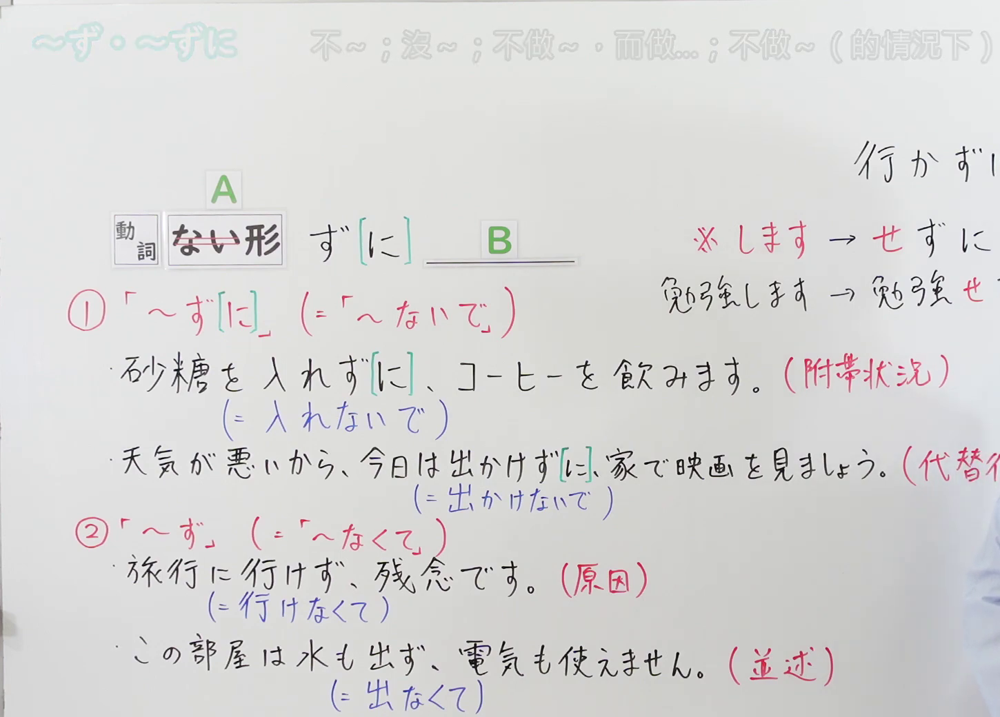
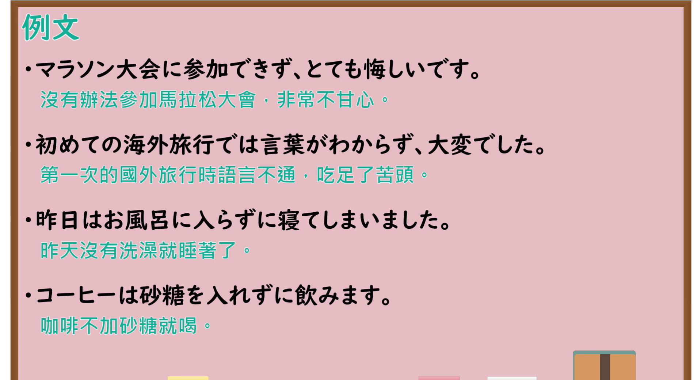

# N4-G-0064 ～ず・～ずに（书面否定附带与否定原因）

## 接续与说明

### 接续板书说明

- **截取时间点**：视频 5分50.40秒（350.40秒） 处。
- **画面说明**：选用 05:50 画面，黑板最上方完整保留「～ず・～ずに 不～；沒～；不做～，而做...；不做～（的情況下）」醒目标题；板书已完整书写接续「[動詞 ない形 <s>ない</s>] ず[に] B／※ します → せずに／勉強します → 勉強せず...」与对应分类：「①「～ず[に]」（=「～ないで」）／砂糖を入れず[に]、コーヒーを飲みます。（附帯状況）（=入れないで）／天気が悪いから、今日は出かけず[に]、家で映画を見ましょう。（代替行為）（=出かけないで）」「②「～ず」（=「～なくて」）／旅行に行けず、残念です。（原因）（=行けなくて）／この部屋は水も出ず、電気も使えません。（並述）（=出なくて）」，老师侧身让出板书区域。固定左上角 (0, 0)，裁切区域宽 1450、高 1040，去除右侧人物与边缘多余画面，充分保留顶部标题与黑板两大对应体系全部板书，高度充足不缺失内容。
- **核心句型与接续要点**：
  - 语法形式优先用平假名，并在括号中标注对应汉字。

## 例文

### 视频核心例句

- **截取时间点**：视频 6分03.54秒（363.54秒） 处。
- **画面说明**：提取自视频 06:03 处的例句黑板页面。底色为粉灰色课程幻灯片，固定左上角 (0, 0)，裁切区域宽 1900、高 1040，去除右侧与底部多余画面，完整保留全部四条例句及中文翻译，确保底部第四条例句完整呈现。
- **例文列表**：
- マラソン大会に参加できず、とても悔しいです。
  - 中文：没有办法参加马拉松大会，非常不甘心。
- 初めての海外旅行では言葉がわからず、大変でした。
  - 中文：第一次的国外旅行时语言不通，吃足了苦头。
- 昨日はお風呂に入らずに寝てしまいました。
  - 中文：昨天没有洗澡就睡着了。
- コーヒーは砂糖を入れずに飲みます。
  - 中文：咖啡不加砂糖就喝。

## 语法解说与补充

### 核心语义与功能边界

- **核心功能**：书面语中的否定伴随状态（相当于〜ないで）与否定因果/中顿并述（相当于〜なくて）
- **易混淆语法辨析**：重点区分 `～ないで`、`～なくて`。

### Hagoromo 文型条目对照

- **文型名**：`Vずに`
  - **大分类**：ものごとの関係（事物之间的关系）
  - **中分类**：付帯状態・非付帯状態（伴随与非伴随状态）
  - **小分类**：付帯状態（書面付帯）
  - **日文释义**：「V1をしないで，V2をする」という意味を表す。書き言葉。口語の「〜ないで」に相当する。
  - **中文释义**：表示在不进行动词1动作的状态下进行动词2的动作。偏向书面语，相当于口语中的「〜ないで」。（注：する→せずに）
- **文型名**：`Vず`
  - **大分类**：ものごとの関係（事物之间的关系）
  - **中分类**：原因・理由（原因・理由）
  - **小分类**：原因・理由（書面原因・中止）
  - **日文释义**：否定の中止形として原因・理由や並述を表す。口語の「〜なくて」に相当する。
  - **中文释义**：作为否定的中顿形，表示否定原因或并述。相当于口语中的「〜なくて」。（注：する→せず）
- **派生词（派生語）**：未列出

### 考点与注意事项

1. **JLPT 考察侧重点**：牢固掌握该句型的标准接续规则与语义使用边界，注意辨析口语随意表达与正式书面表达之间的语体差异。
2. **易错陷阱与辨析**：注意助词搭配、固定呼应形式以及前后主语的一致性要求。

### 参考资料

- 出口日語 第 64 課：[～ず・～ずに（书面否定附带与否定原因）](https://www.youtube.com/watch?v=so-AuWUukm8)（时长：7分18秒）
- [Hagoromo 文型検索「Vずに」](https://hagoromo-text.work/lookup?vid=598)
