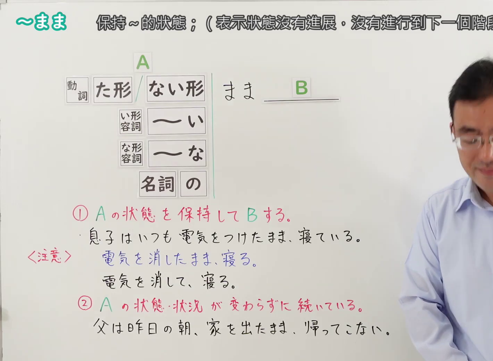
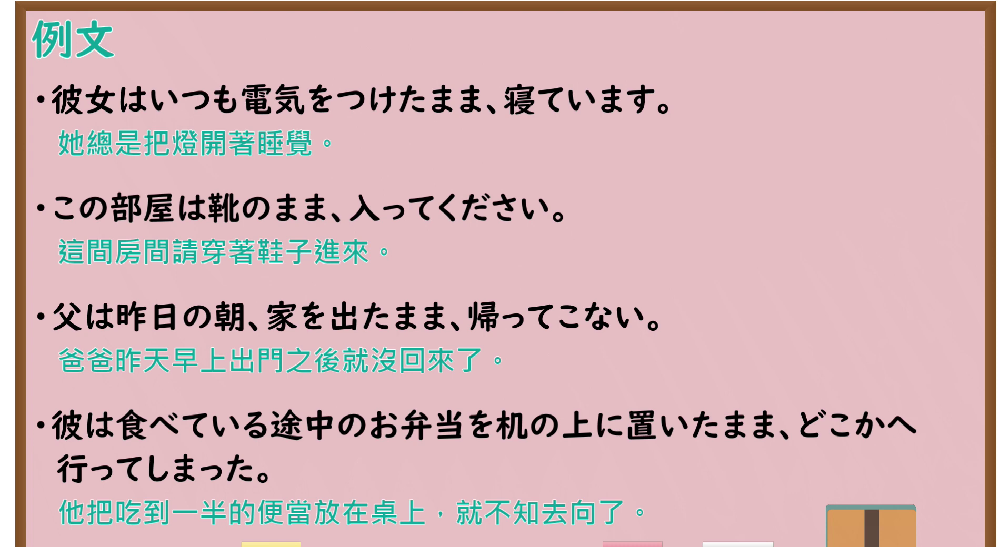

# N4-G-0065 ～まま（保持～的状态）

## 接续与说明

### 接续板书说明

- **截取时间点**：视频 0分01.00秒（1.00秒） 处。
- **画面说明**：选用 00:01 画面，黑板最上方完整保留「～まま 保持～的狀態；（表示狀態沒有進展・沒有進行到下一個階段）」醒目标题；板书已完整书写接续「[動詞 た形／ない形] まま B／[い形容詞 ～い]／[な形容詞 ～な]／[名詞 の]」与分类「① Aの状態を保持してBする。／息子はいつも電気をつけたまま、寝ている。＜注意＞ × 電気を消したまま、寝る。／〇 電気を消して、寝る。」「② Aの状態・状況が変わらずに続いている。／父は昨日の朝、家を出たまま、帰ってこない。」，老师侧身让出板书区域。固定左上角 (0, 0)，裁切区域宽 1420、高 1040，去除右侧人物与边缘多余画面，充分保留顶部大标题与全部板书，高度充足不缺失内容。
- **核心句型与接续要点**：
  - 语法形式优先用平假名，并在括号中标注对应汉字。

## 例文

### 视频核心例句

- **截取时间点**：视频 3分37.15秒（217.15秒） 处。
- **画面说明**：提取自视频 03:37 处的例句黑板页面。底色为粉灰色课程幻灯片，固定左上角 (0, 0)，裁切区域宽 1900、高 1040，去除右侧与底部多余画面，完整保留全部四条例句及中文翻译，确保底部第四条例句完整呈现。
- **例文列表**：
- 彼女はいつも電気をつけたまま、寝ています。
  - 中文：她总是把灯开着睡觉。
- この部屋は靴のまま、入ってください。
  - 中文：这间房间请穿着鞋子进来。
- 父は昨日の朝、家を出たまま、帰ってこない。
  - 中文：爸爸昨天早上出门之后就没回来了。
- 彼は食べている途中のお弁当を机の上に置いたまま、どこかへ行ってしまった。
  - 中文：他把吃到一半的便当放在桌上，就不知去向了。

## 语法解说与补充

### 核心语义与功能边界

- **核心功能**：保持前项状态不进行改变去做后项（状态保持），或状态停滞没有进展（持续不变）
- **易混淆语法辨析**：重点区分 `～っぱなし（放任不管）`、`～て（自然动作接续）`。

### Hagoromo 文型条目对照

- **文型名**：`Vたまま`
  - **大分类**：ものごとの様子（事物的状态）
  - **中分类**：様子・状態（状态与样子）
  - **小分类**：状態（状態保持）
  - **日文释义**：「前に行った動作や起きた事態の結果の状態をそのまま保ちながら，次の行為を行う」または「その状態がそのまま続いている」ことを表す。
  - **中文释义**：表示保持之前行为或事态发生后的状态不变，继续进行下一个行为；或者该状态一直持续没有变化。
- **文型名**：`Vないまま`
  - **大分类**：ものごとの様子（事物的状态）
  - **中分类**：様子・状態（状态与样子）
  - **小分类**：状態（非実現状態維持）
  - **日文释义**：「ある行為をしない状態のまま，次の動作を行う」ことを表す。
  - **中文释义**：表示在未做某动作的状态下，继续进行后续动作。
- **派生词（派生語）**：未列出

### 考点与注意事项

1. **JLPT 考察侧重点**：牢固掌握该句型的标准接续规则与语义使用边界，注意辨析口语随意表达与正式书面表达之间的语体差异。
2. **易错陷阱与辨析**：注意助词搭配、固定呼应形式以及前后主语的一致性要求。

### 参考资料

- 出口日語 第 65 課：[～まま（保持～的状态）](https://www.youtube.com/watch?v=hwxT5UUIJ-I)（时长：4分50秒）
- [Hagoromo 文型検索「Vたまま」](https://hagoromo-text.work/lookup?vid=1550)
- [Hagoromo 文型検索「Vないまま」](https://hagoromo-text.work/lookup?vid=1551)
