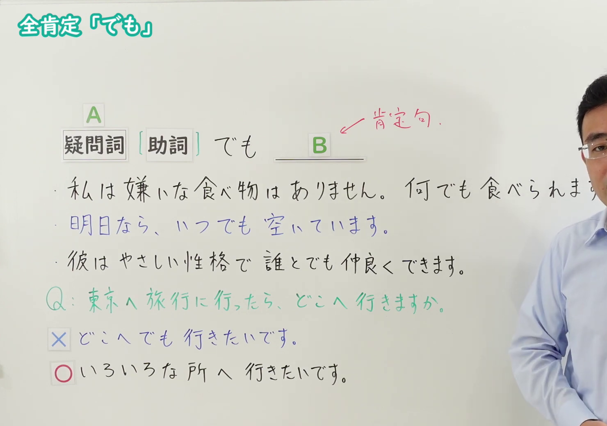

---
{
  "id": "N4-G-0066",
  "kind": "grammar",
  "level": "N4",
  "title": "疑問詞＋でも（全面肯定）",
  "card_revision": 1,
  "schema_version": 1,
  "source": {
    "lesson": "N4 第66个语法",
    "material": "出口日語原视频板书与Hagoromo文型检索正文",
    "video": "https://www.youtube.com/watch?v=V0ZTYnWlHOg",
    "screenshot": "assets/grammar/n4/N4-G-0066-connection.png",
    "screenshot_seconds": 219.8,
    "screenshot_crop": {
      "x": 0,
      "y": 0,
      "width": 1480,
      "height": 1040
    }
  },
  "tags": [
    "疑問詞＋でも",
    "全面肯定",
    "いつでも",
    "どこでも",
    "だれでも",
    "何でも",
    "N4"
  ],
  "confusions": [
    "疑問詞＋も＋否定（全否定）",
    "疑問詞＋か"
  ]
}
---

# N4 第66个语法：疑問詞＋でも（全肯定）

# 视频学习资料整理

- 课程：[出口日語「【Ｎ４文法】助詞：全肯定「でも」」](https://www.youtube.com/watch?v=V0ZTYnWlHOg)
- 视频 ID：`V0ZTYnWlHOg`
- 视频时长：5分14秒

## 接续图

- 实际时间：3分39.80秒（219.80秒）
- 原图尺寸：1920×1080
- 裁切区域：左上角 `(0, 0)` 至右下角 `(1480, 1040)`；选用 03:39 画面，板书已写出标题「全肯定「でも」」、接续「疑問詞［助詞］でも B」（红字箭头注明 B 为肯定句），三句讲解例句（何でも／いつでも／誰とでも），以及绿字问答「Q：東京へ旅行に行ったら、どこへ行きますか。」与「×どこへでも行きたいです。」「○いろいろな所へ行きたいです。」。板书上没有红字功能分项，视为一个功能。固定左上角 (0, 0)，裁去右侧多余画面；第一句例句句末「す」被画面右缘截去，老师位于右侧。

## 例句图

- 实际时间：3分55.12秒（235.12秒）
- 原图尺寸：1920×1080
- 裁切区域：左上角 `(0, 0)` 至右下角 `(1900, 1040)`；提取自视频 03:55 处的例句页。固定左上角 (0, 0)，去除右侧与底部多余画面，完整保留四条例句及中文翻译。

# 核心

## 功能一：全面肯定（疑问词＋でも，后接肯定句）

**最上位意味カテゴリー：**

- **〔疑問詞〕でも：** ものごとの関係（事物之间的关系）
- **いつ〔格助詞〕でも：** ものごとの関係（事物之间的关系）
- **だれ〔格助詞〕でも：** ものごとの関係（事物之间的关系）
- **どこ〔格助詞〕でも：** ものごとの関係（事物之间的关系）

**中位意味カテゴリー：**

- **〔疑問詞〕でも：** 逆接・譲歩（逆接与让步）
- **いつ〔格助詞〕でも：** 逆接・譲歩（逆接与让步）
- **だれ〔格助詞〕でも：** 逆接・譲歩（逆接与让步）
- **どこ〔格助詞〕でも：** 逆接・譲歩（逆接与让步）

**意味：**

- **〔疑問詞〕でも：** 全面的肯定（全面肯定）
- **いつ〔格助詞〕でも：** 範囲（范围）
- **だれ〔格助詞〕でも：** 範囲（范围）
- **どこ〔格助詞〕でも：** 範囲（范围）

**くわしい意味記述：**

- **〔疑問詞〕でも：** 疑問詞の部分にどんな要素を当てはめても，「〜ても…」の「…」が成立するということを表す。（表示无论把什么要素代入疑问词的位置，「〜ても…」中的“…”都成立。）
- **いつ〔格助詞〕でも：** 「いつからでも」「いつまででも」といった使い方で，時と関係する格助詞とともに使われる。「いつからでも」は「いつでも」，「いつまででも」は「ずっと」と同じ意味を表す。（与「いつからでも」「いつまででも」等表示时间的格助词一起使用。「いつからでも」与「いつでも」意思相同，「いつまででも」与「ずっと」意思相同。）
- **だれ〔格助詞〕でも：** 「だれとでも」「だれにでも」「だれからでも」「だれでも」といった使い方で，「どんな人でも」の意味を表す。（用于「だれとでも」「だれにでも」「だれからでも」「だれでも」等说法，表示“无论什么人”。）
- **どこ〔格助詞〕でも：** 「どこででも」「どこへでも」「どこにでも」「どこからでも」「どこまででも」といった使い方で，場所・方向と関係する格助詞とともに使われる。「どんなところでも」の意味を表す。（用于「どこででも」「どこへでも」「どこにでも」「どこからでも」「どこまででも」等说法，与表示场所、方向的格助词一起使用，表示“无论什么地方”。）

**派生語：** 未列出

### 例句

1. あの人は何でも知っています。

   （那个人什么都知道。）

2. そのお土産は、どこでも買えます。

   （那种特产在哪里都能买到。）

3. 用意ができましたから、いつからでも始められます。

   （准备已经好了，所以从什么时候开始都可以。）

4. あの子はいい子だから、だれとでも友だちになれます。

   （那孩子人很好，所以跟谁都能成为朋友。）

5. その本は有名だから、どこででも買えますよ。

   （那本书很有名，所以在哪里都能买到哦。）

# 来源

- [出口日語原视频](https://www.youtube.com/watch?v=V0ZTYnWlHOg)
- [Hagoromo 文型検索「〔疑問詞〕でも」](https://hagoromo-text.work/lookup?vid=1851)（查询日期：2026-10-15）
- [Hagoromo 文型検索「いつ〔格助詞〕でも」](https://hagoromo-text.work/lookup?vid=1923)（查询日期：2026-10-15）
- [Hagoromo 文型検索「だれ〔格助詞〕でも」](https://hagoromo-text.work/lookup?vid=1945)（查询日期：2026-10-15）
- [Hagoromo 文型検索「どこ〔格助詞〕でも」](https://hagoromo-text.work/lookup?vid=1953)（查询日期：2026-10-15）
