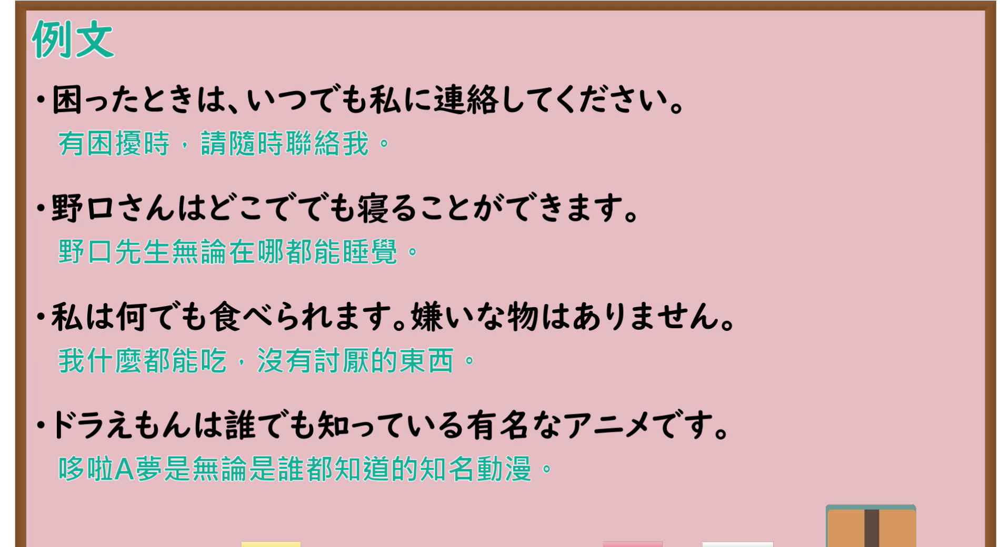

# N4-G-0066 疑問詞＋でも（全肯定）

## 接续与说明

### 接续板书说明

- **截取时间点**：视频 3分39.80秒（219.80秒） 处。
- **画面说明**：选用 03:39 画面，黑板最上方完整保留「全肯定「でも」」醒目标题；板书已完整书写接续「疑問詞 [助詞] でも B (← 肯定句)」与讲解例句：「・私は嫌いな食べ物はありません。何でも食べられます。／・明日なら、いつでも空いています。／・彼はやさしい性格で誰とでも仲良くできます。」「Q: 東京へ旅行に行ったら、どこへ行きますか。／× どこへでも行きたいです。／〇 いろいろな所へ行きたいです。」，老师侧身让出板书区域。固定左上角 (0, 0)，裁切区域宽 1480、高 1040，去除右侧人物与边缘多余画面，充分保留顶部标题与全部黑板文字及对错问答提示，高度充足不缺失内容。
- **核心句型与接续要点**：
  - 语法形式优先用平假名，并在括号中标注对应汉字。

## 例文

### 视频核心例句

- **截取时间点**：视频 3分55.12秒（235.12秒） 处。
- **画面说明**：提取自视频 03:55 处的例句黑板页面。底色为粉灰色课程幻灯片，固定左上角 (0, 0)，裁切区域宽 1900、高 1040，去除右侧与底部多余画面，完整保留全部四条例句及中文翻译，确保底部第四条例句完整呈现。
- **例文列表**：
- 困ったときは、いつでも私に連絡してください。
  - 中文：有困扰时，请随时联络我。
- 野口さんはどこででも寝ることができます。
  - 中文：野口先生无论在哪都能睡觉。
- 私は何でも食べられます。嫌いな物はありません。
  - 中文：我什么都能吃，没有讨厌的东西。
- ドラえもんは誰でも知っている有名なアニメです。
  - 中文：哆啦A梦是无论是谁都知道的知名动漫。

## 语法解说与补充

### 核心语义与功能边界

- **核心功能**：接在疑问词后表达无条件全盘肯定（全肯定），后续必定搭配肯定句
- **易混淆语法辨析**：重点区分 `疑問詞＋も＋否定（全否定）`、`どこへでも vs いろいろな所`。

### Hagoromo 文型条目对照

- **文型名**：`疑問詞＋でも`
  - **大分类**：人との関係（人与人的关系）
  - **中分类**：取り立て（焦点强调）
  - **小分类**：全面肯定（全肯定）
  - **日文释义**：疑問詞につき，すべてに当てはまることを表す（全面肯定）。後件には肯定表現を伴う。
  - **中文释义**：接在疑问词后面，表示对所有情况无条件全部适用（全肯定）。后续句必须搭配肯定表达。
- **派生词（派生語）**：未列出

### 考点与注意事项

1. **JLPT 考察侧重点**：牢固掌握该句型的标准接续规则与语义使用边界，注意辨析口语随意表达与正式书面表达之间的语体差异。
2. **易错陷阱与辨析**：注意助词搭配、固定呼应形式以及前后主语的一致性要求。

### 参考资料

- 出口日語 第 66 課：[疑問詞＋でも（全肯定）](https://www.youtube.com/watch?v=V0ZTYnWlHOg)（时长：5分14秒）
- [Hagoromo 文型検索「疑問詞＋でも」](https://hagoromo-text.work/lookup?vid=648)
