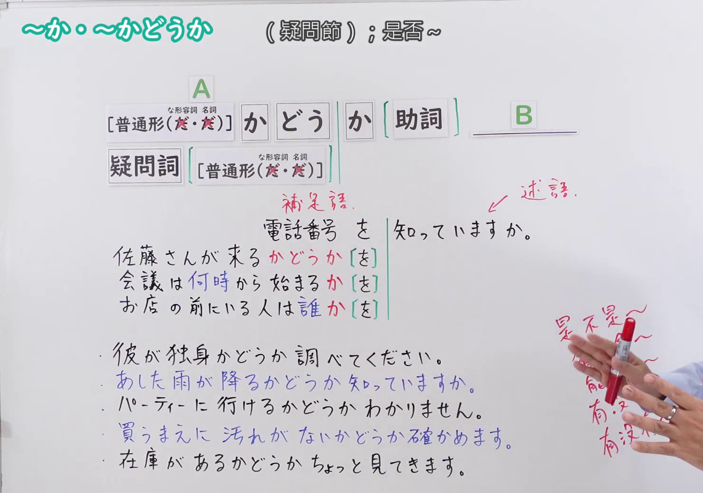
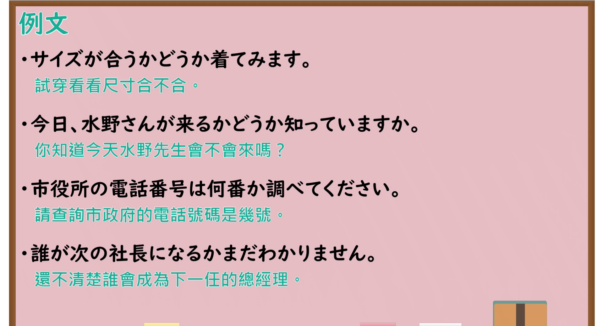

# N4-G-0067 ～か・～かどうか（疑问从句）

## 接续与说明

### 接续板书说明

- **截取时间点**：视频 8分00.00秒（480.00秒） 处。
- **画面说明**：选用 08:00 画面，黑板最上方完整保留「～か・～かどうか （疑問節）：是否～」醒目标题；板书已完整书写接续「[普通形(<s>だ</s>・<s>だ</s>)] か どう か [助詞] B／疑問詞 [普通形(<s>だ</s>・<s>だ</s>)] か」与结构分类「補足語／述語」「電話番号 を 知っていますか。／佐藤さんが来る かどうか [を]／会議は何時から始まる か [を]／お店の前にいる人は誰 か [を]」「・彼が独身かどうか調べてください。／・あした雨が降るかどうか知っていますか。／・パーティーに行けるかどうか わかりません。／・買うまえに汚れがないかどうか確かめます。／・在庫があるかどうか ちょっと見てきます。」，老师侧身让出板书区域。固定左上角 (0, 0)，裁切区域宽 1480、高 1040，去除右侧人物与边缘多余画面，充分保留顶部标题与全部黑板从句对比，高度充足不缺失内容。
- **核心句型与接续要点**：
  - 语法形式优先用平假名，并在括号中标注对应汉字。

## 例文

### 视频核心例句

- **截取时间点**：视频 8分18.80秒（498.80秒） 处。
- **画面说明**：提取自视频 08:18 处的例句黑板页面。底色为粉灰色课程幻灯片，固定左上角 (0, 0)，裁切区域宽 1900、高 1040，去除右侧与底部多余画面，完整保留全部四条例句及中文翻译，确保底部第四条例句完整呈现。
- **例文列表**：
- サイズが合うかどうか着てみます。
  - 中文：试穿看看尺寸合不合。
- 今日、水野さんが来るかどうか知っていますか。
  - 中文：你知道今天水野先生会不会来吗？
- 市役所の電話番号は何番か調べてください。
  - 中文：请查询市政府的电话号码是几号。
- 誰が次の社長になるかまだわかりません。
  - 中文：还不清楚谁会成为下一任的总经理。

## 语法解说与补充

### 核心语义与功能边界

- **核心功能**：将不含疑问词的“是否”问题（〜かどうか）或含疑问词的问题（疑問詞＋〜か）嵌入复合句作为宾语从句
- **易混淆语法辨析**：重点区分 `名詞/な形容詞＋だ（絶対不可加だ）`、`～か〜か（二者择一）`。

### Hagoromo 文型条目对照

- **文型名**：`かどうか`
  - **大分类**：文・節の構成（句子与分句结构）
  - **中分类**：埋め込み節（嵌套分句）
  - **小分类**：引用・疑問（間接疑問節）
  - **日文释义**：「〜であるか，そうでないか」という二者択一の疑問文を主文の中に組み込んで補足語（目的語など）とする。
  - **中文释义**：将“是……还是并非如此”的二选一疑问句嵌入主句中，充当补足语（宾语等从句）。（注：名词与な形容词普通形去「だ」）
- **文型名**：`疑問詞＋か`
  - **大分类**：文・節の構成（句子与分句结构）
  - **中分类**：埋め込み節（嵌套分句）
  - **小分类**：引用・疑問（疑問詞節）
  - **日文释义**：疑問詞を含む疑問文を節として主文の中に組み込む。
  - **中文释义**：将包含疑问词的疑问句作为分句嵌入主句中。
- **派生词（派生語）**：未列出

### 考点与注意事项

1. **JLPT 考察侧重点**：牢固掌握该句型的标准接续规则与语义使用边界，注意辨析口语随意表达与正式书面表达之间的语体差异。
2. **易错陷阱与辨析**：注意助词搭配、固定呼应形式以及前后主语的一致性要求。

### 参考资料

- 出口日語 第 67 課：[～か・～かどうか（疑问从句）](https://www.youtube.com/watch?v=1gQ-7aAebVE)（时长：9分40秒）
- [Hagoromo 文型検索「かどうか」](https://hagoromo-text.work/lookup?vid=390)
