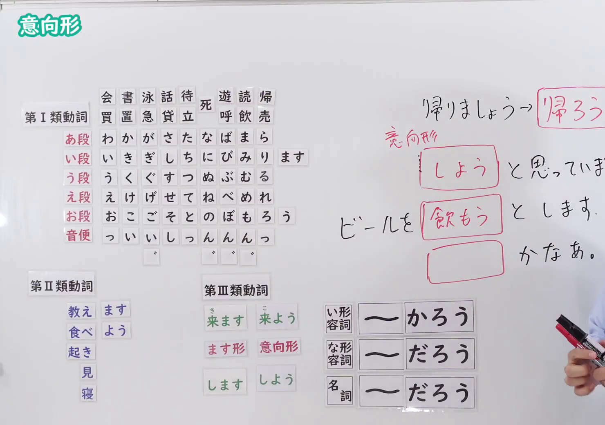

# N4-G-0068 意向形（動詞の活用、意志提議「〜（よ）う」）

## 接续与说明

### 接续板书说明

- **截取时间点**：视频 13分25.35秒（805.35秒） 处。
- **画面说明**：选用 13:25 画面，黑板最上方完整保留「意向形」醒目标题；板书已完整书写动词意向形活用系统：第Ⅰ類（あ・い・う・え・お段+う：買おう・書こう・泳ごう・話そう・待とう・死のう・遊ぼう・読もう・帰ろう）、第Ⅱ類（教えよう・食べよう・起きよう・見よう・寝よう）、第Ⅲ類（来ます→来よう[こよう]、します→しよう）；右侧书写句型扩展「帰りましょう→帰ろう」「意向形 [しよう] と思っています」「ビールを [飲もう] とします」「[行こう] かなあ」以及右下形容词推量「い形容詞 ～かろう／な形容詞 ～だろう／名詞 ～だろう」，老师侧身让出板书区域。固定左上角 (0, 0)，裁切区域宽 1480、高 1040，去除右侧边缘多余画面，充分保留顶部标题与五十音活用板书，高度充足不缺失内容。
- **核心句型与接续要点**：
  - 语法形式优先用平假名，并在括号中标注对应汉字。

## 例文

### 视频核心例句

- **截取时间点**：视频 14分32.16秒（872.16秒） 处。
- **画面说明**：提取自视频 14:32 处的例句黑板页面。底色为粉灰色课程幻灯片，固定左上角 (0, 0)，裁切区域宽 1900、高 1040，去除右侧与底部多余画面，完整保留全部四条例句及中文翻译，确保底部第四条例句完整呈现。
- **例文列表**：
- 今日は寒いから、鍋料理を食べよう。
  - 中文：因为今天很冷，吃火锅吧！
- ゴールデンウィークはどこへ行こうかなあ。
  - 中文：黄金周要去哪里好呢～
- ４月から料理教室に通おうと思っています。
  - 中文：我一直在打算从4月开始去上烹饪课。
- 椅子に座ろうとして転んでしまいました。
  - 中文：正要坐椅子的时候跌倒了。

## 语法解说与补充

### 核心语义与功能边界

- **核心功能**：动词活用之意向形，表示普通体劝诱（〜しよう）、个人打算（〜ようと思う）或正要动作（〜ようとする）
- **易混淆语法辨析**：重点区分 `〜ようと思う（即时意志） vs 〜ようと思っている（长期打算）`、`〜ようとする（即将做某事/试图做）`。

### Hagoromo 文型条目对照

- **文型名**：`Vよう`
  - **大分类**：考え・感情（思考与情感）
  - **中分类**：意志（意志）
  - **小分类**：意志（意志・勧誘）
  - **日文释义**：話者の意志を表す。また，相手を誘う表現（〜ましょう）の普通体（くだけた言い方）として用いられる。
  - **中文释义**：表示说话者的意志；亦用作劝诱对方（〜ましょう）的普通体形式（口语随意说法）。
- **文型名**：`Vようと思う / 思っている`
  - **大分类**：考え・感情（思考与情感）
  - **中分类**：意志（意志）
  - **小分类**：計画（意志打算）
  - **日文释义**：「〜しようと考えている」という話者の意志やこれからの計画を表す。
  - **中文释义**：表示说话者“打算做某事”的意志或后续计划。
- **文型名**：`Vようとする`
  - **大分类**：ものごとの変化（事物的变化）
  - **中分类**：局面（动作阶段）
  - **小分类**：直前・試み（直前・試み）
  - **日文释义**：ある行為を行おうとする直前の段階，または試みる様子を表す。
  - **中文释义**：表示正要进行某动作的临界阶段，或试图努力做某事的样子。
- **派生词（派生語）**：未列出

### 考点与注意事项

1. **JLPT 考察侧重点**：牢固掌握该句型的标准接续规则与语义使用边界，注意辨析口语随意表达与正式书面表达之间的语体差异。
2. **易错陷阱与辨析**：注意助词搭配、固定呼应形式以及前后主语的一致性要求。

### 参考资料

- 出口日語 第 68 課：[意向形（動詞の活用、意志提議「〜（よ）う」）](https://www.youtube.com/watch?v=F4zxtpkCQ3A)（时长：15分48秒）
- [Hagoromo 文型検索「Vよう」](https://hagoromo-text.work/lookup?vid=603)
- [Hagoromo 文型検索「Vようと思う」](https://hagoromo-text.work/lookup?vid=204)
- [Hagoromo 文型検索「Vようとする」](https://hagoromo-text.work/lookup?vid=203)
