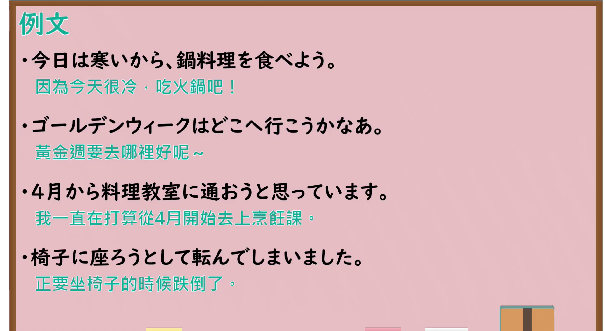

---
{
  "id": "N4-G-0068",
  "kind": "grammar",
  "level": "N4",
  "title": "意向形（～（よ）う）",
  "card_revision": 1,
  "schema_version": 1,
  "source": {
    "lesson": "N4 第68个语法",
    "material": "出口日語原视频板书与Hagoromo文型检索正文",
    "video": "https://www.youtube.com/watch?v=F4zxtpkCQ3A",
    "screenshot": "assets/grammar/n4/N4-G-0068-connection.png",
    "screenshot_seconds": 805.35,
    "screenshot_crop": {
      "x": 0,
      "y": 0,
      "width": 1480,
      "height": 1040
    }
  },
  "tags": [
    "意向形",
    "よう",
    "意志",
    "勧誘",
    "N4"
  ],
  "confusions": [
    "～ましょう"
  ]
}
---

# N4 第68个语法：意向形

# 视频学习资料整理

- 课程：[出口日語「【Ｎ４文法】意向形」](https://www.youtube.com/watch?v=F4zxtpkCQ3A)
- 视频 ID：`F4zxtpkCQ3A`
- 视频时长：15分48秒

## 接续图

- 实际时间：13分25.35秒（805.35秒）
- 原图尺寸：1920×1080
- 裁切区域：左上角 `(0, 0)` 至右下角 `(1480, 1040)`；选用 13:25 画面，板书已写出标题「意向形」、动词三类的意向形变化表（第Ⅰ类按あ・い・う・え・お段与音便排列，第Ⅱ类「教えよう・食べよう・起きよう・見よう・寝よう」，第Ⅲ类「来よう」「しよう」）、「帰りましょう→帰ろう」，红字「意向形」下的红框用法「［しよう］と思っています」「ビールを［飲もう］とします」「［　］かなあ。」，以及形容词推量「い形容詞～かろう／な形容詞・名詞～だろう」。本课介绍意向形本身，板书上没有红字功能分项，视为一个功能；「と思っています」「とします」「かなあ」是意向形的接续示例，不另立功能。固定左上角 (0, 0)，裁去右侧多余画面；右侧「帰ろう」「思っていま」等被画面右缘截去少许，老师持笔位于右下角。

## 例句图

- 实际时间：14分32.16秒（872.16秒）
- 原图尺寸：1920×1080
- 裁切区域：左上角 `(0, 0)` 至右下角 `(1900, 1040)`；提取自视频 14:32 处的例句页。固定左上角 (0, 0)，去除右侧与底部多余画面，完整保留四条例句及中文翻译。

# 核心

## 功能一：意向形：表示意志与劝诱（「帰りましょう」→「帰ろう」）

**最上位意味カテゴリー：**

- **Vよう（意志）：** 考え・感情（想法与情感）
- **Vよう（勧誘）：** 人との関係（人际关系）

**中位意味カテゴリー：**

- **Vよう（意志）：** 意志（意志）
- **Vよう（勧誘）：** 勧誘・申し出・助言（劝诱、提议与建议）

**意味：**

- **Vよう（意志）：** 意志（意志）
- **Vよう（勧誘）：** 勧誘（劝诱）

**くわしい意味記述：**

- **Vよう（意志）：** 話し手がVをすることを決めたという話し手の意志を表す。（表示说话人已决定做 V 的意志。）
- **Vよう（勧誘）：** 話し手がVをすることを決めたという話し手の意志を表す。（表示说话人已决定做 V 的意志。）

**派生語：** 未列出

### 例句

1. 疲れたから、今日は早く寝よう。

   （累了，今天早点睡吧。）

2. お酒2本もらおう。コップは2つね。

   （来两瓶酒吧。杯子要两个哦。）

3. ちょっと休もうよ。

   （稍微休息一下吧。）

4. みんな旅行でも行きたいね。温泉行こうよー。

   （大家都想去旅行呢。去泡温泉吧！）

# 来源

- [出口日語原视频](https://www.youtube.com/watch?v=F4zxtpkCQ3A)
- [Hagoromo 文型検索「Vよう（意志）」](https://hagoromo-text.work/lookup?vid=1663)（查询日期：2026-10-15）
- [Hagoromo 文型検索「Vよう（勧誘）」](https://hagoromo-text.work/lookup?vid=1664)（查询日期：2026-10-15）
