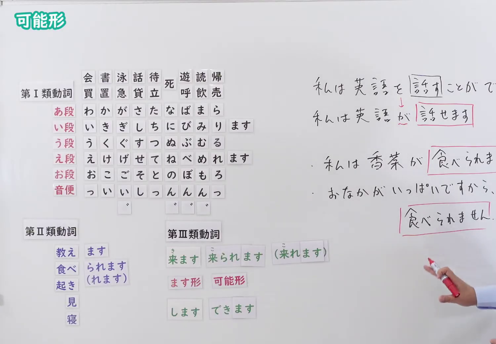

# N4-G-0069 可能形（動詞の活用、能力・状況可能「〜（ら）れる」）

## 接续与说明

### 接续板书说明

- **截取时间点**：视频 10分00.00秒（600.00秒） 处。
- **画面说明**：选用 10:00 画面，黑板最上方完整保留「可能形」醒目标题；板书已完整书写可能形活用规则：第Ⅰ類（え段＋ます：買えます・書けます・泳げます・話せます・待てます・死ねます・遊べます・読めます・帰れます）、第Ⅱ類（教えられます・食べられます・起きられます・見られます・寝られます [口語：れます]）、第Ⅲ類（来ます→来られます[こられます／口語：これます]、します→できます）；右侧书写助词转换与典型例句「私は英語を話すことができます ↓ 私は英語が話せます」「私は香菜が食べられません」「おなかがいっぱいですから、食べられません」，老师侧身让出板书区域。固定左上角 (0, 0)，裁切区域宽 1500、高 1040，去除右侧边缘多余画面，充分保留顶部标题与全部黑板板书，高度充足不缺失内容。
- **核心句型与接续要点**：
  - 语法形式优先用平假名，并在括号中标注对应汉字。

## 例文

### 视频核心例句

- **截取时间点**：视频 11分14.36秒（674.36秒） 处。
- **画面说明**：提取自视频 11:14 处的例句黑板页面。底色为粉灰色课程幻灯片，固定左上角 (0, 0)，裁切区域宽 1900、高 1040，去除右侧与底部多余画面，完整保留全部四条例句及中文翻译，确保底部第四条例句完整呈现。
- **例文列表**：
- 私の兄は英語と中国語が話せます。
  - 中文：我哥哥会说英文和中文。
- 新しいスマホが欲しいですが、高くて買えません。
  - 中文：我想要新的智能手机，但是很贵，买不起。
- 台湾料理は好きですが、パクチーは食べられません。
  - 中文：我喜欢台湾料理，但却没办法吃香菜。
- このコピー機は一分間に１００枚印刷できます。
  - 中文：这台复印机可以一分钟复印100张。

## 语法解说与补充

### 核心语义与功能边界

- **核心功能**：动词活用之可能形，表示具备某种技能能力（能力可能）或客观条件允许实现（状况可能）
- **易混淆语法辨析**：重点区分 `格助詞「を」→「が」の転換`、`見える・聞こえる（自発） vs 見られる・聞ける（可能）`、`ら抜き言葉（食べれる・来れる）`。

### Hagoromo 文型条目对照

- **文型名**：`Vられる（可能）`
  - **大分类**：ものごとの様子（事物的状态）
  - **中分类**：可能・難易（可能与难易）
  - **小分类**：可能（能力可能・状況可能）
  - **日文释义**：主語となる人物がその行為を行う能力を持っていること（能力可能），または外界の条件が許してその行為が実現可能であること（状況可能）を表す。目的語の助詞「を」は通常「が」になる。
  - **中文释义**：表示动作主体具备进行该动作的能力（能力可能），或外界客观条件允许达成该动作（状况可能）。宾语助词「を」通常转变为「が」。
- **派生词（派生語）**：未列出

### 考点与注意事项

1. **JLPT 考察侧重点**：牢固掌握该句型的标准接续规则与语义使用边界，注意辨析口语随意表达与正式书面表达之间的语体差异。
2. **易错陷阱与辨析**：注意助词搭配、固定呼应形式以及前后主语的一致性要求。

### 参考资料

- 出口日語 第 69 課：[可能形（動詞の活用、能力・状況可能「〜（ら）れる」）](https://www.youtube.com/watch?v=B82OzYse3BI)（时长：12分13秒）
- [Hagoromo 文型検索「Vられる」](https://hagoromo-text.work/lookup?vid=198)
