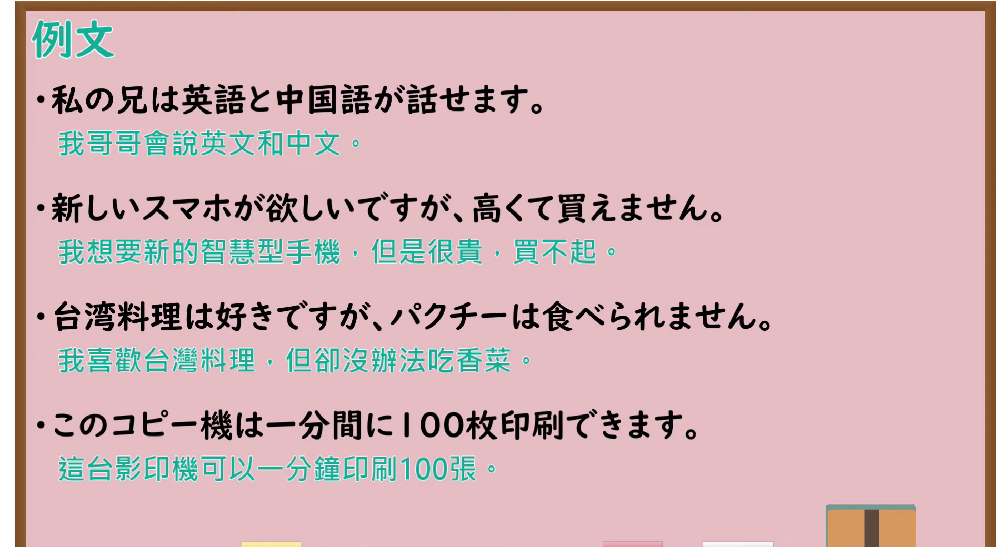

---
{
  "id": "N4-G-0069",
  "kind": "grammar",
  "level": "N4",
  "title": "可能形（能力・状況可能）",
  "card_revision": 1,
  "schema_version": 1,
  "source": {
    "lesson": "N4 第69个语法",
    "material": "出口日語原视频板书与Hagoromo文型检索正文",
    "video": "https://www.youtube.com/watch?v=B82OzYse3BI",
    "screenshot": "assets/grammar/n4/N4-G-0069-connection.png",
    "screenshot_seconds": 600.0,
    "screenshot_crop": {
      "x": 0,
      "y": 0,
      "width": 1500,
      "height": 1040
    }
  },
  "tags": [
    "可能形",
    "能力可能",
    "状況可能",
    "ことができる",
    "N4"
  ],
  "confusions": [
    "～ことができる",
    "～（ら）れる（受身・尊敬）"
  ]
}
---

# N4 第69个语法：可能形

# 视频学习资料整理

- 课程：[出口日語「【Ｎ４文法】可能形」](https://www.youtube.com/watch?v=B82OzYse3BI)
- 视频 ID：`B82OzYse3BI`
- 视频时长：12分13秒

## 接续图

- 实际时间：10分0.00秒（600.00秒）
- 原图尺寸：1920×1080
- 裁切区域：左上角 `(0, 0)` 至右下角 `(1500, 1040)`；选用 10:00 画面，板书已写出标题「可能形」、动词三类的可能形变化表（第Ⅰ类 え段＋ます，第Ⅱ类「られます（れます）」，第Ⅲ类「来られます（来れます）」「できます」），右侧以「私は英語を話すことができます」→「私は英語が話せます」说明助词由「を」变「が」，并写有「私は香菜が食べられません」「おなかがいっぱいですから、食べられません」。板书上没有红字功能说明，视为一个功能。固定左上角 (0, 0)，裁去右侧多余画面；右侧例句句末被画面右缘截去，老师持红笔位于右下角。

## 例句图

- 实际时间：11分14.36秒（674.36秒）
- 原图尺寸：1920×1080
- 裁切区域：左上角 `(0, 0)` 至右下角 `(1900, 1040)`；提取自视频 11:14 处的例句页。固定左上角 (0, 0)，去除右侧与底部多余画面，完整保留四条例句及中文翻译。

# 核心

## 功能一：可能：能够做……（可能形）

**最上位意味カテゴリー：**

- **Vられる（可能）：** ものごとの様子（事物的样态）
- **ことができる：** ものごとの様子（事物的样态）

**中位意味カテゴリー：**

- **Vられる（可能）：** 可能・難易（可能与难易）
- **ことができる：** 可能・難易（可能与难易）

**意味：**

- **Vられる（可能）：** 可能：可能（可能：可能）
- **ことができる：** 可能：可能（可能：可能）

**くわしい意味記述：**

- **Vられる（可能）：** 可能の意味を表す。可能には，あることができる能力を表す能力可能，何かができる状況を表す状況可能がある。（表示可能的意思。可能包括表示有能力做某事的能力可能，以及表示能够做某事的状况的状况可能。）
- **ことができる：** ある人の能力や可能性を表す時に用いる。改まった場面，かたい文章では可能形よりも用いられる。（用于表示某人的能力或可能性。在郑重场合和生硬的文章中，比可能形更常用。）

**派生語：** 未列出

### 例句

1. 私は中国語が少し話せます。

   （我会说一点中文。）

2. なっとうが食べられます。

   （我能吃纳豆。）

3. あなたは英語で手紙を書くことができますか。

   （你能用英语写信吗？）

4. 熊は、あごの骨を砕かれたりして馬に食らいつくことができない。

   （熊的下颌骨被打碎之类，就没法咬住马了。）

5. わたしゃね、今でもその情景を、ありありと思い出すことが出来る。

   （我啊，直到现在还能清清楚楚地回想起那番情景。）

# 来源

- [出口日語原视频](https://www.youtube.com/watch?v=B82OzYse3BI)
- [Hagoromo 文型検索「Vられる（可能：可能）」](https://hagoromo-text.work/lookup?vid=198)（查询日期：2026-10-15）
- [Hagoromo 文型検索「ことができる」](https://hagoromo-text.work/lookup?vid=507)（查询日期：2026-10-15）
