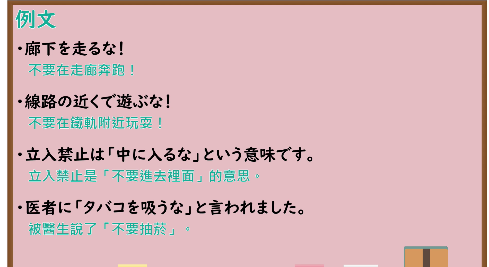

# N4-G-0071 禁止形（動詞の活用、強い禁止）

## 接续与说明

### 接续板书说明

- **截取时间点**：视频 5分48.60秒（348.60秒） 处。
- **画面说明**：黑板最上方完整保留「禁止形」醒目标题；板书已完整贴好动词禁止形变换体系：第Ⅰ類（辞書形＋な：書く・泳ぐ・話す・待つ・死ぬ・遊ぶ・読む・帰る＋な）、第Ⅱ類（教えるな・食べるな・起きるな・見るな・寝るな）、第Ⅲ類（来るな・するな）；中间附有板书例句「廊下を走るな！」「医者にタバコを吸うなと言われました」；老师侧立右侧，板书文字全览无遮挡。固定左上角 (0, 0)，裁切宽 1900、高 1040，高度充足标题完好。
- **核心句型与接续要点**：
  - 语法形式优先用平假名，并在括号中标注对应汉字。
  - **動詞辞書形 ＋ な**
    - 第Ⅰ類動詞：辞書形 ＋ な（例：`いくな(行くな)`、`はなすな(話すな)`、`のむな(飲むな)`）
    - 第Ⅱ類動詞：辞書形 ＋ な（例：`たべるな(食べるな)`、`みるな(見るな)`、`おきるな(起きるな)`）
    - 第Ⅲ類動詞：`くるな(来るな)`、`するな`

## 例文

### 视频核心例句

- **截取时间点**：视频 7分03.02秒（423.02秒） 处。
- **画面说明**：提取自视频 07:03 处的例句黑板页面。底色为粉灰色课程幻灯片，固定左上角 (0, 0)，裁切区域宽 1900、高 1040，去除右侧与底部多余边框，完整保留全部四条例句及中文翻译。
- **例文列表**：
- ここに車を止めるな。
  - 中文：請勿將車停在這裡。
- 時間がないから、話を遮るな。
  - 中文：因為沒有時間了，請不要打斷我說話。
- 医者に酒を飲むなと言われました。
  - 中文：醫生跟我說不可以喝酒。
- テスト中は携帯電話を見るなと注意されました。
  - 中文：考試中被提醒不可以看手機。

## 语法解说与补充

### 核心语义与功能边界

- **核心功能**：动词活用之禁止形，表示强烈的禁止命令，语气强硬严肃，相当于“不许做某事”。
- **常见使用语境**：
  1. **交通与安全标识、告示口号**：`はい(入)るな`（禁止入内）、`さわる(触る)な`（请勿触摸）。
  2. **紧急危险状况下的制止**：`あぶ(危)ない！うご(動)くな！`（危险！别动！）。
  3. **间接引述别人的禁止要求**：`～なと言われました`（被要求不准……），常出现在转述医嘱、校规或上级命令。
  4. **男性长辈、上级或同辈熟人之间的粗鲁告诫**：女性或日常对等交流中通常不直接对人使用。

### 易混淆语法辨析

| 表达方式 | 接续 | 语气色彩与使用场合 | 示例 |
| :--- | :--- | :--- | :--- |
| **禁止形** | 辞書形＋な | 最强硬、命令性禁止；常用于标语、紧急制止或间接引述 | `ろうか(廊下)をはし(走)るな！` |
| **ないでください** | ない形＋でください | 礼貌恳请或正式提醒对方不要做某事，无居高临下之感 | `ろうかをはしらないでください。` |
| **な（終助詞・詠嘆・確認）** | 各品词普通形＋な | 句尾语气词，用于自言自语或感叹、轻微确认，与禁止无关 | `いい天気だなあ。` |
| **なさい（命令）** | ます形＋なさい | 父母对孩子、教师对学生的教导命令，针对做某事 | `はやく(早く)ね(寝)なさい。` |

### JLPT 考点聚焦

1. **间接引述句型**：JLPT N4 听力与读解极常考查 `「～な」と言われました / と注意されました`，测试学习者是否能准确识别出这是「禁止（～てはいけない）」的意思，而非正面做某事。
2. **变形混淆陷阱**：
   - 命令形是变换词尾（如第Ⅰ类变成え段 `いけ(行け)`、第Ⅱ类加ろ `たべろ(食べろ)`）；
   - 禁止形则是**全动词统一在辞书形后加 `な`**（如 `いくな(行くな)`、`たべるな(食べるな)`），切不可将命令形与禁止形混淆。

