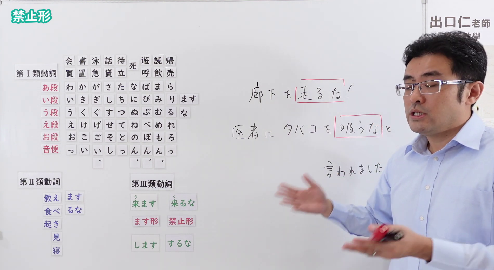

---
{
  "id": "N4-G-0071",
  "kind": "grammar",
  "level": "N4",
  "title": "禁止形（强烈的禁止）",
  "card_revision": 1,
  "schema_version": 1,
  "source": {
    "lesson": "N4 第71个语法",
    "material": "出口日語原视频板书与Hagoromo文型检索正文",
    "video": "https://www.youtube.com/watch?v=vG7evfvAR2Y",
    "screenshot": "assets/grammar/n4/N4-G-0071-connection.png",
    "screenshot_seconds": 348.6,
    "screenshot_crop": {
      "x": 0,
      "y": 0,
      "width": 1900,
      "height": 1040
    }
  },
  "tags": [
    "禁止形",
    "禁止",
    "N4"
  ],
  "confusions": [
    "～ないでください",
    "～てはいけない"
  ]
}
---

# N4 第71个语法：禁止形

# 视频学习资料整理

- 课程：[出口日語「【Ｎ４文法】禁止形」](https://www.youtube.com/watch?v=vG7evfvAR2Y)
- 视频 ID：`vG7evfvAR2Y`
- 视频时长：8分18秒

## 接续图

- 实际时间：5分48.60秒（348.60秒）
- 原图尺寸：1920×1080
- 裁切区域：左上角 `(0, 0)` 至右下角 `(1900, 1040)`；黑板上方保留「禁止形」标题；板书已贴出动词禁止形变化表（第Ⅰ类 う段＋な，第Ⅱ类「るな」，第Ⅲ类「来るな」「するな」），右侧写有红框例句「廊下を［走るな］！」「医者にタバコを［吸うな］と言われました」。本课介绍禁止形，视为一个功能。固定左上角 (0, 0)，裁切宽 1900；老师站在右侧，手和身体遮住了部分空白板面，右上角可见频道标识，未遮挡板书文字。

## 例句图

- 实际时间：7分3.02秒（423.02秒）
- 原图尺寸：1920×1080
- 裁切区域：左上角 `(0, 0)` 至右下角 `(1900, 1040)`；提取自视频 07:03 处的例句页。固定左上角 (0, 0)，去除右侧与底部多余画面，完整保留四条例句及中文翻译。

# 核心

## 功能一：禁止形：表示强烈的禁止

**最上位意味カテゴリー：**

- **な：** 人との関係（人际关系）

**中位意味カテゴリー：**

- **な：** 依頼・命令（请求与命令）

**意味：**

- **な：** 命令、禁止（命令、禁止）

**くわしい意味記述：**

- **な：** Vで表す行為をしないように，相手に命令する時に使う。叱るときや注意書きなどで使うことが多い。（用于命令对方不要做 V 所表示的行为。多用于斥责或注意事项等。）

**派生語：** 未列出

### 例句

1. あの部屋には入るな。

   （别进那个房间。）

2. もうとか、かわいそうなこと言うなよ。

   （别再说什么可怜的话了啊。）

3. 何か、でも基本的にはキャンプの中では英語使うなっていうルールが。

   （不过，基本上营地里有“不许说英语”的规定。）

# 来源

- [出口日語原视频](https://www.youtube.com/watch?v=vG7evfvAR2Y)
- [Hagoromo 文型検索「な」](https://hagoromo-text.work/lookup?vid=1086)（查询日期：2026-10-15）
