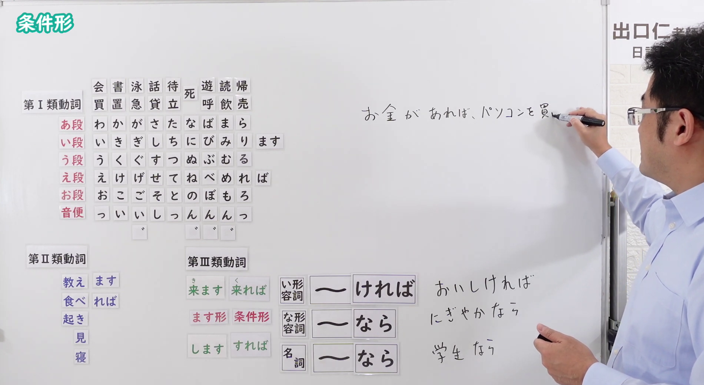

# N4-G-0072 条件形・ば形（仮定条件・確定条件）

## 接续与说明

### 接续板书说明

- **截取时间点**：视频 5分56.20秒（356.20秒） 处。
- **画面说明**：黑板最上方清晰保留「条件形」醒目标题；板书完整贴出条件形变形全体系：第Ⅰ類（え段＋ば：買えば・書けば・泳げば・話せば・待てば・死ねば・遊べば・読めば・帰れば）、第Ⅱ類（教えれば・食べれば・起きれば・見れば・寝れば）、第Ⅲ類（来れば[くれば]・すれば）；右侧列出形容词与名词接续规则：い形容詞（～ければ：おいしければ）、な形容詞（～なら：にぎやかなら）、名詞（～なら：学生なら）；白板右侧附有手写例句「お金があれば、パソコンを...」；老师立于右侧，黑板规则全景清晰无挡。固定左上角 (0, 0)，裁切宽 1900、高 1040。
- **核心句型与接续要点**：
  - 语法形式优先用平假名，并在括号中标注对应汉字。
  - **動詞**：
    - 第Ⅰ類：う段 假名变为 **え段** 假名 ＋ `ば`（例：`か(買)えば`、`い(行)けば`、`の(飲)めば`）
    - 第Ⅱ類：去掉 `る` ＋ `れば`（例：`た(食)べれば`、`み(見)れば`）
    - 第Ⅲ類：`く(来)れば`（注意读音由くる变く）、`すれば`
  - **否定形（ない形）**：`～なければ`（例：`い(行)かなければ`、`た(食)べなければ`）
  - **い形容詞**：去 `い` ＋ `ければ`（例：`やす(安)ければ`、`よ(良)ければ`）
  - **な形容詞**：词干 ＋ `なら`（口语常可省去ば）
  - **名詞**：名词 ＋ `なら`

## 例文

### 视频核心例句

- **截取时间点**：视频 7分51.28秒（471.28秒） 处。
- **画面说明**：提取自视频 07:51 处的例句黑板页面。底色为粉灰色课程幻灯片，固定左上角 (0, 0)，裁切区域宽 1900、高 1040，去除右侧与底部多余画面，完整呈现四条例句与中文翻译。
- **例文列表**：
- 安ければ、たくさん買います。
  - 中文：如果便宜的話，我會買很多。
- 時間がなければ、無理をしなくてもいいです。
  - 中文：要是沒有時間的話，不用太勉強也沒關係。
- 操作が簡単なら、お年寄りでも使えます。
  - 中文：如果操作簡單的話，老人家也能使用。
- 雨なら、明日のバーベキューは中止です。
  - 中文：如果下雨的話，明天的烤肉就取消。

## 语法解说与补充

### 核心语义与功能边界

- **核心功能**：表示前项条件成立后，后项动作或结论随之发生，侧重于“逻辑假定条件”或“前项是后项成立的必要前提”。
- **经典功能特征**：
  1. **假定条件（一般法则、假定推导）**：`はる(春)になれば、花が咲きます。`（到了春天花就会开）。
  2. **提建议与劝告（～ばいい）**：`どうすればいいですか。`（该怎么做才好呢？）。
  3. **并列对比（～も～ば、～も～）**：`かのじょ(彼女)は歌も上手なら、ダンスも得意だ。`（她既歌唱得好，舞蹈也很拿手）。

### 易混淆假定句型辨析（と・ば・たら・なら）

| 形式 | 核心特征 | 后项限制 | 典型使用场景 |
| :--- | :--- | :--- | :--- |
| **～ば** | 假定前提，突出因果推导或必要条件 | 原则上后项**不能有**意志、命令、请求（除非前项是状态动词/形容词） | 逻辑假定、客观推论、提供建议 |
| **～と** | 恒常必然条件、自然规律、意外发现 | 后项**绝对不能**是意志、命令、请求 | 机器操作、路线指引、自然规律 |
| **～たら** | 泛用性最强，前项动作完成后发生后项 | 后项**无限制**，可接意志、请求、命令 | 口语首选、发生后发现某事 |
| **～なら** | 就对方话题展开意见、建议或限定 | 后项多为说话人的判断、建议、意志 | 承接话题、给出建议（“如果是……的话”） |

### JLPT 考点聚焦

1. **后项意志限制例外**：若前项是**状态性动词（如 `ある`、`いる`）**或**形容词**时，`～ば` 后项允许接意志表现，例如：`じかん(時間)があれば、映画を見に行きましょう。`（这在 JLPT N4 文法考题中常作为高频考点！）。
2. **否定变形 `～なければ`**：考查与 `～なければならない`、`～なくてもいい` 的联动。

