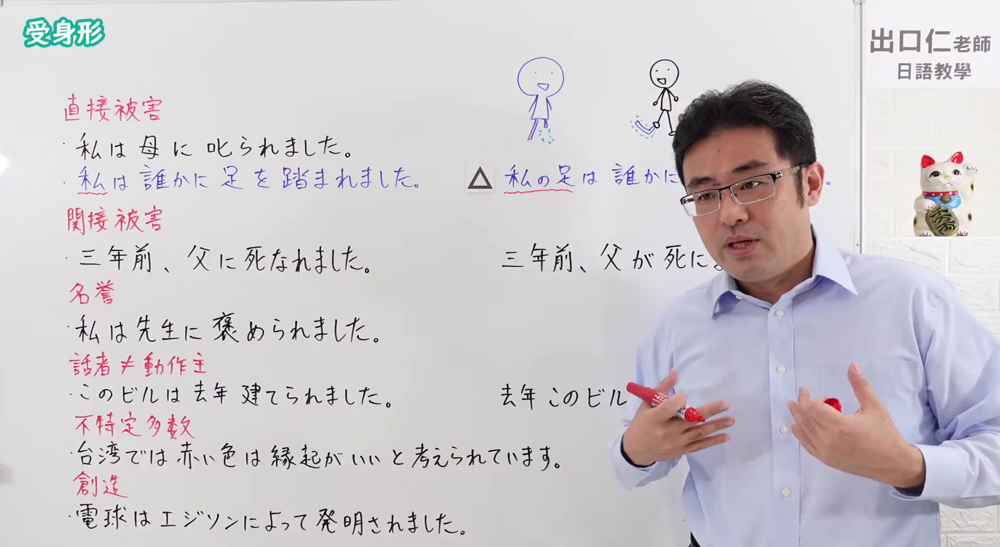

---
{
  "id": "N4-G-0073",
  "kind": "grammar",
  "level": "N4",
  "title": "受身形（受身）",
  "card_revision": 1,
  "schema_version": 1,
  "source": {
    "lesson": "N4 第73个语法",
    "material": "出口日語原视频板书与Hagoromo文型检索正文",
    "video": "https://www.youtube.com/watch?v=ajl6BFhvfHI",
    "screenshot": "assets/grammar/n4/N4-G-0073-connection.png",
    "screenshot_seconds": 464.2,
    "screenshot_crop": {
      "x": 0,
      "y": 0,
      "width": 1900,
      "height": 1040
    }
  },
  "tags": [
    "受身形",
    "受身",
    "被害",
    "N4"
  ],
  "confusions": [
    "～（さ）せられる",
    "～てもらう"
  ]
}
---

# N4 第73个语法：受身形

# 视频学习资料整理

- 课程：[出口日語「【Ｎ４文法】受身形」](https://www.youtube.com/watch?v=ajl6BFhvfHI)
- 视频 ID：`ajl6BFhvfHI`
- 视频时长：14分3秒

## 接续图

- 实际时间：7分44.20秒（464.20秒）
- 原图尺寸：1920×1080
- 裁切区域：左上角 `(0, 0)` 至右下角 `(1900, 1040)`；黑板上方保留「受身形」标题；板书用红字标出六类用法——「直接被害」「間接被害」「名誉」「話者≠動作主」「不特定多数」「創造」——并各附例句（「私は母に叱られました」「三年前、父に死なれました」「私は先生に褒められました」「このビルは去年建てられました」「台湾では赤い色は縁起がいいと考えられています」「電球はエジソンによって発明されました」），上方有被踩脚的小人示意图及对应的主动句对照（「私の足は誰かに…」等，右侧被老师遮挡）。本课介绍受身形，按你的要求视为一个功能，六类红字用法作为该功能的用法示例，不另立功能。固定左上角 (0, 0)，裁切宽 1900；老师站在右侧，遮住了对照句的后半。

## 例句图

- 实际时间：12分56.48秒（776.48秒）
- 原图尺寸：1920×1080
- 裁切区域：左上角 `(0, 0)` 至右下角 `(1900, 1040)`；提取自视频 12:56 处的例句页。固定左上角 (0, 0)，去除右侧与底部多余画面，完整保留四条例句及中文翻译。

# 核心

## 功能一：受身形：表示被动（直接被动、间接被害等）

**最上位意味カテゴリー：**

- **Vられる（直接受け身）：** ものごとの関係（事物之间的关系）
- **Vられる（非情の受身）：** ものごとの関係（事物之间的关系）
- **Vられる（迷惑の受け身）：** ものごとの関係（事物之间的关系）

**中位意味カテゴリー：**

- **Vられる（直接受け身）：** ことがらの視点（事情的视点）
- **Vられる（非情の受身）：** ことがらの視点（事情的视点）
- **Vられる（迷惑の受け身）：** ことがらの視点（事情的视点）

**意味：**

- **Vられる（直接受け身）：** 受け身：直接受け身（被动：直接被动）
- **Vられる（非情の受身）：** 受け身：いわゆる非情の受身（被动：所谓无情被动）
- **Vられる（迷惑の受け身）：** 受け身：いわゆる迷惑の受け身（被动：所谓麻烦被动）

**くわしい意味記述：**

- **Vられる（直接受け身）：** ほかからある行為を受けることを表す。（表示承受来自他人的某种行为。）
- **Vられる（非情の受身）：** ある行為の対象を主語にして，社会的な事実や公に知らせる事柄を言う時に使う。（以某行为的对象为主语，用于陈述社会性事实或向公众告知的事项。）
- **Vられる（迷惑の受け身）：** 自分が直接行為を受けないが，ある出来事や他の人がしたことによって間接的な被害を受けたり，迷惑だと感じたりする時に使う。（自己并未直接受到行为，但因某件事或他人所做之事而受到间接的损害，或感到麻烦时使用。）

**派生語：** 未列出

### 例句

1. 私は昨日母に叱られた。

   （我昨天被妈妈骂了。）

2. この雑誌は毎月発行されている。

   （这本杂志每月发行。）

3. 学校から帰る時、雨に降られた。

   （从学校回家的时候，被雨淋了。）

4. ついに妻にも先立たれてから、ひとりで遍路の旅に出た。

   （终于连妻子也先于自己离世之后，独自踏上了遍路之旅。）

5. 一般寄付は学校に贈られる。

   （一般捐款会赠送给学校。）

# 来源

- [出口日語原视频](https://www.youtube.com/watch?v=ajl6BFhvfHI)
- [Hagoromo 文型検索「Vられる（受け身：直接受け身）」](https://hagoromo-text.work/lookup?vid=194)（查询日期：2026-10-15）
- [Hagoromo 文型検索「Vられる（受け身：いわゆる非情の受身）」](https://hagoromo-text.work/lookup?vid=195)（查询日期：2026-10-15）
- [Hagoromo 文型検索「Vられる（受け身：いわゆる迷惑の受け身）」](https://hagoromo-text.work/lookup?vid=196)（查询日期：2026-10-15）
