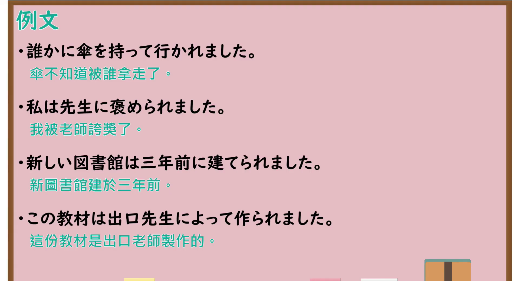

# N4-G-0073 受身形（直接受身・間接受身・被害・名誉）

## 接续与说明

### 接续板书说明

- **截取时间点**：视频 7分44.20秒（464.20秒） 处。
- **画面说明**：黑板左上角清晰醒目显示「受身形」标题；板书详细工整展示受身形的六大语义分类体系与典型对比例句：直接被害（私は母に叱られました／私は誰かに足を踏まれました）、間接被害（三年前、父に死なれました）、名誉（私は先生に褒められました）、話者≠動作主（このビルは去年建てられました）、不特定多数（台湾では赤い色は縁起がいいと考えられています）、創造（電球はエジソンによって発明されました）；中央绘有被踩脚的直接受身与间接受身小人示意图；老师站在右侧讲解，整面黑板板书清晰无遮挡。固定左上角 (0, 0)，裁切宽 1900、高 1040。
- **核心句型与接续要点**：
  - 语法形式优先用平假名，并在括号中标注对应汉字。
  - **動詞受身形变形规则**：
    - 第Ⅰ類動詞：う段 假名变为 **あ段** 假名 ＋ `れます`（例：`しか(叱)る` → `しか(叱)られます`、`ふ(踏)む` → `ふ(踏)まれます`、`か(書)く` → `か(書)かれます`；注意：あ段是わ，如 `う(買)う` → `か(買)われます`）
    - 第Ⅱ類動詞：去掉 `る` ＋ `られます`（例：`ほ(褒)める` → `ほ(褒)められます`、`た(食)べる` → `た(食)べられます`）
    - 第Ⅲ類動詞：`く(来)ます` → `こ(来)られます`（注意读音变こ）、`します` → `されます`

## 例文

### 视频核心例句

- **截取时间点**：视频 12分56.48秒（776.48秒） 处。
- **画面说明**：提取自视频 12:56 处的例句黑板页面。底色为粉灰色课程幻灯片，固定左上角 (0, 0)，裁切区域宽 1900、高 1040，去除右侧与底部多余边框，完整保留四条核心例句及中文翻译。
- **例文列表**：
- 満員電車で足を踏まれました。
  - 中文：在客滿的電車裡被人踩到了腳。
- 雨に降られて、服がびしょ濡れになりました。
  - 中文：被雨淋得衣服全濕透了。
- 先生に作文を褒められました。
  - 中文：作文被老師稱讚了。
- この歌は世界中の人に歌われています。
  - 中文：這首歌被全世界的人傳唱著。

## 语法解说与补充

### 核心语义与六大功能分类

出口仁老师在板书中将日语受身形系统化归纳为 6 大类别：
1. **直接被害（直接被动）**：主体受到动作施加者的直接物理或心理侵害。
   - 例：`私は母に叱られました。`（我被妈妈批评了。）
   - 带所有物的直接被害：`私は誰かに足を踏まれました。`（我的脚被某人踩了；注意日语通常以人为主语，不以“私の足”作主语）。
2. **間接被害（迷惑の受身 / 自动词被动）**：自动词后接受身形，动作本身不针对主体，但动作造成的事实给主体带来困扰或损害。
   - 例：`三年前、父に死なれました。`（三年前父亲过世了，给我带来极大悲痛）。
   - 例：`雨に降られました。`（被雨淋了）。
3. **名誉（正面积极的受身）**：受表扬、推选或奖励。
   - 例：`私は先生に褒められました。`（我被老师夸奖了）。
4. **話者≠動作主（客观陈述建筑、产生）**：动作主体不明确或不重要，客观描述事物状态。
   - 例：`このビルは去年建てられました。`（这栋楼是去年建成的）。
5. **不特定多数（社会普遍认知）**：
   - 例：`台湾では赤い色は縁起がいいと考えられています。`（在台湾红色被认为是吉利的）。
6. **創造（发明、发现、创作）**：施事者使用 `によって`。
   - 例：`電球はエジソンによって発明されました。`（电灯是由爱迪生发明的）。

### JLPT 考点聚焦

1. **助词 `に` vs `によって`**：
   - 一般受身的动作主体用助词 `に`（`先生に褒められた`）；
   - 但在**创造、发明、著述（発明する・発見する・書く・建てる）**等事物受身句中，创造者必须用 `～によって`（例如：`エジソンによって発明された`）。
2. **所有物受身句式结构**：
   - 必须牢记：`【人】は 【施事者】に 【所有物】を 受身動詞`（如 `私は泥棒に財布を盗まれた`）。
   - 考题常挖空助词 `に` 与 `を`，陷阱选项常故意将所有物作为主语或用错助词。

