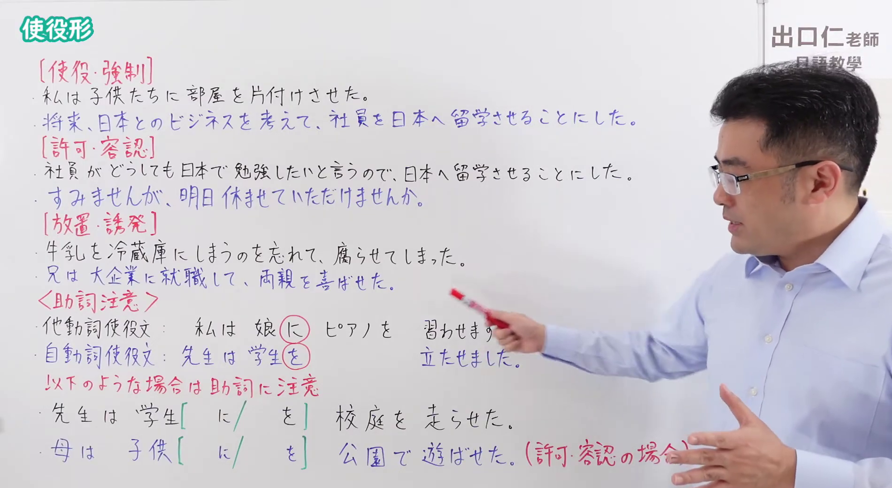
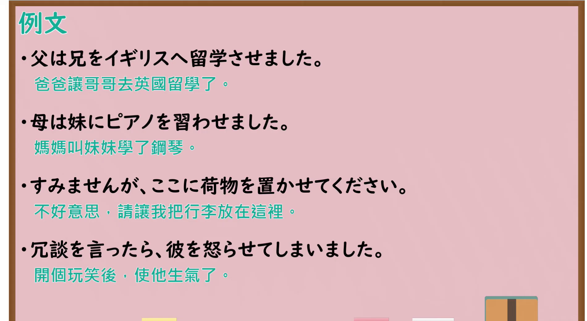

---
{
  "id": "N4-G-0074",
  "kind": "grammar",
  "level": "N4",
  "title": "使役形（使役）",
  "card_revision": 1,
  "schema_version": 1,
  "source": {
    "lesson": "N4 第74个语法",
    "material": "出口日語原视频板书与Hagoromo文型检索正文",
    "video": "https://www.youtube.com/watch?v=tjQFAeWWxHE",
    "screenshot": "assets/grammar/n4/N4-G-0074-connection.png",
    "screenshot_seconds": 585.2,
    "screenshot_crop": {
      "x": 0,
      "y": 0,
      "width": 1900,
      "height": 1040
    }
  },
  "tags": [
    "使役形",
    "使役",
    "N4"
  ],
  "confusions": [
    "～（ら）れる（受身）",
    "～てもらう"
  ]
}
---

# N4 第74个语法：使役形

# 视频学习资料整理

- 课程：[出口日語「【Ｎ４文法】使役形」](https://www.youtube.com/watch?v=tjQFAeWWxHE)
- 视频 ID：`tjQFAeWWxHE`
- 视频时长：17分44秒

## 接续图

- 实际时间：9分45.20秒（585.20秒）
- 原图尺寸：1920×1080
- 裁切区域：左上角 `(0, 0)` 至右下角 `(1900, 1040)`；黑板上方保留「使役形」标题；板书以粉红字标出三类用法——［使役・強制］［許可・容認］［放置・誘発］，各附两句例句；其下为〈助詞注意〉：他動詞使役文「私は娘に（に圈出）ピアノを習わせます」、自動詞使役文「先生は学生を（を圈出）立たせました」，并写有「先生は学生［に／を］校庭を走らせた」「母は子供［に／を］公園で遊ばせた（許可・容認の場合）」。本课介绍使役形，按你的要求视为一个功能，三类用法作为该功能的用法示例，不另立功能。固定左上角 (0, 0)，裁切宽 1900；老师站在右侧，「（許可・容認の場合）」末尾被他的手遮挡。

## 例句图

- 实际时间：16分50.00秒（1010.00秒）
- 原图尺寸：1920×1080
- 裁切区域：左上角 `(0, 0)` 至右下角 `(1900, 1040)`；提取自视频 16:50 处的例句页。固定左上角 (0, 0)，去除右侧与底部多余画面，完整保留四条例句及中文翻译。

# 核心

## 功能一：使役形：表示使役（强制、许可、诱发）

**最上位意味カテゴリー：**

- **させる（使役：強制）：** ものごとの関係（事物之间的关系）
- **させる（使役：誘発・許可）：** ものごとの関係（事物之间的关系）

**中位意味カテゴリー：**

- **させる（使役：強制）：** ことがらの視点（事情的视点）
- **させる（使役：誘発・許可）：** ことがらの視点（事情的视点）

**意味：**

- **させる（使役：強制）：** 使役：強制（使役：强制）
- **させる（使役：誘発・許可）：** 使役：誘発・許可（使役：诱发・许可）

**くわしい意味記述：**

- **させる（使役：強制）：** 他人にその行為をするように強制する。（强制他人做该行为。）
- **させる（使役：誘発・許可）：** 感情に関係する動詞とともに使われ，他人がその感情を持つ原因になる，ということを表す。（与表示感情的动词一起使用，表示成为他人产生该感情的原因。）

**派生語：** 未列出

### 例句

1. お母さんは、こどもに部屋をかたづけさせた。

   （妈妈让孩子收拾了房间。）

2. お父さんは子どもを8時に寝させた。

   （爸爸让孩子八点睡觉。）

3. 妹を泣かせてはいけません。

   （不可以把妹妹弄哭。）

4. 変な顔をして、みんなを笑わせた。

   （做了个怪脸，把大家逗笑了。）

5. 私が留学したいと言ったら、両親は行かせてくれた。

   （我说想去留学，父母就让我去了。）

# 来源

- [出口日語原视频](https://www.youtube.com/watch?v=tjQFAeWWxHE)
- [Hagoromo 文型検索「させる（使役：強制）」](https://hagoromo-text.work/lookup?vid=566)（查询日期：2026-10-15）
- [Hagoromo 文型検索「させる（使役：誘発・許可）」](https://hagoromo-text.work/lookup?vid=567)（查询日期：2026-10-15）
