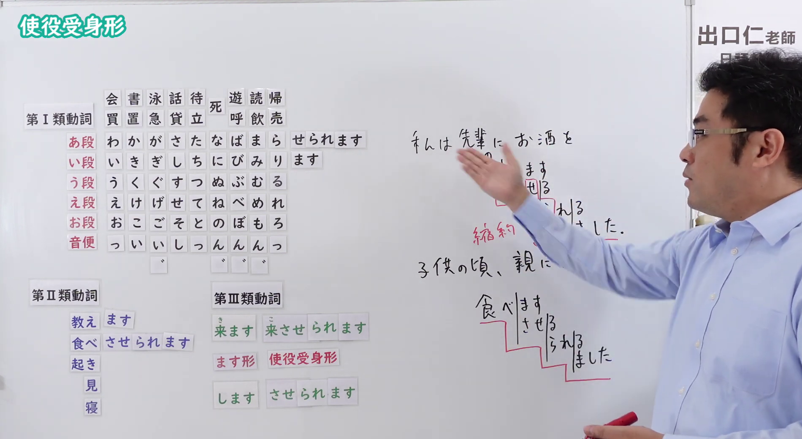

---
{
  "id": "N4-G-0075",
  "kind": "grammar",
  "level": "N4",
  "title": "使役受身形（使役被动）",
  "card_revision": 1,
  "schema_version": 1,
  "source": {
    "lesson": "N4 第75个语法",
    "material": "出口日語原视频板书与Hagoromo文型检索正文",
    "video": "https://www.youtube.com/watch?v=hOxB3L_3uLQ",
    "screenshot": "assets/grammar/n4/N4-G-0075-connection.png",
    "screenshot_seconds": 471.1,
    "screenshot_crop": {
      "x": 0,
      "y": 0,
      "width": 1900,
      "height": 1040
    }
  },
  "tags": [
    "使役受身形",
    "使役受身",
    "N4"
  ],
  "confusions": [
    "～（さ）せる（使役）",
    "～（ら）れる（受身）"
  ]
}
---

# N4 第75个语法：使役受身形

# 视频学习资料整理

- 课程：[出口日語「【Ｎ４文法】使役受身形」](https://www.youtube.com/watch?v=hOxB3L_3uLQ)
- 视频 ID：`hOxB3L_3uLQ`
- 视频时长：11分13秒

## 接续图

- 实际时间：7分51.10秒（471.10秒）
- 原图尺寸：1920×1080
- 裁切区域：左上角 `(0, 0)` 至右下角 `(1900, 1040)`；黑板上方保留「使役受身形」标题；板书已贴出动词使役受身形变化表（第Ⅰ类 あ段＋せられます，第Ⅱ类「させられます」，第Ⅲ类「来させられます」「させられます」），右侧手写「私は先輩にお酒を…」，并以台阶图推导「食べます→させる→られる→ました」，红字标注「縮約」。本课介绍使役受身形，视为一个功能。固定左上角 (0, 0)，裁切宽 1900；老师的手遮住了右上方部分手写句和推导图，右侧「出口仁」标识被截去一部分。

## 例句图

- 实际时间：9分38.78秒（578.78秒）
- 原图尺寸：1920×1080
- 裁切区域：左上角 `(0, 0)` 至右下角 `(1900, 1040)`；提取自视频 09:38 处的例句页。固定左上角 (0, 0)，去除右侧与底部多余画面，完整保留四条例句及中文翻译。

# 核心

## 功能一：使役被动形：表示被迫做……

**最上位意味カテゴリー：**

- **させられる：** ものごとの関係（事物之间的关系）

**中位意味カテゴリー：**

- **させられる：** ことがらの視点（事情的视点）

**意味：**

- **させられる：** 使役＋受け身（使役＋被动）

**くわしい意味記述：**

- **させられる：** ある人の命令や指示を受けて，その動作をするという意味を表す。（表示接受某人的命令或指示而做该动作。）

**派生語：** 未列出

### 例句

1. 子供のころ、母にいろいろな野菜を食べさせられました。

   （小时候，被妈妈逼着吃了各种各样的蔬菜。）

2. あー、何か前、洗車させられそうになったことはあるけど。

   （啊，之前倒是差点被叫去洗过车。）

3. ギリシアを除く東欧はソ連の勢力下にはいり、ソ連によって変革させられたのである。

   （除希腊以外的东欧进入了苏联的势力范围，被苏联强行改变了。）

4. それまで大半の東欧諸国は、スターリンの政策によって孤立化させられてきた。

   （在那之前，大部分东欧国家一直被斯大林的政策弄得孤立起来。）

5. 先輩が相談事があるからぜひこいと言うからはるばる来たけど、こんな思いさせられるとは思わなかったよ。

   （学长说有事要商量，让我务必来，我才大老远赶来，没想到会被这样对待。）

# 来源

- [出口日語原视频](https://www.youtube.com/watch?v=hOxB3L_3uLQ)
- [Hagoromo 文型検索「させられる（使役＋受け身）」](https://hagoromo-text.work/lookup?vid=565)（查询日期：2026-10-15）
