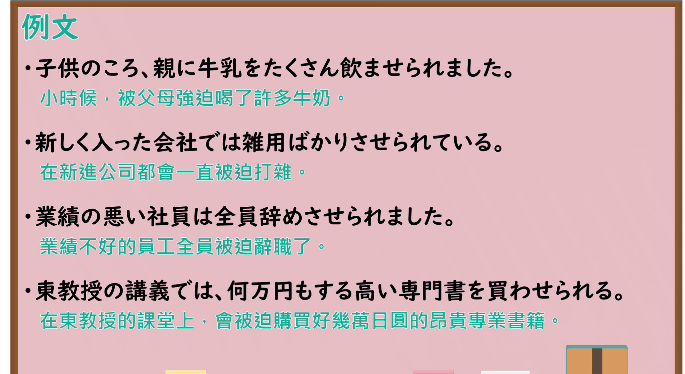

# N4-G-0075 使役受身形（強制被害・不本意・縮約形）

## 接续与说明

### 接续板书说明

- **截取时间点**：视频 7分51.10秒（471.10秒） 处。
- **画面说明**：黑板最上方完整保留「使役受身形」醒目标题；板书完整排列动词使役受身形活用体系：第Ⅰ類（あ段＋せられます：書かせられます・泳がせられます・飲ませられます等）、第Ⅱ類（教えさせられます・食べさせられます・起きさせられます・見させられます・寝させられます）、第Ⅲ類（来させられます[こさせられます]・させられます）；右侧手写阶梯推导演示图：飲みます→飲ませる→飲ませられる→飲ませられました，以及縮約形（飲まされる）说明；下方书写经典句「子供の頃、親に...食べさせられました」；老师站在右侧讲解，全部磁铁规则卡片完整展示无遮挡。固定左上角 (0, 0)，裁切宽 1900、高 1040。
- **核心句型与接续要点**：
  - 语法形式优先用平假名，并在括号中标注对应汉字。
  - **使役受身形变形推导原理**：`動詞使役形 ＋ られる`（即“被迫使做某事”）
    - 第Ⅰ類動詞：
      - 正式全称：う段 假名变为 **あ段** 假名 ＋ `せられます`（例：`の(飲)む` → `の(飲)ませられます`、`か(書)く` → `か(書)かせられます`）
      - **日常縮約形（更常用）**：あ段 假名 ＋ `されます`（例：`の(飲)まされます`、`か(書)かされます`）
      - **注意特例**：以 `す` 结尾的第Ⅰ类动词（如 `はな(話)す`），为避免音节重复发音拗口，**没有缩约形**，只能用 `はな(話)させられます`！
    - 第Ⅱ類動詞：去掉 `る` ＋ `させられます`（例：`た(食)べる` → `た(食)べさせられます`；第Ⅱ类**无缩约形**）
    - 第Ⅲ類動詞：`く(来)ます` → `こ(来)させられます`、`します` → `させられます`（第Ⅲ类**无缩约形**）

## 例文

### 视频核心例句

- **截取时间点**：视频 9分38.78秒（578.78秒） 处。
- **画面说明**：提取自视频 09:38 处的例句黑板页面。底色为粉灰色课程幻灯片，固定左上角 (0, 0)，裁切区域宽 1900、高 1040，去除右侧与底部多余画面，四条例句及中文翻译完整清晰呈现。
- **例文列表**：
- 子供の頃、母にピアノを習わせられました。
  - 中文：小時候被母親逼著學鋼琴。
- 嫌いな野菜を無理やり食べさせられました。
  - 中文：被硬逼著吃討厭的蔬菜。
- 先輩に重い荷物を持たせられました。
  - 中文：被學長要求拿重行李。
- 会議で長い間立たせられました。
  - 中文：在會議中被罰站了很久。

## 语法解说与补充

### 核心语义与功能边界

- **核心功能**：表示主体在外部压力、他人强制或无可奈何的情况下，“被迫、不得不做某事”，带有明显的**不情愿、受害感或困扰情绪**。
- **基本句型**：`【主体】は 【强迫者】に 【被迫做的事情】を 使役受身動詞`
  - 例：`私は上司に無理やりお酒を飲まされました。`（我被上司硬逼着喝酒了）。

### 使役 vs 受身 vs 使役受身 极简对比

| 形式 | 动作发起者 | 谁做动作 | 情感色彩 | 例句 |
| :--- | :--- | :--- | :--- | :--- |
| **使役** | 说话人（或其他主体） | 对方 | 命令、允许 | `母は私に野菜を食べさせた。`（妈妈让我吃蔬菜） |
| **受身** | 对方 | 对方（作用于我） | 受到影响、迷惑 | `私は犬に手を噛まれた。`（我的手被狗咬了） |
| **使役受身** | 对方（逼迫） | **说话人自己**（不得不做） | **被迫、不情愿、痛苦** | `私は母に野菜を食べさせられた。`（我被妈妈逼着吃了蔬菜） |

### JLPT 考点聚焦

1. **第Ⅰ类动词縮約形考点**：JLPT 考试中第Ⅰ类动词的缩约形考查频率极高（例如：`待たされた`、`行かされた`、`読まされた`），常考查变形还原。
2. **`す` 结尾动词的陷阱**：`話す`、`落とす` 等词尾为 `す` 的动词绝对不能说成 `*話さされる`，只能是 `話させられる`。
3. **主语与动作执行者识别**：使役受身句的主语就是最终执行该动作的人，但不是出于自愿。

