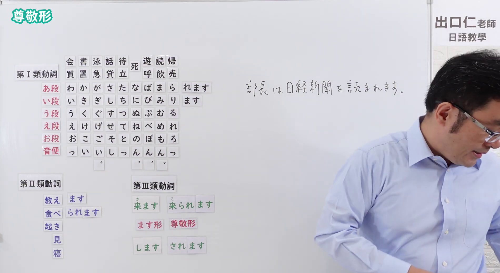

# N4-G-0076 尊敬形（動詞の活用、相手への敬意・受身同形）

## 接续与说明

### 接续板书说明

- **截取时间点**：视频 5分01.20秒（301.20秒） 处。
- **画面说明**：黑板最上方完整保留「尊敬形」醒目标题；板书完整排列动词尊敬形活用全体系：第Ⅰ類（あ段＋れます：買われます・書かれます・読まれます等）、第Ⅱ類（教えられます・食べられます・見られます・寝られます）、第Ⅲ類（来られます[こられます]・されます）；右侧手写板书例句「部長は日経新聞を読まれます。」；老师侧身立于右侧，黑板活用规则文字完全清晰露出一目了然。固定左上角 (0, 0)，裁切宽 1900、高 1040。
- **核心句型与接续要点**：
  - 语法形式优先用平假名，并在括号中标注对应汉字。
  - **動詞尊敬形变形规则**（**活用规则与受身形完全相同**！）：
    - 第Ⅰ類動詞：う段 假名变为 **あ段** 假名 ＋ `れます`（例：`か(書)く` → `か(書)かれます`、`よ(読)む` → `よ(読)まれます`、`か(買)う` → `か(買)われます`）
    - 第Ⅱ類動詞：去掉 `る` ＋ `られます`（例：`た(食)べる` → `た(食)べられます`、`み(見)る` → `み(見)られます`）
    - 第Ⅲ類動詞：`く(来)ます` → `こ(来)られます`（注意读音变こ）、`します` → `されます`

## 例文

### 视频核心例句

- **截取时间点**：视频 7分11.72秒（431.72秒） 处。
- **画面说明**：提取自视频 07:11 处的例句黑板页面。底色为粉灰色课程幻灯片，固定左上角 (0, 0)，裁切区域宽 1900、高 1040，去除右侧与底部多余画面，四条例句及中文翻译完整清晰呈现。
- **例文列表**：
- 先生はもう帰られました。
  - 中文：老師已經回去了。
- 社長は新しい車を買われました。
  - 中文：社長買了新車。
- 部長は何時ごろ来られますか。
  - 中文：經理大約幾點會來呢？
- お客様はもう帰られましたか。
  - 中文：客人已經回去了嗎？

## 语法解说与补充

### 核心语义与功能边界

- **核心功能**：通过动词词尾形态变化（与受身同形）直接对动作主体表示敬意。动作的主体必须是说话人想要尊敬的尊长、上司、长辈或客户。
- **敬意梯度定位**：
  - 日语尊敬表现的敬意由轻到重通常为：
    **尊敬形（～れる・～られる） ＜ お～になります ＜ 特殊尊敬語（いらっしゃる・召し上がる等）**
  - 因此，「尊敬形」是一种轻度到中度、自然且日常使用极广的尊敬表现，常用于向熟识的老师、同事的长辈提问或陈述。

### 三重同形辨析（受身 vs 可能 vs 尊敬）

以第Ⅱ类动词（如 `食べられます`、`来られます`）为例，形态完全重合，必须根据语境与助词严格区分：

| 句型类别 | 主语与施事者特征 | 核心助词结构 | 例句与含义 |
| :--- | :--- | :--- | :--- |
| **受身形（被动）** | 主体为受事者，施事者用 `に` | `【我】は【他人】に～られる` | `私は先生に褒められました。` （我被老师夸奖了） |
| **可能形（能够）** | 宾语助词往往转为 `が` | `【主体】は【能力对象】が～られる` | `私は刺身が食べられます。` （我能吃生鱼片） |
| **尊敬形（尊敬）** | 主语必为敬意对象，保持原句宾格 `を` | `【尊长】は【宾语】を～られる` | `先生は刺身を食べられました。` （老师吃了生鱼片） |

### JLPT 考点聚焦

1. **主谓一致原则**：尊敬形的主语**绝对不能是说话人自己或本方人员（内人）**！如果看到 `私は明日来られます`，它只可能是可能形（我明天能来），绝不可能是尊敬形。
2. **同形语义识别**：JLPT 读解中常考查某个动词到底是被动、可能还是尊敬，最直接的判别方法就是**看主语是谁**以及**是否保留了宾格助词 `を`**。

