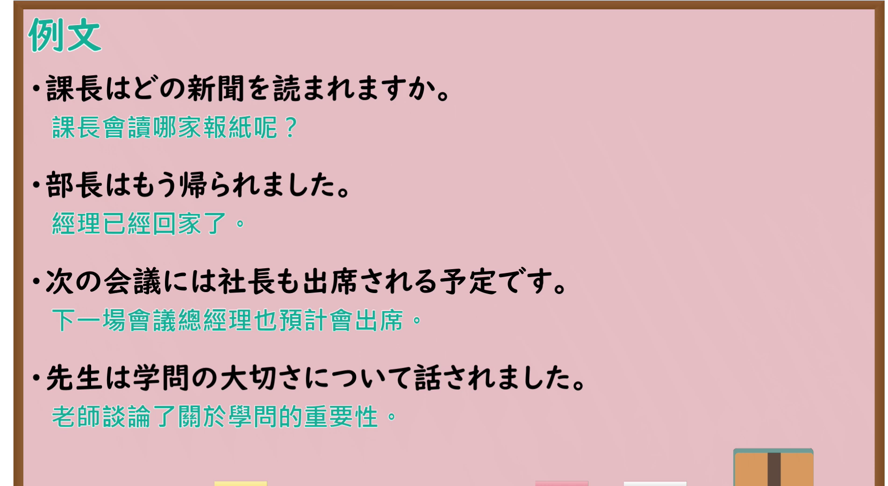

---
{
  "id": "N4-G-0076",
  "kind": "grammar",
  "level": "N4",
  "title": "尊敬形（尊敬）",
  "card_revision": 1,
  "schema_version": 1,
  "source": {
    "lesson": "N4 第76个语法",
    "material": "出口日語原视频板书与Hagoromo文型检索正文",
    "video": "https://www.youtube.com/watch?v=Yp9fkaS64fM",
    "screenshot": "assets/grammar/n4/N4-G-0076-connection.png",
    "screenshot_seconds": 301.2,
    "screenshot_crop": {
      "x": 0,
      "y": 0,
      "width": 1900,
      "height": 1040
    }
  },
  "tags": [
    "尊敬形",
    "敬語",
    "N4"
  ],
  "confusions": [
    "～お～になる",
    "～（ら）れる（受身）"
  ]
}
---

# N4 第76个语法：尊敬形

# 视频学习资料整理

- 课程：[出口日語「【Ｎ４文法】尊敬形」](https://www.youtube.com/watch?v=Yp9fkaS64fM)
- 视频 ID：`Yp9fkaS64fM`
- 视频时长：8分22秒

## 接续图

- 实际时间：5分1.20秒（301.20秒）
- 原图尺寸：1920×1080
- 裁切区域：左上角 `(0, 0)` 至右下角 `(1900, 1040)`；黑板上方保留「尊敬形」标题；板书已贴出动词尊敬形变化表（第Ⅰ类 あ段＋れます，第Ⅱ类「られます」，第Ⅲ类「来られます」「されます」），右侧手写例句「部長は日経新聞を読まれます。」。本课介绍尊敬形，视为一个功能。固定左上角 (0, 0)，裁切宽 1900；老师低头站在画面右下角，右上角可见频道标识，未遮挡板书文字。

## 例句图

- 实际时间：7分11.72秒（431.72秒）
- 原图尺寸：1920×1080
- 裁切区域：左上角 `(0, 0)` 至右下角 `(1900, 1040)`；提取自视频 07:11 处的例句页。固定左上角 (0, 0)，去除右侧与底部多余画面，完整保留四条例句及中文翻译。

# 核心

## 功能一：尊敬形：表示对对方的敬意（与被动同形）

**最上位意味カテゴリー：**

- **Vられる（尊敬語：受け身と同形）：** 人との関係（人际关系）

**中位意味カテゴリー：**

- **Vられる（尊敬語：受け身と同形）：** 敬意（敬意）

**意味：**

- **Vられる（尊敬語：受け身と同形）：** 尊敬語：受け身と同形（尊敬语：与被动同形）

**くわしい意味記述：**

- **Vられる（尊敬語：受け身と同形）：** 相手や第三者に尊敬の気持ちを表すときに使う。（用于对对方或第三方表示尊敬之意。）

**派生語：** 未列出

### 例句

1. 先生、来月の学会に行かれますか。

   （老师，您下个月会去参加学会吗？）

2. ご婚約時の記者会見で雅子さまは「愛情に満ちた温かい家庭、お互いをいたわり合って助け合って行く家庭を」と述べられました。

   （订婚时的记者会上，雅子殿下说道：“希望建立充满爱情、温暖、彼此体谅并互相扶持的家庭。”）

3. 先日、私が外務大臣の時にタジキスタンに派遣した秋野豊さんを始めとする四名の方が非業の死を遂げられました。

   （前几天，包括我担任外务大臣时派往塔吉克斯坦的秋野丰先生在内的四位，遭遇不幸身亡。）

4. 西郷従道侯がアメリカヘ行かれたとき、ある歓迎会に招かれ、その宴席に着くと、主催者が立って歓迎の辞を述べた。

   （西乡从道侯去美国的时候，受邀参加某个欢迎会，一到宴席上，主办方就站起来致了欢迎词。）

# 来源

- [出口日語原视频](https://www.youtube.com/watch?v=Yp9fkaS64fM)
- [Hagoromo 文型検索「Vられる（尊敬語：受け身と同形）」](https://hagoromo-text.work/lookup?vid=197)（查询日期：2026-10-15）
