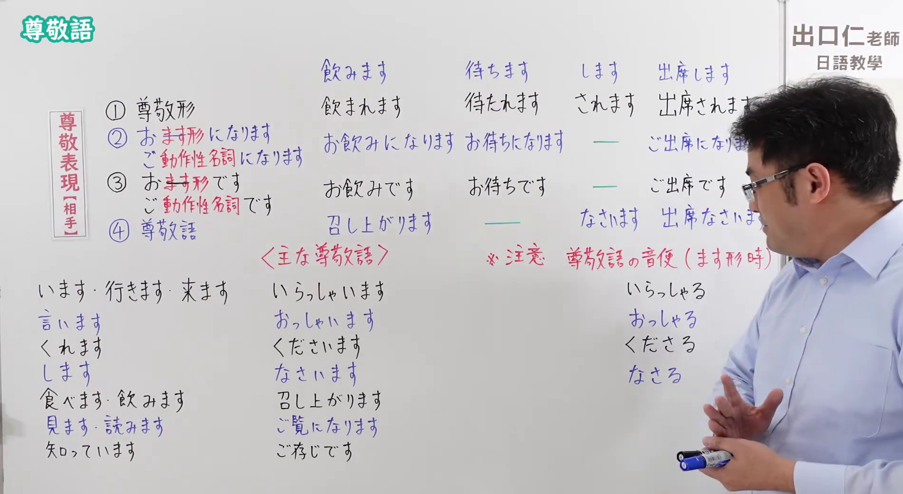
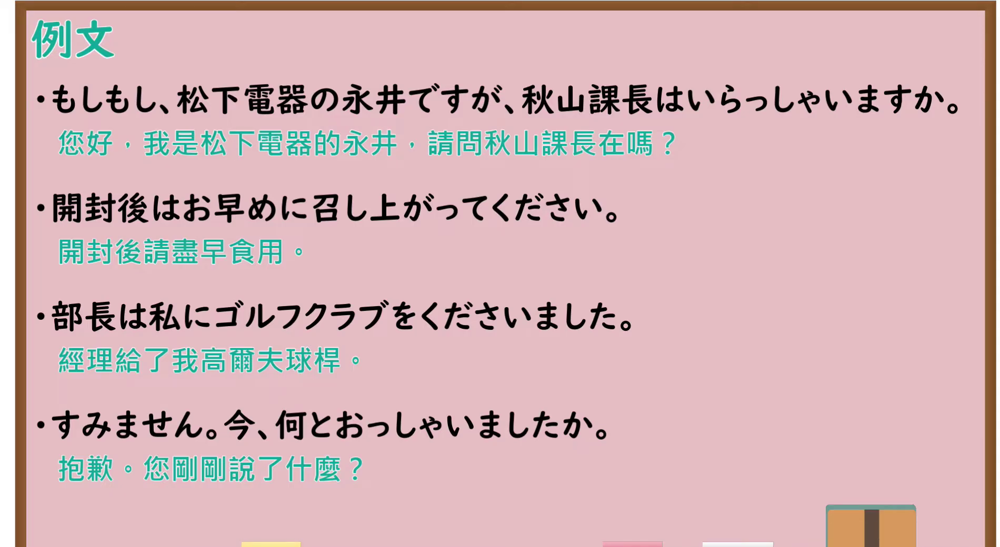

# N4-G-0077 尊敬語（相手を高める表現・特殊動詞・お～になる・音便）

## 接续与说明

### 接续板书说明

- **截取时间点**：视频 8分14.20秒（494.20秒） 处。
- **画面说明**：黑板左上角清晰保留「尊敬語」大标题；板书左侧标明「尊敬表現【相手】」四大维度：①尊敬形（飲まれます）、②お/ご～になります（お飲みになります・ご出席になります）、③お/ご～です（お飲みです・ご出席です）、④特殊尊敬語（召し上がります・なさいます）；下方完整列出「<主な尊敬語>」经典对照表：います・行きます・来ます→いらっしゃいます、言います→おっしゃいます、くれます→くださいます、します→なさいます、食べます・飲みます→召し上がります、見ます・読みます→ご覧になります、知っています→ご存じです；右侧专门写出「※注意 尊敬語の音便（ます形時）」：いらっしゃる・おっしゃる・くださる・なさる（～います音便）；老师站在右侧讲解，所有板书文字 100% 完整展现无遮挡。固定左上角 (0, 0)，裁切宽 1900、高 1040。
- **核心句型与接续要点**：
  - 语法形式优先用平假名，并在括号中标注对应汉字。
  - **核心特殊尊敬动词对应表**：
    - `います`、`いきます(行きます)`、`きます(来ます)` → `いらっしゃいます`（辞書形：`いらっしゃる`）
    - `いいます(言います)` → `おっしゃいます`（辞書形：`おっしゃる`）
    - `くれます` → `くださいます`（辞書形：`くださる`）
    - `します` → `なさいます`（辞書形：`なさる`）
    - `たべます(食べます)`、`のみます(飲みます)` → `め(召)しあ(上)がります`
    - `みます(見ます)` → `ごらん(ご覧)になります`
    - `し(知)っています` → `ごぞんじ(ご存じ)です` / `ごぞんじ(ご存じ)だ`
  - **特殊动词接「ます」时的音便变化（四大特殊敬语动词）**：
    - `いらっしゃる` → `いらっしゃいます`（并非 *いらっしゃります）
    - `おっしゃる` → `おっしゃいます`（并非 *おっしゃります）
    - `くださる` → `くださいます`（并非 *くださります）
    - `なさる` → `なさいます`（并非 *なさります）

## 例文

### 视频核心例句

- **截取时间点**：视频 10分28.34秒（628.34秒） 处。
- **画面说明**：提取自视频 10:28 处的例句黑板页面。底色为粉灰色课程幻灯片，固定左上角 (0, 0)，裁切区域宽 1900、高 1040，去除右侧与底部多余画面，四条例句及中文翻译完整清晰呈现。
- **例文列表**：
- もしもし、松下電器の永井ですが、秋山課長はいらっしゃいますか。
  - 中文：您好，我是松下電器的永井，請問秋山課長在嗎？
- 開封後はお早めに召し上がってください。
  - 中文：開封後請盡早食用。
- 部長は私にゴルフクラブをくださいました。
  - 中文：經理給了我高爾夫球桿。
- すみません。今、何とおっしゃいましたか。
  - 中文：抱歉。您剛剛說了什麼？

## 语法解说与补充

### 核心语义与功能边界

- **核心功能**：用于抬高听话人或话题中的尊长、客人、上司的行为动作，属于敬语系统中敬意程度最高的表达手段之一。
- **体系分类**：
  1. **特殊尊敬动词**：固有特殊词汇（如 `いらっしゃる`、`召し上がる`），敬意最高，日常优先使用。
  2. **一般规则尊敬**：对于没有特殊固有动词的词汇，采用 `お＋動詞ます形＋になります`（详见第79课）或 `動詞尊敬形`（第76课）。

### JLPT 考点聚焦

1. **特殊动词音便必考**：`いらっしゃる`、`おっしゃる`、`くださる`、`なさる` 四大动词的「ます形」全部将 `る` 变为 `い`（即：`いらっしゃいます`、`おっしゃいます`、`くださいます`、`なさいます`），在 JLPT 读音与文字词汇题中是经典高频陷阱！
2. **`くれます` 的对应词是 `くださる`**：`～てくださる` 表示尊长为我做某事，考题常与谦让形式 `～ていただく` 混淆考查。
3. **内外亲疏原则**：对公司外部客户或业务伙伴谈及自己公司社长或部长的行为时，**绝对不能用尊敬语**（必须用谦让语），这是商务日语和读解的核心必考法则。

