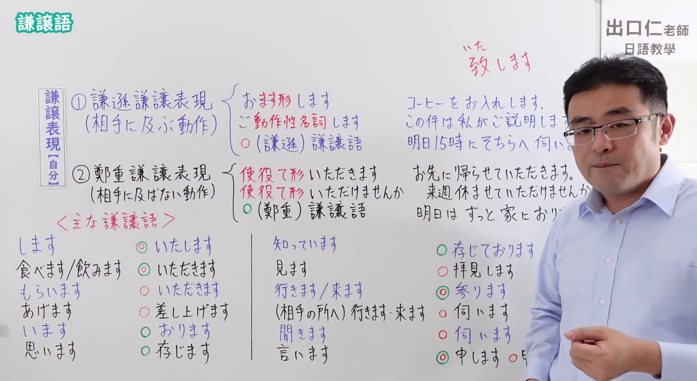

# N4-G-0078 謙譲語（自分を低める表現・謙遜と鄭重・特殊動詞・お～する）

## 接续与说明

### 接续板书说明

- **截取时间点**：视频 9分58.60秒（598.60秒） 处。
- **画面说明**：黑板左上角清晰醒目显示「謙譲語」大标题；板书完整系统剖析「謙譲表現【自分】」两大分类：①謙遜謙譲表現（相手に及ぶ動作：おます形します・ご動作性名詞します・○謙遜謙譲語，板书例句：コーヒーをお入れします／この件は私がご説明します／明日15時にそちらへ伺います）、②鄭重謙譲表現（相手に及ばない動作：使役て形いただきます・使役て形いただけませんか・○鄭重謙譲語，板书例句：お先に帰らせていただきます／来週休ませていただけませんか／明日はずっと家におります）；下方列出「<主な謙譲語>」全套对照表：します→いたします、食べます/飲みます→いただきます、もらいます→いただきます、あげます→差し上げます、います→おります、思います→存じます、知っています→存じております、見ます→拝見します、行きます/来ます→参ります、(相手の所へ)行きます・来ます・聞きます→伺います、言います→申します/申し上げます；右上标注「致します」；老师站在最右侧，全部板书文字与分类标记毫无遮挡。固定左上角 (0, 0)，裁切宽 1900、高 1040。
- **核心句型与接续要点**：
  - 语法形式优先用平假名，并在括号中标注对应汉字。
  - **核心特殊谦让动词对应表**：
    - `します` → `いたします(致します)`
    - `たべます(食べます)`、`のみます(飲みます)` → `いただきます`
    - `もらいます` → `いただきます`
    - `あげます` → `さ(差)しあ(上)げます`
    - `います` → `おります`
    - `おも(思)います` → `ぞん(存)じます`
    - `し(知)っています` → `ぞん(存)じております`
    - `みます(見ます)` → `はいけん(拝見)します`
    - `いきます(行きます)`、`きます(来ます)`（单纯移动） → `まい(参)ります`
    - （前往对方处所）`いきます`、`きます`、`き(聞)きます` → `うかが(伺)います`
    - `いいます(言います)` → `もう(申)します` / `もう(申)しあ(上)げます`

## 例文

### 视频核心例句

- **截取时间点**：视频 12分34.40秒（754.40秒） 处。
- **画面说明**：提取自视频 12:34 处的例句黑板页面。底色为粉灰色课程幻灯片，固定左上角 (0, 0)，裁切区域宽 1900、高 1040，去除右侧与底部多余画面，四条例句及中文翻译完整清晰呈现。
- **例文列表**：
- パスポートとチケットを拝見します。預け荷物はお一つですか。
  - 中文：我要看護照和機票。托運行李是一件嗎？
- 液晶パネルの納期変更の件、承知いたしました。
  - 中文：液晶顯示器的交貨日期更改一事，我已經知道了。
- 部長の奥様から文明堂のカステラをいただきました。
  - 中文：從經理夫人那收到了文明堂的長崎蛋糕。
- お疲れ様でした。お先に失礼いたします。
  - 中文：辛苦了。我先離開了。

## 语法解说与补充

### 核心语义与两类谦让区分（现代敬语分类核心）

出口仁老师在板书中特别强调了谦让语的两个深层分类，这是精准掌握商务日语的关键：
1. **謙遜謙譲表現（謙譲語Ⅰ：相手に及ぶ動作）**：
   - 动作直接涉及对方或为对方服务，通过贬抑自身动作来向对方表示敬意。
   - 句型：`お＋動詞ます形＋します` / `ご＋動作性名詞＋します` / 固有谦让词（如 `伺う`、`拝見する`、`差し上げる`）。
   - 例：`コーヒーをお入れします。`（我来为您泡咖啡）。
2. **鄭重謙譲表現（丁重語／謙譲語Ⅱ：相手に及ばない動作）**：
   - 动作不直接作用于对方，纯粹为了在听话人面前表现出恭敬郑重、有教养的态度。
   - 句型：`使役て形＋いただきます` / 固有丁重词（如 `参る`、`おる`、`申す`、`いたす`）。
   - 例：`明日はずっと家におります。`（明天我一直在家）。

### 经典易错混淆点：伺います vs 参ります

| 动词 | 性质 | 移动方向指向 | 使用语境 |
| :--- | :--- | :--- | :--- |
| **伺います** | 谦让语Ⅰ | **指向对方所在的处所**（相手の所へ） | `明日、先生のお宅へ伺います。`（明天我去拜访老师家） |
| **参ります** | 丁重语（谦让语Ⅱ） | **中性移动或不涉及对方处所** | `電車が参ります。` / `明日東京へ参ります。`（去东京出差） |

### JLPT 考点聚焦

1. **主谓对应陷阱**：谦让语的主语**永远是自己或本方人员**！绝对不能对对方说 `*先生、明日参りますか`（应用 `いらっしゃいますか`）。
2. **`いただく` 的多重身份**：
   - 作实义动词：`もらう` 的谦让语（从别人处得到）或 `食べる/飲む` 的谦让语；
   - 作补助动词：`～ていただく`（请对方为我做某事，相当于 `～てもらう` 的谦让敬称）。

