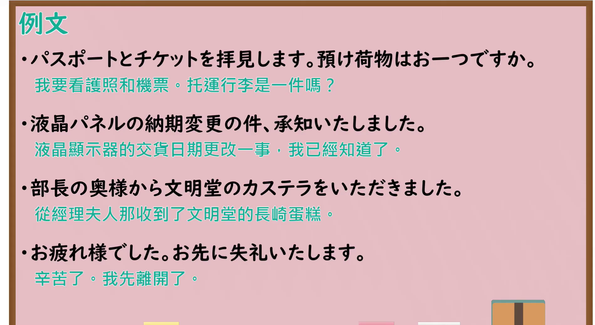

---
{
  "id": "N4-G-0078",
  "kind": "grammar",
  "level": "N4",
  "title": "謙譲語（谦让语）",
  "card_revision": 1,
  "schema_version": 1,
  "source": {
    "lesson": "N4 第78个语法",
    "material": "出口日語原视频板书与Hagoromo文型检索正文",
    "video": "https://www.youtube.com/watch?v=ucDOAUuTC7Q",
    "screenshot": "assets/grammar/n4/N4-G-0078-connection.png",
    "screenshot_seconds": 598.6,
    "screenshot_crop": {
      "x": 0,
      "y": 0,
      "width": 1900,
      "height": 1040
    }
  },
  "tags": [
    "謙譲語",
    "敬語",
    "N4"
  ],
  "confusions": [
    "尊敬語",
    "丁寧語"
  ]
}
---

# N4 第78个语法：謙譲語

# 视频学习资料整理

- 课程：[出口日語「【Ｎ４文法】謙譲語」](https://www.youtube.com/watch?v=ucDOAUuTC7Q)
- 视频 ID：`ucDOAUuTC7Q`
- 视频时长：13分40秒

## 接续图

- 实际时间：9分58.60秒（598.60秒）
- 原图尺寸：1920×1080
- 裁切区域：左上角 `(0, 0)` 至右下角 `(1900, 1040)`；黑板左上角保留「謙譲語」标题；左侧写有「謙譲表現【自分】」的两类：①謙遜謙譲表現（相手に及ぶ動作）——「お（ます形）します」「ご（動作性名詞）します」「謙遜謙譲語」，例句「コーヒーをお入れします」「この件は私がご説明します」「明日15時にそちらへ伺います」；②鄭重謙譲表現（相手に及ばない動作）——「使役て形いただきます」「使役て形いただけませんか」「鄭重謙譲語」，例句「お先に帰らせていただきます」「来週休ませていただけませんか」「明日はずっと家におります」；下方为〈主な謙譲語〉对照表（いたします、いただきます、差し上げます、おります、存じます、存じております、拝見します、参ります、伺います、申します等），顶部红字写有「致します」。本课介绍谦让语，按你的要求视为一个功能，两类谦让表现作为该功能的构成方式，不另立功能。固定左上角 (0, 0)，裁切宽 1900；老师站在右侧，遮住了例句和对照表的末尾。

## 例句图

- 实际时间：12分34.40秒（754.40秒）
- 原图尺寸：1920×1080
- 裁切区域：左上角 `(0, 0)` 至右下角 `(1900, 1040)`；提取自视频 12:34 处的例句页。固定左上角 (0, 0)，去除右侧与底部多余画面，完整保留四条例句及中文翻译。

# 核心

## 功能一：谦让语：降低自己一方的表达

**最上位意味カテゴリー：**

- **お〜する：** 人との関係（人际关系）
- **はいけんする（拝見する）：** 人との関係（人际关系）
- **いたす：** 人との関係（人际关系）
- **いただく：** 人との関係（人际关系）

**中位意味カテゴリー：**

- **お〜する：** 敬意（敬意）
- **はいけんする（拝見する）：** 敬意（敬意）
- **いたす：** 敬意（敬意）
- **いただく：** 授受（授受）

**意味：**

- **お〜する：** 謙譲：相手にかかわる自分の行為（谦让：与对方相关的自己的行为）
- **はいけんする（拝見する）：** 謙譲：見る（谦让：见る）
- **いたす：** 謙譲：する（谦让：する）
- **いただく：** 尊敬：物をもらう（尊敬：物をもらう）

**くわしい意味記述：**

- **お〜する：** 相手に対する尊敬の気持ちを表すために，話し手が自分の行為をへりくだって話すときに使う。（为了表示对对方的尊敬，说话人谦逊地讲述自己的行为时使用。）
- **はいけんする（拝見する）：** 「目上の人が所有している物を見る」という意味の謙譲語。物を所有している人を敬う表現。（“看对方（长辈）所有的物品”之意的谦让语。是表示尊敬物品所有者的表达。）
- **いたす：** 「する」の丁寧な言い方。聞き手に敬意を表す。（「する」的郑重说法。向听话人表示敬意。）
- **いただく：** 「もらう」の謙譲語。または「食べる」「飲む」の謙譲語。（「もらう」的谦让语。或者是「食べる」「飲む」的谦让语。）

**派生語：** 未列出

### 例句

1. そのことはお客様にはもうお知らせしました。

   （那件事已经告知过客人了。）

2. 先生のお宅の庭を拝見しました。

   （我参观了老师家的庭院。）

3. この仕事は私どもがいたします。

   （这项工作由我们来做。）

4. じゃ、これで失礼致します。

   （那么，我就此告辞了。）

5. 私は先生からこの本をいただきました。

   （我从老师那里收到了这本书。）

# 来源

- [出口日語原视频](https://www.youtube.com/watch?v=ucDOAUuTC7Q)
- [Hagoromo 文型検索「お〜する」](https://hagoromo-text.work/lookup?vid=332)（查询日期：2026-10-15）
- [Hagoromo 文型検索「はいけんする」](https://hagoromo-text.work/lookup?vid=1880)（查询日期：2026-10-15）
- [Hagoromo 文型検索「いたす」](https://hagoromo-text.work/lookup?vid=288)（查询日期：2026-10-15）
- [Hagoromo 文型検索「いただく」](https://hagoromo-text.work/lookup?vid=289)（查询日期：2026-10-15）
