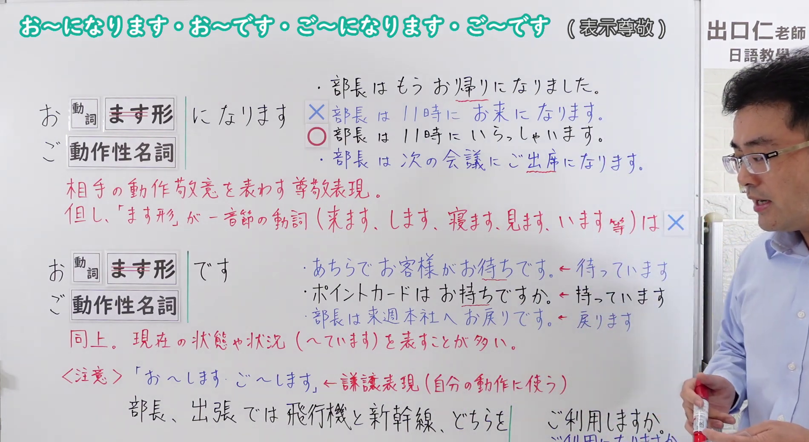
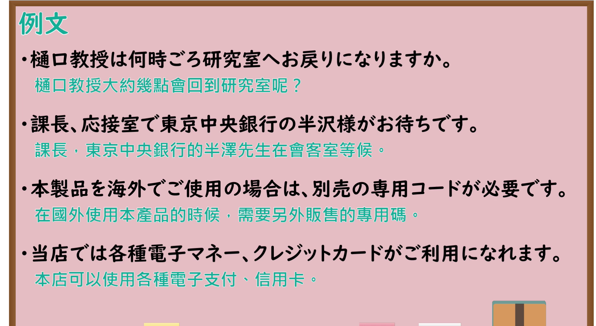

---
{
  "id": "N4-G-0079",
  "kind": "grammar",
  "level": "N4",
  "title": "お～になります・お～です・ご～になります・ご～です（尊敬表现）",
  "card_revision": 1,
  "schema_version": 1,
  "source": {
    "lesson": "N4 第79个语法",
    "material": "出口日語原视频板书与Hagoromo文型检索正文",
    "video": "https://www.youtube.com/watch?v=Z7GAPGnEbcs",
    "screenshot": "assets/grammar/n4/N4-G-0079-connection.png",
    "screenshot_seconds": 445.0,
    "screenshot_crop": {
      "x": 0,
      "y": 0,
      "width": 1900,
      "height": 1040
    }
  },
  "tags": [
    "お～になります",
    "お～です",
    "ご～になります",
    "ご～です",
    "尊敬",
    "N4"
  ],
  "confusions": [
    "お～する（謙譲）",
    "～れる（尊敬形）"
  ]
}
---

# N4 第79个语法：お～になります・お～です

# 视频学习资料整理

- 课程：[出口日語「【Ｎ４文法】お～になります・お～です・ご～になります・ご～です」](https://www.youtube.com/watch?v=Z7GAPGnEbcs)
- 视频 ID：`Z7GAPGnEbcs`
- 视频时长：9分53秒

## 接续图

- 实际时间：7分25.00秒（445.00秒）
- 原图尺寸：1920×1080
- 裁切区域：左上角 `(0, 0)` 至右下角 `(1900, 1040)`；黑板上方保留标题「お～になります・お～です・ご～になります・ご～です（表示尊敬）」；上半部分为「お［動詞ます形］になります／ご［動作性名詞］になります」，红字说明「相手の動作敬意を表わす尊敬表現。但し、「ます形」が一音節の動詞（来ます、します、寝ます、見ます、います等）は×」，并有「×部長は11時にお来になります／○部長は11時にいらっしゃいます」的正误对照；下半部分为「お［動詞ます形］です／ご［動作性名詞］です」，红字说明「同上。現在の状態や状況（～ています）を表すことが多い」，例句「あちらでお客様がお待ちです」「ポイントカードはお持ちですか」「部長は来週本社へお戻りです」；底部〈注意〉写有「お～します・ご～します」是谦让表现（用于自己的动作）。板书有两条红字说明，分为两个功能。固定左上角 (0, 0)，裁切宽 1900；老师站在右侧，底部「ご利用になりますか」被遮挡一部分。

## 例句图

- 实际时间：8分48.66秒（528.66秒）
- 原图尺寸：1920×1080
- 裁切区域：左上角 `(0, 0)` 至右下角 `(1900, 1040)`；提取自视频 08:48 处的例句页。固定左上角 (0, 0)，去除右侧与底部多余画面，完整保留四条例句及中文翻译。

# 核心

## 功能一：对对方的动作表示敬意的尊敬表现（お〜になります・ご〜になります）

**最上位意味カテゴリー：**

- **お〜になる：** 人との関係（人际关系）
- **ご〜になる：** 人との関係（人际关系）

**中位意味カテゴリー：**

- **お〜になる：** 敬意（敬意）
- **ご〜になる：** 敬意（敬意）

**意味：**

- **お〜になる：** 尊敬：する（尊敬：する）
- **ご〜になる：** 尊敬：する（スル動詞）（尊敬：する（する类动词））

**くわしい意味記述：**

- **お〜になる：** 相手や第三者の行為について「おVになる」の形で述べ，相手や第三者に対する尊敬の気持ちを表す時に使う。（对对方或第三方的行为，用「おVになる」的形式叙述，表示对对方或第三方的尊敬时使用。）
- **ご〜になる：** 「VNする」の尊敬語。（「VNする」的尊敬语。）

**派生語：** 未列出

### 例句

1. 先生は何時ごろお帰りになりますか。

   （老师大概几点回去呢？）

2. でも誰かに似ているとお思いになりませんか

   （不过，您不觉得他像什么人吗？）

3. そうですか……きっとお疲れになったんでしょう

   （是吗……您一定是累了吧。）

4. 昭和天皇は生物学をご研究になっていました。

   （昭和天皇曾研究过生物学。）

5. 皇太子ご夫妻は三十一日、訪日中のベルギー皇太子フィリップ殿下を江戸東京博物館（東京都墨田区横網）に案内、館内を一緒にご覧になった。

   （皇太子夫妇于三十一日，陪同正在访日的比利时王储菲利普殿下参观江户东京博物馆（东京都墨田区横网），并在馆内一同观览。）

## 功能二：同上，多表示现在的状态或状况（～ています）（お〜です・ご〜です）

**最上位意味カテゴリー：**

- **お〜だ：** 人との関係（人际关系）
- **ご〜だ：** 人との関係（人际关系）

**中位意味カテゴリー：**

- **お〜だ：** 敬意（敬意）
- **ご〜だ：** 敬意（敬意）

**意味：**

- **お〜だ：** 尊敬：行為を表す名詞（尊敬：表示行为的名词）
- **ご〜だ：** 尊敬:継続（スル動詞）（尊敬:持续（する类动词））

**くわしい意味記述：**

- **お〜だ：** 「Vています」の尊敬の形である。（「Vています」的尊敬形式。）
- **ご〜だ：** 「〜だ」や「VNする」の尊敬語。（「〜だ」和「VNする」的尊敬语。）

**派生語：** お〜だ： お〜です

### 例句

1. 社長がお呼びです。

   （社长找您。）

2. 今日は、これからお出かけですか

   （您今天这就要出门吗？）

3. 奥さんやお嬢ちゃんお済みですか？

   （太太和小姐都用完了吗？）

4. 山本先生は地震についてご研究だと聞きました。

   （听说山本老师正在研究地震。）

# 来源

- [出口日語原视频](https://www.youtube.com/watch?v=Z7GAPGnEbcs)
- [Hagoromo 文型検索「お〜になる」](https://hagoromo-text.work/lookup?vid=341)（查询日期：2026-10-15）
- [Hagoromo 文型検索「ご〜になる」](https://hagoromo-text.work/lookup?vid=489)（查询日期：2026-10-15）
- [Hagoromo 文型検索「お〜だ」](https://hagoromo-text.work/lookup?vid=334)（查询日期：2026-10-15）
- [Hagoromo 文型検索「ご〜だ」](https://hagoromo-text.work/lookup?vid=485)（查询日期：2026-10-15）
