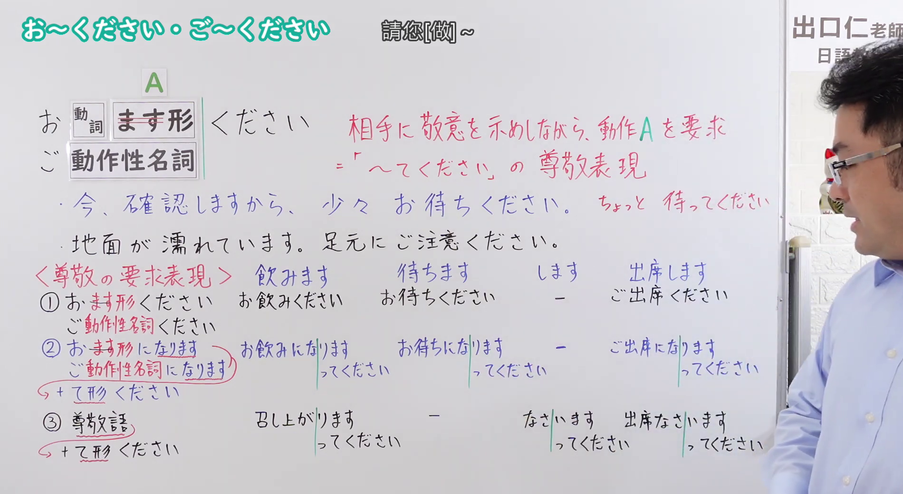
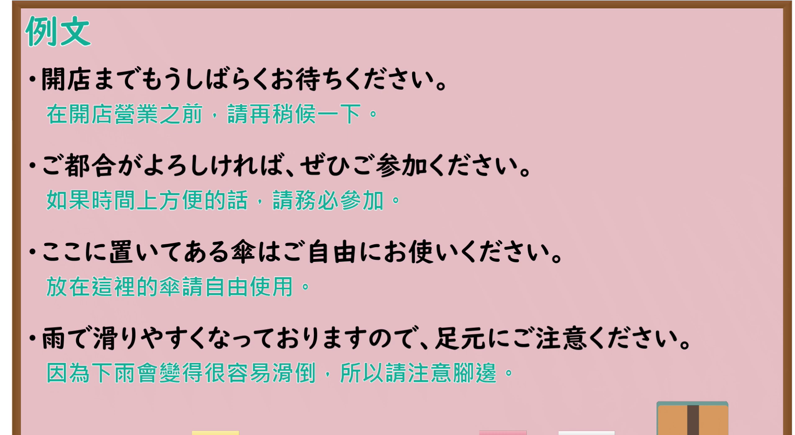

---
{
  "id": "N4-G-0080",
  "kind": "grammar",
  "level": "N4",
  "title": "お～ください・ご～ください（请您做……）",
  "card_revision": 1,
  "schema_version": 1,
  "source": {
    "lesson": "N4 第80个语法",
    "material": "出口日語原视频板书与Hagoromo文型检索正文",
    "video": "https://www.youtube.com/watch?v=dmJXOayhHsM",
    "screenshot": "assets/grammar/n4/N4-G-0080-connection.png",
    "screenshot_seconds": 524.87,
    "screenshot_crop": {
      "x": 0,
      "y": 0,
      "width": 1900,
      "height": 1040
    }
  },
  "tags": [
    "お～ください",
    "ご～ください",
    "尊敬",
    "依頼",
    "N4"
  ],
  "confusions": [
    "～てください",
    "お～になってください"
  ]
}
---

# N4 第80个语法：お～ください・ご～ください

# 视频学习资料整理

- 课程：[出口日語「【Ｎ４文法】お～ください・ご～ください」](https://www.youtube.com/watch?v=dmJXOayhHsM)
- 视频 ID：`dmJXOayhHsM`
- 视频时长：11分58秒

## 接续图

- 实际时间：8分44.87秒（524.87秒）
- 原图尺寸：1920×1080
- 裁切区域：左上角 `(0, 0)` 至右下角 `(1900, 1040)`；黑板上方保留标题「お～ください・ご～ください」及中文「請您［做］～」；接续「お［動詞ます形］ください／ご［動作性名詞］ください」，红字说明「相手に敬意を示しながら、動作Aを要求＝「～てください」の尊敬表現」，例句「今、確認しますから、少々お待ちください」（旁注「ちょっと待ってください」）与「地面が濡れています。足元にご注意ください」；下方〈尊敬の要求表現〉按「飲みます」「待ちます」「します」「出席します」四列对照三种方式：①お／ご……ください、②お／ご……になります＋て形ください、③尊敬語＋て形ください。红字说明只有一条，视为一个功能。固定左上角 (0, 0)，裁切宽 1900；老师站在右侧，右上角可见频道标识，未遮挡板书文字。

## 例句图

- 实际时间：11分1.48秒（661.48秒）
- 原图尺寸：1920×1080
- 裁切区域：左上角 `(0, 0)` 至右下角 `(1900, 1040)`；提取自视频 11:01 处的例句页。固定左上角 (0, 0)，去除右侧与底部多余画面，完整保留四条例句及中文翻译。

# 核心

## 功能一：对对方表示敬意的同时，要求做动作 A（「～てください」的尊敬表现）

**最上位意味カテゴリー：**

- **お〜ください：** 人との関係（人际关系）
- **ご〜ください：** 人との関係（人际关系）

**中位意味カテゴリー：**

- **お〜ください：** 依頼・命令（请求与命令）
- **ご〜ください：** 依頼・命令（请求与命令）

**意味：**

- **お〜ください：** 尊敬：丁寧な指示・命令（尊敬：礼貌的指示、命令）
- **ご〜ください：** 尊敬：ください（スル動詞）（尊敬：ください（する类动词））

**くわしい意味記述：**

- **お〜ください：** ある行為を相手に指示したり，勧める時に使う。公共の場などで使われることが多い。（用于对对方指示或劝说做某个行为。多用于公共场所等。）
- **ご〜ください：** ある行為を相手に指示したり，勧める時に使う。公共の場などで使われることが多い。（用于对对方指示或劝说做某个行为。多用于公共场所等。）

**派生語：** 未列出

### 例句

1. ここでしばらくお待ちください。

   （请在这里稍等一会儿。）

2. お帰りの際にこちらの札をレジまでお持ちください。

   （回去的时候，请把这块牌子带到收银台。）

3. 「命ばかりはお助けください」

   （“请饶我一命”。）

4. 今後ともどうぞご指導ください。

   （今后也请多多指教。）

5. それじゃ、若い娘を連れた中年すぎの男で角張った顔をしたのを見かけましたらご一報ください。

   （那么，如果看到带着年轻姑娘、四十多岁、脸型方正的男人，请通知我一声。）

# 来源

- [出口日語原视频](https://www.youtube.com/watch?v=dmJXOayhHsM)
- [Hagoromo 文型検索「お〜ください」](https://hagoromo-text.work/lookup?vid=330)（查询日期：2026-10-15）
- [Hagoromo 文型検索「ご〜ください」](https://hagoromo-text.work/lookup?vid=482)（查询日期：2026-10-15）
